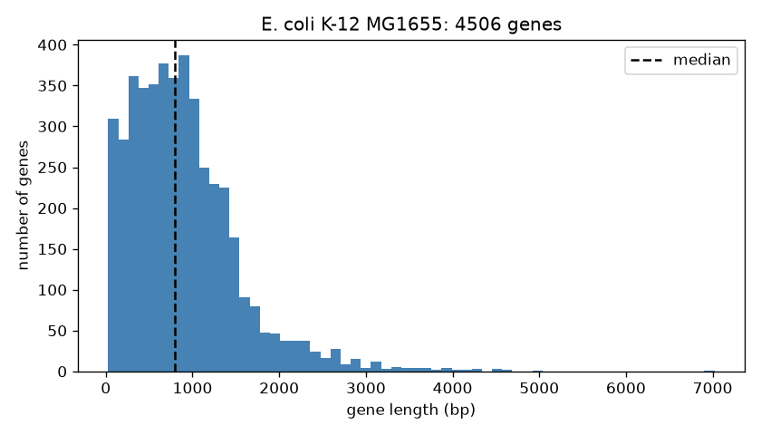
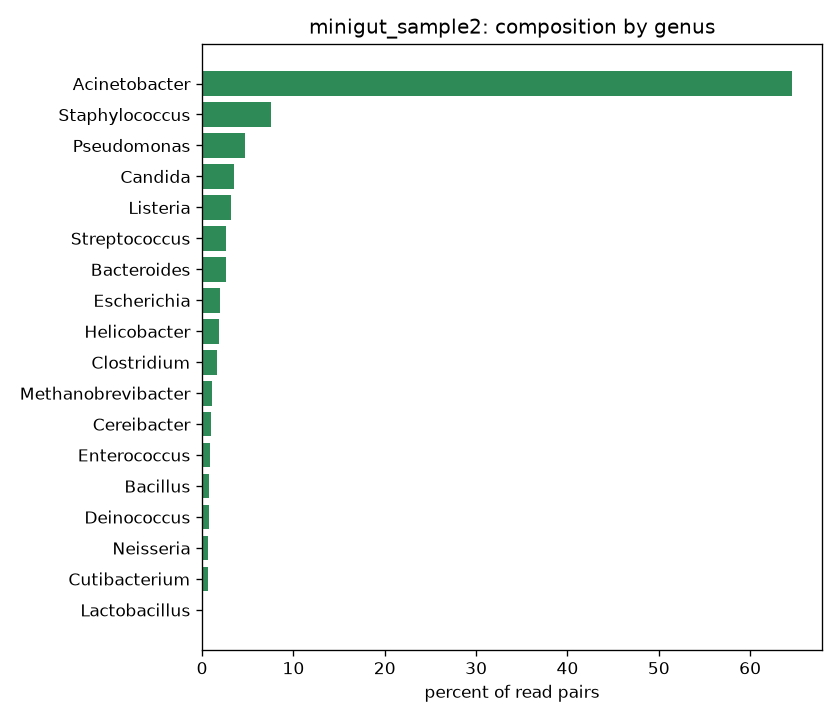

<div dir="rtl">

# درس: جدول‌ها و نمودار با pandas

**بخش:** `03_Python` · **ماژول:** `06_Pandas` · **پیش‌نیاز:** ماژول [Biopython (۲)](../05_Biopython_GenBank/) · **زمان:** حدود ۹۰ دقیقه · **ابزار:** Python 3.13، pandas 3.0، matplotlib 3.11 · **آخرین اجرا:** 2026-10-20

---

## در یک نگاه

**در پایان این درس می‌توانید:**
1. یک جدول TSV را در یک **DataFrame** بخوانید و ساختارش را ببینید.
2. ستون بگیرید، آمار توصیفی بگیرید، سطرها را **گزینش** و **مرتب** کنید.
3. با **`groupby`** گروه‌به‌گروه خلاصه کنید و ستون تازه بسازید.
4. یک **نمودار** (هیستوگرام و نمودار میله‌ای) بکشید و در فایل PNG ذخیره کنید.

**پیش از آغاز:** جدول ژن‌های ماژول ۰۳ را دوباره بسازید:

<div dir="ltr">

```bash
conda activate bioinfo_course
cd ~/Bioinformatics_Learning-main/01_Linux/99_scripts_data/data
P3=~/Bioinformatics_Learning-main/03_Python/99_scripts_data/03_Python_Functions_Files/scripts
P=~/Bioinformatics_Learning-main/03_Python/99_scripts_data/06_Pandas/scripts
python3 $P3/gene_table.py ecoli_k12.gff genes.tsv
```

</div>

<div dir="ltr">

```text
wrote 4506 genes to genes.tsv
```

</div>

---

## ۱. داستان: بیشتر خروجی‌ها جدول‌اند

جدول ژن‌ها، شمار ریدهای هر باکتری، فهرست جهش‌ها (VCF)، گزارش کیفیت… بیشتر خروجی‌های بیوانفورماتیک **جدول**‌اند. تا این‌جا جدول‌ها را با `cut`، `sort` و `awk`، یا با حلقه‌های پایتون خواندیم. برای پرسش‌های ساده خوب است؛ ولی «میانگین طول ژن‌ها، جدا برای هر رشته» یا «درصد هر جنس در نمونه» با حلقه چند خط می‌شود.

‏**pandas** کتابخانه‌ی جدول در پایتون است: یک جدول = یک **DataFrame**، و بیشتر کارها **یک خط**.

---

## ۲. خواندن جدول

<div dir="ltr">

```python
>>> import pandas as pd
>>> df = pd.read_csv("genes.tsv", sep="\t")
>>> df.head()
   name  start   end strand  length
0  thrL    190   255      +      66
1  thrA    337  2799      +    2463
2  thrB   2801  3733      +     933
3  thrC   3734  5020      +    1287
4  yaaX   5234  5530      +     297
```

</div>

| تکه | یعنی |
| :--- | :--- |
| `import pandas as pd` | ‏pandas را بیاور و آن را کوتاه `pd` بنام (قراردادی همگانی) |
| ‏`pd.read_csv(فایل, sep="\t")` | فایل را بخوان؛ `sep="\t"` = جداکننده Tab است (پیش‌فرض ویرگول است: CSV) |
| `df` | نام رایج برای یک **DataFrame** (*data frame*) |
| `df.head()` | ۵ سطر یکم؛ همان `head` در Bash |
| `0, 1, 2…` در چپ | **ایندکس**: شماره‌ی هر سطر، که pandas خودش افزود |

سطر یکم فایل (`name start …`) خودکار **نام ستون‌ها** شد.

### ساختار جدول

<div dir="ltr">

```python
>>> df.shape
(4506, 5)
>>> df.columns
Index(['name', 'start', 'end', 'strand', 'length'], dtype='str')
>>> df.dtypes
name        str
start     int64
end       int64
strand      str
length    int64
dtype: object
```

</div>

- ‏`shape`: ۴٬۵۰۶ سطر، ۵ ستون.
- ‏`dtypes`: **نوع** هر ستون. pandas خودش فهمید که `start` و `length` **عدد**ند (`int64`) و `name` متن (`str`). دیگر `int()` لازم نیست (اشتباه ۱ ماژول ۰۳)!

---

## ۳. یک ستون و آمار آن

<div dir="ltr">

```python
>>> df["length"].head(3)
0      66
1    2463
2     933
Name: length, dtype: int64
>>> df["length"].mean()
np.float64(897.4221038615179)
>>> df["length"].describe()
count    4506.000000
mean      897.422104
std       644.298318
min        27.000000
25%       441.000000
50%       792.000000
75%      1203.000000
max      7020.000000
Name: length, dtype: float64
```

</div>

- ‏`df["length"]`: یک **ستون** (در pandas: یک **Series**)؛ مانند دیکشنری، با نام.
- ‏`.mean()`: میانگین، **۸۹۷٫۴**، همان عدد `awk` و `gff_genes.py`. (`np.float64` یعنی «یک عدد اعشاری»؛ نمایش pandas است.)
- ‏`.describe()`: همه‌ی آمار توصیفی در یک خط: شمار، میانگین، انحراف معیار، کمینه، چارک‌ها و بیشینه. **میانه** (۵۰٪) ۷۹۲ است، کمتر از میانگین: چند ژن بسیار بلند میانگین را بالا کشیده‌اند (نمودار بخش ۶).

| می‌خواهم | pandas |
| :--- | :--- |
| میانگین / میانه | `.mean()` / `.median()` |
| کمینه / بیشینه | `.min()` / `.max()` |
| جمع / شمار | `.sum()` / `.count()` |
| انحراف معیار | `.std()` |

---

## ۴. گزینش و مرتب کردن سطرها

### گزینش با شرط

<div dir="ltr">

```python
>>> df[df["length"] > 5000]
      name    start      end strand  length
2037  yeeJ  2044995  2052014      +    7020
```

</div>

### کالبدشکافی

<div dir="ltr">

```text
df[  df["length"] > 5000  ]
 ①   ──────────②─────────
```

</div>

| بخش | یعنی |
| :-: | :--- |
| ② | برای **هر سطر** شرط را می‌سنجد و یک ستون `True`/`False` می‌سازد (۴٬۵۰۶ تا) |
| ① | ‏`df[…]` با آن ستون: تنها سطرهای `True` را نگه دار |

مانند `awk '$5 > 5000'`، بی حلقه. دو شرط با هم:

<div dir="ltr">

```python
>>> df[(df["strand"] == "-") & (df["length"] > 4500)]
      name    start      end strand  length
2583  yfhM  2647326  2652287      -    4962
2718  ypjA  2778146  2782726      -    4581
3040  yghJ  3114550  3119112      -    4563
```

</div>

⚠️ در pandas، «و» با **`&`** نوشته می‌شود (نه `and`)، «یا» با **`|`** (نه `or`)، و **هر شرط در پرانتز**.

گزینش بر پایه‌ی متن:

<div dir="ltr">

```python
>>> df[df["name"].str.startswith("rpo")]
      name    start      end strand  length
2643  rpoE  2709437  2710012      -     576
2803  rpoS  2866559  2867551      -     993
3133  rpoD  3213047  3214888      +    1842
3266  rpoN  3344717  3346150      +    1434
3357  rpoA  3440040  3441029      -     990
3526  rpoH  3599929  3600783      -     855
3730  rpoZ  3822106  3822381      +     276
4077  rpoB  4181245  4185273      +    4029
4078  rpoC  4185350  4189573      +    4224
```

</div>

‏`.str` همه‌ی متدهای رشته (`startswith`، `upper`، `split`، …) را روی **همه‌ی** سطرهای یک ستون اجرا می‌کند. همان ۹ ژن rpo ماژول ۰۳، این بار با همه‌ی ستون‌ها.

### مرتب کردن

<div dir="ltr">

```python
>>> df.sort_values("length", ascending=False).head(5)
      name    start      end strand  length
2037  yeeJ  2044995  2052014      +    7020
2583  yfhM  2647326  2652287      -    4962
1699   lhr  1729087  1733703      +    4617
2718  ypjA  2778146  2782726      -    4581
3040  yghJ  3114550  3119112      -    4563
>>> df.sort_values("length").head(3)
      name    start      end strand  length
1028  ymdG  1079120  1079146      +      27
3647  baxL  3737177  3737203      -      27
3497  yhgP  3573679  3573708      -      30
```

</div>

‏`ascending=False` = از بزرگ به کوچک (مانند `sort -rn`). کوتاه‌ترین ژن‌ها، ymdG و baxL با ۲۷ باز، همان یافته‌ی بخش ۰۱.

---

## ۵. گروه‌بندی و ستون تازه

### شمردن و `groupby`

<div dir="ltr">

```python
>>> df["strand"].value_counts()
strand
-    2290
+    2216
Name: count, dtype: int64
>>> df.groupby("strand")["length"].mean()
strand
+    888.721119
-    905.841921
Name: length, dtype: float64
```

</div>

- ‏`value_counts()`: شمار هر مقدار؛ همان `sort | uniq -c` بخش ۰۱.
- ‏`groupby("strand")["length"].mean()`: سه گام، که بهتر است این‌گونه خوانده شوند:

| گام | تکه | یعنی |
| :-: | :--- | :--- |
| ۱ | `df.groupby("strand")` | سطرها را بر پایه‌ی `strand` **گروه کن** (دو گروه: + و −) |
| ۲ | `["length"]` | در هر گروه، ستون `length` را بگیر |
| ۳ | `.mean()` | میانگین هر گروه |

میانگین طول ژن‌ها روی دو رشته نزدیک به هم است (۸۸۹ و ۹۰۶).

### ستون تازه

<div dir="ltr">

```python
>>> df["kb"] = df["length"] / 1000
>>> df.head(3)
   name  start   end strand  length     kb
0  thrL    190   255      +      66  0.066
1  thrA    337  2799      +    2463  2.463
2  thrB   2801  3733      +     933  0.933
```

</div>

حساب روی **کل ستون** با یک خط، بی حلقه. و یک پرسش زیستی:

<div dir="ltr">

```python
>>> (df["length"] % 3 != 0).sum()
np.int64(146)
```

</div>

**۱۴۶ ژن** طولی دارند که مضرب ۳ نیست! (`True` هنگام جمع، ۱ شمرده می‌شود.) ۱۴۵ تا از آن‌ها ژن‌های **RNA** اند (۷۲ tRNA، ۷۲ ncRNA و ۱ rRNA؛ با `grep` روی `gene_biotype` در GFF شمرده شد)، که کدون ندارند و طولشان به ۳ ربطی ندارد. جدول `genes.tsv` همه‌ی خط‌های `gene` را دارد، نه تنها ژن‌های پروتئین‌ساز. و یکی، **prfB**، پروتئین‌ساز است: همان ژنی که ریبوزوم هنگام خواندنش یک باز می‌لغزد (ماژول ۰۵).

---

## ۶. نمودار: هیستوگرام طول ژن‌ها

‏**matplotlib** کتابخانه‌ی نمودار پایتون است. اسکریپت [gene_lengths.py](../99_scripts_data/06_Pandas/scripts/gene_lengths.py):

<div dir="ltr">

```python
import pandas as pd
import matplotlib.pyplot as plt

df = pd.read_csv(table_file, sep="\t")

fig, ax = plt.subplots(figsize=(7, 4))
ax.hist(df["length"], bins=60, color="steelblue")
ax.axvline(df["length"].median(), color="black", linestyle="--", label="median")
ax.set_xlabel("gene length (bp)")
ax.set_ylabel("number of genes")
ax.set_title(f"E. coli K-12 MG1655: {len(df)} genes")
ax.legend()
fig.tight_layout()
fig.savefig(png_file, dpi=120)
```

</div>

### کالبدشکافی

| تکه | یعنی |
| :--- | :--- |
| `import matplotlib.pyplot as plt` | بخش نمودارکشی matplotlib، با نام کوتاه `plt` |
| `fig, ax = plt.subplots(figsize=(7, 4))` | یک **صفحه** (`fig`) با یک **محور** (`ax`) بساز؛ ۷ در ۴ اینچ |
| ‏`ax.hist(ستون, bins=60)` | **هیستوگرام**: بازه‌ی طول‌ها را به ۶۰ ستون بشکن و در هر کدام بشمار |
| `ax.axvline(x, …)` | یک خط عمودی در جای `x` (این‌جا میانه) |
| ‏`label="median"` و `ax.legend()` | نام خط، و نمایش راهنمای نمودار |
| `set_xlabel`، `set_ylabel`، `set_title` | نام محورها و عنوان. **نمودار بی نام محور، نیمه‌کاره است** |
| `fig.tight_layout()` | فاصله‌ها را مرتب کن تا نوشته‌ها بریده نشوند |
| ‏`fig.savefig(فایل, dpi=120)` | در فایل ذخیره کن؛ `dpi` = وضوح |

<div dir="ltr">

```bash
python3 $P/gene_lengths.py genes.tsv gene_lengths.png
```

</div>

(خروجی متنی همان `describe()` بخش ۳ است، و در پایان `saved gene_lengths.png`.) فایل را با دوبار کلیک باز کنید:



**نگاه زیستی:** بیشتر ژن‌ها ۲۰۰ تا ۱٬۵۰۰ باز دارند (پروتئین‌های ۷۰ تا ۵۰۰ آمینواسیدی). دُم بلند سمت راست (چند ژن بالای ۴٬۰۰۰ باز، و yeeJ با ۷٬۰۲۰) میانگین را از میانه بالاتر برده است. **توزیع چوله** (skewed): برای چنین داده‌ای، میانه گزارش بهتری از «ژن معمولی» است.

---

## ۷. داده‌ی دوم: ترکیب یک نمونه‌ی میکروبی

‏`ground_truth.tsv` می‌گوید هر نمونه‌ی شبیه‌سازی‌شده‌ی بخش ۰۱ از چه باکتری‌هایی و با چند جفت رید ساخته شده:

<div dir="ltr">

```python
>>> gt = pd.read_csv("ground_truth.tsv", sep="\t")
>>> gt.shape
(23, 4)
>>> gt[["sample", "read_pairs"]].head(3)
            sample  read_pairs
0          minigut       28912
1          minigut       21088
2  minigut_sample2       16154
>>> gt.groupby("sample")["read_pairs"].sum()
sample
minigut            50000
minigut_sample2    24993
Name: read_pairs, dtype: int64
```

</div>

‏`gt[["sample", "read_pairs"]]`: با **فهرستی** از نام‌ها (دو کروشه)، چند ستون می‌گیریم. جمع هر نمونه، همان شمار ریدهای `seqkit stats` (۵۰٬۰۰۰ و ۲۴٬۹۹۳).

### درصد هر موجود: فراوانی نسبی

<div dir="ltr">

```python
>>> gt["percent"] = gt["read_pairs"] / gt.groupby("sample")["read_pairs"].transform("sum") * 100
>>> s2 = gt[gt["sample"] == "minigut_sample2"]
>>> s2[["organism", "percent"]].head(4)
                                            organism    percent
2               Acinetobacter baumannii strain AB030  64.634098
3                        Pseudomonas aeruginosa PAO1   4.713320
4              Staphylococcus epidermidis ATCC 12228   3.861081
5  Staphylococcus aureus subsp. aureus NCTC 8325 ...   3.681031
>>> gt.groupby("sample")["percent"].sum()
sample
minigut            100.0
minigut_sample2    100.0
Name: percent, dtype: float64
```

</div>

| تکه | یعنی |
| :--- | :--- |
| `groupby("sample")["read_pairs"].sum()` | **یک** عدد برای هر نمونه (۲ عدد) |
| `groupby(…)["read_pairs"].transform("sum")` | جمع نمونه را **کنار هر سطر** بگذار (۲۳ عدد)، تا بتوانیم سطر را بر آن بخش کنیم |
| `... * 100` | درصد |

جمع درصدهای هر نمونه ۱۰۰ است: وارسی درستی حساب. (`...` در یک خانه یعنی pandas متن بلند را برای نمایش کوتاه کرده است؛ داده کامل است.)

### اسکریپت: ترکیب در سطح جنس، با نمودار

‏[composition.py](../99_scripts_data/06_Pandas/scripts/composition.py) یک نمونه را برمی‌دارد، از نام هر موجود **جنس** (واژه‌ی یکم) را بیرون می‌کشد، درصدها را در هر جنس جمع می‌زند، جدول را ذخیره و نمودار میله‌ای می‌کشد:

<div dir="ltr">

```python
gt = gt[gt["sample"] == sample]
gt["percent"] = gt["read_pairs"] / gt["read_pairs"].sum() * 100
gt["genus"] = gt["organism"].str.split().str[0]
by_genus = gt.groupby("genus")["percent"].sum().sort_values()

by_genus.round(2).to_csv(f"{sample}_genus.tsv", sep="\t")

fig, ax = plt.subplots(figsize=(7, 6))
ax.barh(by_genus.index, by_genus.values, color="seagreen")
```

</div>

| تکه | یعنی |
| :--- | :--- |
| `.str.split().str[0]` | هر نام را در فاصله بشکن و واژه‌ی یکم را بگیر: `"Staphylococcus aureus …"` → `"Staphylococcus"` |
| `.sort_values()` | از کم به زیاد |
| `.round(2)` | گرد کردن به دو رقم |
| ‏`.to_csv(فایل, sep="\t")` | **نوشتن** جدول در فایل TSV |
| ‏`ax.barh(نام‌ها, مقدارها)` | نمودار میله‌ای **افقی** (نام‌های بلند خواناتر می‌مانند) |
| `by_genus.index` / `.values` | نام‌های گروه / عددهایشان |

<div dir="ltr">

```bash
python3 $P/composition.py ground_truth.tsv minigut_sample2 composition.png
```

</div>

<div dir="ltr">

```text
genus
Lactobacillus          0.10
Cutibacterium          0.62
Neisseria              0.70
Deinococcus            0.70
Bacillus               0.74
Enterococcus           0.89
Cereibacter            0.95
Methanobrevibacter     1.06
Clostridium            1.59
Helicobacter           1.84
Escherichia            2.00
Bacteroides            2.58
Streptococcus          2.62
Listeria               3.21
Candida                3.50
Pseudomonas            4.71
Staphylococcus         7.54
Acinetobacter         64.63
Name: percent, dtype: float64
saved composition.png
```

</div>



**نگاه زیستی:** یک جنس (*Acinetobacter*، ۶۵٪) **چیره** است و بیشتر جنس‌ها کمتر از ۳٪ اند: ساختار رایج جوامع میکروبی (چند گونه‌ی فراوان، دُمی بلند از گونه‌های کمیاب). دو جنس **باکتری نیستند**: *Candida* یک **قارچ** (یوکاریوت) و *Methanobrevibacter* یک **آرکی** است. سه گونه‌ی *Streptococcus* و دو *Staphylococcus* در سطح جنس با هم جمع شدند.

> **یادآوری:** این ترکیب را خودمان ساخته‌ایم (داده‌ی **شبیه‌سازی‌شده**) و از پیش می‌دانیم. در بخش ۰۶ (متاژنومیکس)، همین جدول را باید از روی ریدها و با یک پایگاه داده‌ی **کامل** تخمین بزنیم؛ و این فایل «پاسخ درست» برای سنجیدن آن تخمین خواهد بود.

---

## ۸. سه اشتباه رایج (با پیام واقعی)

### اشتباه ۱: فراموش کردن `sep="\t"`

<div dir="ltr">

```python
>>> pd.read_csv("genes.tsv").head(2)
  name\tstart\tend\tstrand\tlength
0            thrL\t190\t255\t+\t66
1         thrA\t337\t2799\t+\t2463
```

</div>

بی هیچ خطایی، **یک ستون** با همه‌ی متن. پیش‌فرض `read_csv` ویرگول است. اگر جدولی تنها یک ستون داشت، جداکننده را وارسی کنید.

### اشتباه ۲: نام نادرست ستون

<div dir="ltr">

```python
>>> df["lenght"]
```

</div>

<div dir="ltr">

```text
KeyError: 'lenght'
```

</div>

(خط پایانی پیام بلند.) نام ستون باید **دقیق** باشد؛ `df.columns` را ببینید.

### اشتباه ۳: فراموش کردن `()`

<div dir="ltr">

```python
>>> df["length"].mean
<bound method Series.mean of 0         66
1       2463
…
```

</div>

بی پرانتز، متد **اجرا نمی‌شود**؛ پایتون تنها می‌گوید «این یک متد است». `.mean()`.

---

## ۹. جمع‌بندی

- `pd.read_csv(f, sep="\t")` → DataFrame؛ `head`، `shape`، `columns`، `dtypes`.
- ستون: `df["c"]`؛ چند ستون: `df[["a", "b"]]`؛ آمار: `.mean()`، `.describe()`.
- گزینش: `df[df["c"] > x]`؛ چند شرط با `&` و `|`، هر شرط در پرانتز؛ متن: `.str.startswith()`.
- مرتب: `sort_values("c", ascending=False)`؛ شمار: `value_counts()`.
- گروه: `groupby("g")["c"].mean()`؛ جمع کنار هر سطر: `transform("sum")`.
- ستون تازه: `df["new"] = …`؛ نوشتن: `.to_csv(f, sep="\t")`.
- نمودار: `fig, ax = plt.subplots()`، `ax.hist` / `ax.barh`، نام محورها، `fig.savefig`.

---

## کارت دستورهای این درس

| می‌خواهم… | pandas / matplotlib |
| :--- | :--- |
| خواندن TSV | `df = pd.read_csv("f.tsv", sep="\t")` |
| نگاه کلی | `df.head()`، `df.shape`، `df.dtypes` |
| آمار یک ستون | `df["c"].describe()` |
| سطرهای با شرط | `df[(df["a"] == "x") & (df["b"] > 5)]` |
| آغاز متن | `df[df["name"].str.startswith("rpo")]` |
| مرتب کردن | `df.sort_values("c", ascending=False)` |
| شمار هر مقدار | `df["c"].value_counts()` |
| خلاصه‌ی گروهی | `df.groupby("g")["c"].mean()` |
| ستون تازه | `df["kb"] = df["length"] / 1000` |
| نوشتن جدول | `df.to_csv("out.tsv", sep="\t", index=False)` |
| هیستوگرام | `fig, ax = plt.subplots()` / `ax.hist(df["c"], bins=50)` |
| ذخیره‌ی نمودار | `fig.savefig("plot.png", dpi=120)` |

---

<details>
<summary>📘 <b>برای کنجکاوها (اختیاری):</b> <code>index=False</code>، و seaborn</summary>

‏`df.to_csv("out.tsv", sep="\t")` شماره‌ی سطرها (ایندکس) را هم ستون یکم می‌نویسد؛ برای جدولی مانند `genes.tsv` که ایندکسش تنها شماره است، `index=False` آن را کنار می‌گذارد. در `composition.py` ایندکس، **نام جنس** است و باید نوشته شود.

‏**seaborn** (در محیط `bioinfo_course` نصب است) روی matplotlib ساخته شده و نمودارهای آماری (جعبه‌ای، ویولنی، heatmap) را با یک خط می‌کشد؛ نمونه: `sns.boxplot(data=df, x="strand", y="length", ax=ax)`. در بخش ۰۴ (R و آمار) و بخش‌های بعد، از این نمودارها بیشتر خواهید دید.
</details>

---

## واژه‌نامه‌ی این درس

| اصطلاح | معنی |
| :--- | :--- |
| DataFrame | جدول pandas: سطر و ستون‌های نام‌دار |
| Series | یک ستون (یا یک سطر) pandas |
| ایندکس (index) | برچسب سطرها (پیش‌فرض: ۰، ۱، ۲، …) |
| `groupby` | گروه کردن سطرها بر پایه‌ی یک ستون، برای خلاصه‌ی هر گروه |
| هیستوگرام | نمودار شمار داده‌ها در هر بازه |
| فراوانی نسبی (relative abundance) | درصد هر موجود از کل یک نمونه |
| توزیع چوله (skewed) | توزیعی با دُم بلند در یک سو |

---

## منابع

### راهنما
- راهنمای رسمی pandas، «10 minutes to pandas»: https://pandas.pydata.org/docs/user_guide/10min.html
- راهنمای matplotlib، «Quick start guide»: https://matplotlib.org/stable/users/explain/quick_start.html
- Data Carpentry — *Data Analysis and Visualization in Python for Ecologists*: https://datacarpentry.github.io/python-ecology-lesson/

### فیلم‌های آموزشی

**Coursera:**
- ‏University of Michigan — *Introduction to Data Science in Python* (هفته‌های ۲ و ۳، pandas): https://www.coursera.org/learn/python-data-analysis

**edX:**
- IBM — *Analyzing Data with Python*: https://www.edx.org/learn/data-analysis/ibm-analyzing-data-with-python

**YouTube:**
- Corey Schafer — *Python Pandas Tutorial (Part 1): Getting Started with Data Analysis*: https://www.youtube.com/watch?v=ZyhVh-qRZPA

> **وارسی نشانی‌ها:** همه‌ی نشانی‌ها در پایان کار دوره یک‌جا وارسی می‌شوند. همه‌ی کدها در 2026-10-20 با Python 3.13.15، pandas 3.0.5 و matplotlib 3.11.1 اجرا شدند.

</div>
