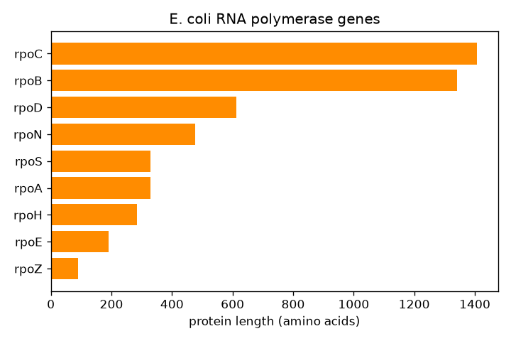

<div dir="rtl">

# پاسخ تشریحی: جدول‌ها و نمودار با pandas

> کدها در 2026-10-20 با Python 3.13.15، pandas 3.0.5 و matplotlib 3.11.1 اجرا شدند.

---

## تمرین ۱: ژن‌های بلند

<div dir="ltr">

```python
import pandas as pd
df = pd.read_csv("genes.tsv", sep="\t")
long_genes = df[df["length"] > 3000]
print(len(long_genes))
print(long_genes["strand"].value_counts())
top10 = df.sort_values("length", ascending=False).head(10)
print(top10)
print((top10["strand"] == "-").sum())
```

</div>

<div dir="ltr">

```text
55
strand
+    33
-    22
Name: count, dtype: int64
      name    start      end strand  length
2037  yeeJ  2044995  2052014      +    7020
2583  yfhM  2647326  2652287      -    4962
1699   lhr  1729087  1733703      +    4617
2718  ypjA  2778146  2782726      -    4581
3040  yghJ  3114550  3119112      -    4563
933   mukB   976326   980786      +    4461
3277  gltB  3354725  3359185      +    4461
501   rhsD   523261   527541      +    4281
3547  rhsB  3619192  3623427      +    4236
4078  rpoC  4185350  4189573      +    4224
3
```

</div>

1. **۵۵** ژن (۳۳ روی +، ۲۲ روی −): تنها ۱٫۲٪ ژن‌ها، همان «دُم» هیستوگرام درس.
2. سه تا روی رشته‌ی منفی (yfhM، ypjA، yghJ). **rpoC** دهمین ژن بلند ژنوم است. mukB (پروتئین تاخوردگی کروموزوم) و gltB (گلوتامات سنتاز) هم در میان آن‌هایند.

‏`(top10["strand"] == "-").sum()`: ستون `True`/`False` را جمع زدیم؛ هر `True` یک شمرده می‌شود (همان ترفند `% 3` در درس).

---

## تمرین ۲: ژن‌های یک ناحیه

<div dir="ltr">

```python
import pandas as pd
df = pd.read_csv("genes.tsv", sep="\t")
region = df[(df["start"] >= 4175000) & (df["end"] <= 4190000)]
print(region[["name", "start", "end", "strand", "length"]])
print(len(region))
```

</div>

<div dir="ltr">

```text
      name    start      end strand  length
4066  thrU  4175388  4175463      +      76
4067  tyrU  4175472  4175556      +      85
4068  glyT  4175673  4175747      +      75
4069  thrT  4175754  4175829      +      76
4070  tufB  4175944  4177128      +    1185
4071  secE  4177358  4177741      +     384
4072  nusG  4177743  4178288      +     546
4073  rplK  4178447  4178875      +     429
4074  rplA  4178879  4179583      +     705
4075  rplJ  4179996  4180493      +     498
4076  rplL  4180560  4180925      +     366
4077  rpoB  4181245  4185273      +    4029
4078  rpoC  4185350  4189573      +    4224
13
```

</div>

**۱۳** ژن. `rpo_region.gb` ۱۵ ژن داشت؛ دو ژن نیستند: **coaA** و **yjaZ**، همان دو ژن **نیمه** در لبه‌های ناحیه (`<1` و `>15001` در ماژول ۰۵). شرط ما تنها ژن‌هایی را نگه داشت که **کامل** درون ناحیه‌اند. اگر ژن‌هایی را هم که **بخشی** از آن‌ها در ناحیه است بخواهید: `(df["end"] >= 4175000) & (df["start"] <= 4190000)`.

نام‌ها و جایگاه‌ها با GenBank یکی‌اند (برای نمونه tufB: ۹۴۵ در ناحیه = ۴٬۱۷۵٬۹۴۴ در ژنوم).

---

## تمرین ۳: ژن‌های y

<div dir="ltr">

```python
import pandas as pd
df = pd.read_csv("genes.tsv", sep="\t")
y = df[df["name"].str.startswith("y")]
print(len(y), round(len(y) / len(df) * 100, 1))
print(df.groupby(df["name"].str.startswith("y"))["length"].median())
```

</div>

<div dir="ltr">

```text
1319 29.3
name
False    879.0
True     621.0
Name: length, dtype: float64
```

</div>

1. **۱٬۳۱۹** ژن، یعنی **۲۹٫۳٪**. نزدیک به یک‌سوم ژن‌های پژوهیده‌ترین باکتری جهان هنوز کار روشنی ندارند! (برخی از آن‌ها کارشان پیدا شده ولی نام y را نگه داشته‌اند.)
2. میانه‌ی ژن‌های y **۶۲۱** باز و دیگر ژن‌ها **۸۷۹**. ژن‌های y کوتاه‌ترند. یک توضیح ممکن: پروتئین‌های کوچک دیرتر شناخته شده‌اند و کم‌تر پژوهیده شده‌اند.

‏`groupby` با یک ستون `True`/`False`: دو گروه، `False` (غیر y) و `True` (y).

---

## تمرین ۴: ترکیب نمونه‌ی `minigut`

<div dir="ltr">

```bash
python3 $P/composition.py ground_truth.tsv minigut minigut.png
cat minigut_genus.tsv
```

</div>

<div dir="ltr">

```text
genus
Escherichia    42.18
Bacteroides    57.82
Name: percent, dtype: float64
saved minigut.png
genus	percent
Escherichia	42.18
Bacteroides	57.82
```

</div>

دو جنس: *Bacteroides* **۵۷٫۸۲٪** و *Escherichia* **۴۲٫۱۸٪**. با شمارش Biopython: ۲۸٬۹۱۲ ÷ ۵۰٬۰۰۰ = ۵۷٫۸۲٪ و ۲۱٬۰۸۸ ÷ ۵۰٬۰۰۰ = ۴۲٫۱۸٪. یکسان، از دو راه گوناگون.

---

## تمرین ۵: نمودار ژن‌های RNA پلیمراز

<div dir="ltr">

```python
import pandas as pd
import matplotlib.pyplot as plt
df = pd.read_csv("genes.tsv", sep="\t")
rpo = df[df["name"].str.startswith("rpo")].sort_values("length")
rpo["aa"] = rpo["length"] // 3 - 1
print(rpo[["name", "length", "aa"]])
rpo[["name", "length", "aa"]].to_csv("rpo_genes.tsv", sep="\t", index=False)

fig, ax = plt.subplots(figsize=(6, 4))
ax.barh(rpo["name"], rpo["aa"], color="darkorange")
ax.set_xlabel("protein length (amino acids)")
ax.set_title("E. coli RNA polymerase genes")
fig.tight_layout()
fig.savefig("rpo_genes.png", dpi=120)
```

</div>

<div dir="ltr">

```text
      name  length    aa
3730  rpoZ     276    91
2643  rpoE     576   191
3526  rpoH     855   284
3357  rpoA     990   329
2803  rpoS     993   330
3266  rpoN    1434   477
3133  rpoD    1842   613
4077  rpoB    4029  1342
4078  rpoC    4224  1407
```

</div>

<div dir="ltr">

```bash
head -n 3 rpo_genes.tsv
```

</div>

<div dir="ltr">

```text
name	length	aa
rpoZ	276	91
rpoE	576	191
```

</div>



1. جدول بالا؛ با `index=False` ستون شماره‌ها در فایل نیامد.
2. نمودار بالا.
3. ‏**rpoC (β′، ۱٬۴۰۷)** و **rpoB (β، ۱٬۳۴۲)**: همان عددهای ترجمه‌ی Biopython در ماژول‌های ۰۴ و ۰۵. rpoA (α، ۳۲۹) هم با تمرین ۳ ماژول ۰۴ یکی است.

**نگاه زیستی:** هسته‌ی RNA پلیمراز α₂ββ′ω است (rpoA، rpoB، rpoC، rpoZ). پنج ژن دیگر (rpoD، rpoS، rpoN، rpoH، rpoE) **فاکتورهای سیگما**ی گوناگون‌اند که پلیمراز را به پروموترهای گروه‌های گوناگون ژن می‌برند: σ⁷⁰ (rpoD) برای ژن‌های روزمره، σˢ (rpoS) برای فاز ایستا و تنش، σ³² (rpoH) برای شوک گرمایی، و … .

</div>
