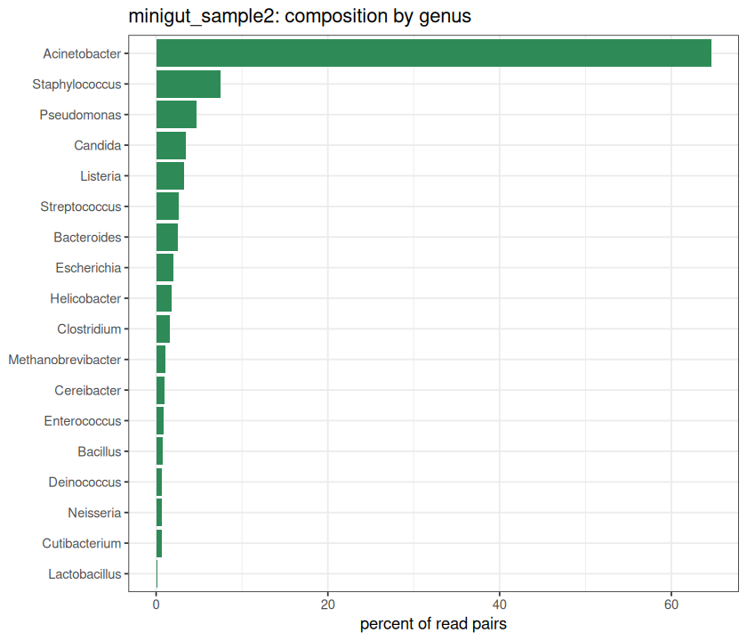

<div dir="rtl">

# درس: اجرای یک اسکریپت آماده‌ی R از ترمینال

**بخش:** `04_R_Packages` · **ماژول:** `02_Run_Rscript` · **پیش‌نیاز:** ماژول [نصب بسته‌ها](../01_Install_Packages/) · **زمان:** حدود ۶۰ دقیقه · **ابزار:** R 4.6.1، ggplot2 4.0.3 · **آخرین اجرا:** 2026-10-20

---

## در یک نگاه

**در پایان این درس می‌توانید:**
1. یک اسکریپت آماده‌ی R را با `Rscript script.R ورودی‌ها` اجرا کنید.
2. از روی **سرآیند** اسکریپت بفهمید چه ورودی‌هایی می‌خواهد، چه بسته‌هایی لازم دارد و چه خروجی‌هایی می‌سازد.
3. پیام‌های خطا را بخوانید: `Error`، `Calls:`، `Warning`، `Execution halted`.
4. خروجی و پیام‌ها را در فایل جدا ذخیره کنید و نسخه‌ها را برای بخش روش‌های مقاله ثبت کنید (`sessionInfo`).
5. یک تنظیم ساده (مانند رنگ نمودار) را در اسکریپت عوض کنید، بی‌آنکه R بلد باشید.

**پیش از آغاز:**

<div dir="ltr">

```bash
conda activate r_packages
mkdir -p ~/r_practice && cd ~/r_practice
cp ~/Bioinformatics_Learning-main/01_Linux/99_scripts_data/data/ground_truth.tsv .
P=~/Bioinformatics_Learning-main/04_R_Packages/99_scripts_data
```

</div>

‏`ground_truth.tsv` همان جدول ترکیب دو نمونه‌ی میکروبی بخش ۰۱ است: هر سطر یک موجود در یک نمونه و شمار جفت‌ریدهایش.

---

## ۱. داستان: یک اسکریپت از همکار

همکارتان می‌گوید: «برای نمودار ترکیب نمونه‌ها یک اسکریپت R نوشته‌ام؛ روی داده‌ی خودت اجرایش کن.» یا در مخزن GitHub یک مقاله، فایلی به نام `figure2.R` می‌بینید. در هر دو حال **لازم نیست R بلد باشید**؛ همان‌گونه که اسکریپت‌های Bash و پایتون این دوره را اجرا کردید، این را هم اجرا می‌کنید. تنها باید بدانید **کجای فایل را بخوانید**.

در ماژول pandas بخش ۰۳، اسکریپت `composition.py` درصد هر جنس را در یک نمونه حساب کرد و نمودار کشید. اسکریپت `composition.R` **همان کار** را با R و بسته‌ی **ggplot2** می‌کند. پس می‌توانید نتیجه را با پایتون بسنجید.

---

## ۲. خواندن اسکریپت پیش از اجرا

فایل را باز کنید (`less $P/02_Run_Rscript/scripts/composition.R`). لازم نیست همه‌ی خط‌ها را بفهمید؛ تنها **چهار جا** را بخوانید:

<div dir="ltr">

```r
# composition.R: percentage of reads from each genus in one sample, as a table and a bar chart   ①
# Same job as composition.py (part 03, module 06), written in R with ggplot2.
# Usage: Rscript composition.R ground_truth.tsv minigut_sample2 composition_R.png                ②

args <- commandArgs(trailingOnly = TRUE)                                                        ③
if (length(args) != 3) {
  cat("Usage: Rscript composition.R <ground_truth.tsv> <sample> <output.png>\n")
  quit(status = 1)
}
table_file <- args[1]
sample     <- args[2]
png_file   <- args[3]

suppressPackageStartupMessages(library(ggplot2))                                                ④
...
write.table(by_genus, out_tsv, ...)                                                             ⑤
ggsave(png_file, p, ...)
```

</div>

| نشانه | چه می‌گوید | شما چه می‌کنید |
| :---: | :--- | :--- |
| ① | این اسکریپت **چه کار** می‌کند | بسنجید همان چیزی است که می‌خواهید |
| ② | ‏**‏Usage**: شکل درست اجرا، با یک نمونه | ترتیب ورودی‌ها را از همین‌جا بردارید |
| ③ | ورودی‌ها از خط فرمان گرفته می‌شوند: `args[1]`، `args[2]`، `args[3]` | ‏`args[1]` همان `sys.argv[1]` پایتون یا `$1` در Bash است. **R از ۱ می‌شمارد**، نه از ۰ |
| ④ | ‏`library(…)`: بسته‌های لازم | با `check_packages.R` (ماژول ۰۱) وارسی کنید نصب‌اند |
| ⑤ | ‏`write.table`، `ggsave`، `png(…)`: **فایل‌های خروجی** | بدانید پس از اجرا چه فایل‌هایی باید ببینید |

خط‌های میانی (حساب درصد، ساختن نمودار) را **نیازی نیست بخوانید**؛ آن کار نویسنده‌ی اسکریپت بود.

<details>
<summary>✋ امتحان کن: اسکریپت چند ورودی می‌خواهد و چه فایل‌هایی می‌سازد؟</summary>

سه ورودی: جدول، نام نمونه و نام فایل PNG (بخش ③، `length(args) != 3`). دو خروجی: فایل PNG با نامی که خودتان دادید، و جدول `<نمونه>_genus_R.tsv` (نامش در اسکریپت از روی نام نمونه ساخته می‌شود: `paste0(sample, "_genus_R.tsv")`).

</details>

---

## ۳. اجرا

<div dir="ltr">

```bash
Rscript $P/02_Run_Rscript/scripts/composition.R ground_truth.tsv minigut_sample2 composition_R.png
```

</div>

<div dir="ltr">

```text
              genus percent
      Lactobacillus    0.10
      Cutibacterium    0.62
          Neisseria    0.70
        Deinococcus    0.70
           Bacillus    0.74
       Enterococcus    0.89
        Cereibacter    0.95
 Methanobrevibacter    1.06
        Clostridium    1.59
       Helicobacter    1.84
        Escherichia    2.00
        Bacteroides    2.58
      Streptococcus    2.62
           Listeria    3.21
            Candida    3.50
        Pseudomonas    4.71
     Staphylococcus    7.54
      Acinetobacter   64.63
saved minigut_sample2_genus_R.tsv and composition_R.png 
```

</div>

| تکه | یعنی |
| :--- | :--- |
| `Rscript` | اجرای R |
| `$P/02_Run_Rscript/scripts/composition.R` | **مسیر** اسکریپت؛ اسکریپت در پوشه‌ی دوره است، داده در پوشه‌ی کار شما |
| `ground_truth.tsv` | ورودی ۱ ← `args[1]` |
| `minigut_sample2` | ورودی ۲ ← `args[2]` |
| `composition_R.png` | ورودی ۳ ← `args[3]` |

اعداد **دقیقاً همان** خروجی `composition.py` در بخش ۰۳ است (Acinetobacter ۶۴٫۶۳٪، Staphylococcus ۷٫۵۴٪…). دو زبان، یک پاسخ.



### چه فایل‌هایی ساخته شد؟

<div dir="ltr">

```bash
ls
head -3 minigut_sample2_genus_R.tsv
```

</div>

<div dir="ltr">

```text
composition_R.png  ground_truth.tsv  minigut_sample2_genus_R.tsv
genus	percent
Lactobacillus	0.1
Cutibacterium	0.62
```

</div>

جدول خروجی یک TSV ساده است: می‌توانید با `sort`، `awk` یا pandas کار را ادامه دهید. **این الگوی همه‌ی بسته‌های R این بخش است: ورودی فایل، خروجی فایل.**

<details>
<summary>✋ امتحان کن: همین اسکریپت را برای نمونه‌ی <code>minigut</code> اجرا کنید. چند جنس دارد؟</summary>

<div dir="ltr">

```bash
Rscript $P/02_Run_Rscript/scripts/composition.R ground_truth.tsv minigut minigut.png
```

</div>

<div dir="ltr">

```text
       genus percent
 Escherichia   42.18
 Bacteroides   57.82
saved minigut_genus_R.tsv and minigut.png 
```

</div>

دو جنس.

</details>

---

## ۴. وقتی چیزی درست پیش نمی‌رود: خواندن خطاها

همه‌ی پیام‌های زیر از اجرای واقعی‌اند.

### الف) ورودی کم: پیام خود اسکریپت

<div dir="ltr">

```bash
Rscript $P/02_Run_Rscript/scripts/composition.R ground_truth.tsv minigut_sample2
echo "exit=$?"
```

</div>

<div dir="ltr">

```text
Usage: Rscript composition.R <ground_truth.tsv> <sample> <output.png>
exit=1
```

</div>

اسکریپت خوب ورودی‌هایش را می‌شمارد و اگر کم یا زیاد بود، شکل درست را چاپ می‌کند و با کد خروج `1` بیرون می‌رود (همان `exit 1` اسکریپت‌های Bash در بخش ۰۱).

### ب) فایل نیست

<div dir="ltr">

```bash
Rscript $P/02_Run_Rscript/scripts/composition.R groundtruth.tsv minigut_sample2 x.png
```

</div>

<div dir="ltr">

```text
Error in file(file, "rt") : cannot open the connection
Calls: read.delim -> read.table -> file
In addition: Warning message:
In file(file, "rt") :
  cannot open file 'groundtruth.tsv': No such file or directory
Execution halted
```

</div>

یک پیام خطای R چهار تکه دارد:

| خط | یعنی | ارزش برای شما |
| :--- | :--- | :--- |
| `Error in file(file, "rt") : cannot open the connection` | **خطا**: کدام تابع و چه شد | مهم؛ ولی گاهی کلی است |
| `Calls: read.delim -> read.table -> file` | **زنجیره**: کدام دستور اسکریپت، کدام را صدا زد تا به خطا رسید | ‏`read.delim` نخستین نام است: یعنی هنگام **خواندن جدول** |
| `In addition: Warning message: … No such file or directory` | **هشدار** همراه، که اغلب علت **واقعی** را می‌گوید | این‌جا: نام فایل نادرست است |
| `Execution halted` | اجرا ایستاد؛ هیچ خروجی ساخته نشد | — |

**قاعده: همه‌ی پیام را بخوانید، نه تنها خط یکم.** این‌جا خط `Error` کلی بود و هشدار زیرش علت را گفت: `groundtruth.tsv` نیست (نام درست `ground_truth.tsv` است).

### ج) ورودی‌ها جابه‌جا

<div dir="ltr">

```bash
Rscript $P/02_Run_Rscript/scripts/composition.R minigut_sample2 ground_truth.tsv out.png
```

</div>

<div dir="ltr">

```text
Error in file(file, "rt") : cannot open the connection
Calls: read.delim -> read.table -> file
In addition: Warning message:
In file(file, "rt") :
  cannot open file 'minigut_sample2': No such file or directory
Execution halted
```

</div>

اسکریپت `minigut_sample2` را **نام فایل** پنداشت، چون در جایگاه یکم آمد. ترتیب ورودی‌ها را همیشه از خط Usage بردارید.

### د) نام نمونه نادرست

<div dir="ltr">

```bash
Rscript $P/02_Run_Rscript/scripts/composition.R ground_truth.tsv minigut3 x.png
```

</div>

<div dir="ltr">

```text
No rows for sample: minigut3 
```

</div>

این پیام را نویسنده‌ی اسکریپت گذاشته است. نام‌های درست را از خود جدول بگیرید: `cut -f1 ground_truth.tsv | sort -u`.

### هـ) مسیر اسکریپت نادرست

<div dir="ltr">

```bash
Rscript composition.R ground_truth.tsv minigut x.png
echo "exit=$?"
```

</div>

<div dir="ltr">

```text
Fatal error: cannot open file 'composition.R': No such file or directory
exit=2
```

</div>

‏`composition.R` در پوشه‌ی کار شما نیست، در پوشه‌ی دوره است. یا مسیر کامل (`$P/…`) را بدهید یا اسکریپت را کپی کنید.

### و) هشدار، خطا نیست

<div dir="ltr">

```bash
Rscript -e 'as.numeric("abc")'
echo "exit=$?"
```

</div>

<div dir="ltr">

```text
[1] NA
Warning message:
NAs introduced by coercion 
exit=0
```

</div>

‏`Warning` یعنی «اجرا ادامه یافت، ولی به این نگاه کن». کد خروج `0` است. هشدار را نادیده نگیرید: این‌جا «abc» عدد نبود و R به‌جایش `NA` (= مقدار گمشده) گذاشت. اگر در جدولی ده‌ها `NA` ببینید، شاید ستون عددی‌تان متن دارد.

<details>
<summary>✋ امتحان کن: در خروجی زیر، علت خطا چیست؟</summary>

<div dir="ltr">

```text
Error in library(ggplot) : there is no package called ‘ggplot’
Execution halted
```

</div>

نام بسته در اسکریپت (یا دستور) نادرست است: باید `ggplot2` باشد. (اگر این خطا از اسکریپت آماده‌ی کسی دیگر است و نام درست است، پس بسته نصب نیست؛ ماژول ۰۱.)

</details>

---

## ۵. پیام‌ها و خروجی را جدا ذخیره کنید

در بخش ۰۱ دیدید که برنامه‌ها دو جریان خروجی دارند: **stdout** (`>`) و **stderr** (`2>`). در R، جدول‌ها و `cat` به stdout می‌روند و **پیام‌ها، هشدارها و خطاها** به stderr:

<div dir="ltr">

```bash
Rscript $P/02_Run_Rscript/scripts/composition.R ground_truth.tsv minigut m.png > m.out 2> m.err
echo "exit=$?"
cat m.out
cat m.err
```

</div>

<div dir="ltr">

```text
exit=0
       genus percent
 Escherichia   42.18
 Bacteroides   57.82
saved minigut_genus_R.tsv and m.png 
```

</div>

‏`m.err` خالی است: نه هشدار، نه خطا. در کار با چند اسکریپت (ماژول ۰۴) همین الگو گزارش هر اجرا را نگه می‌دارد.

### ‏`--vanilla`: اجرای پاک

<div dir="ltr">

```bash
Rscript --vanilla $P/02_Run_Rscript/scripts/composition.R ground_truth.tsv minigut m.png
```

</div>

‏R هنگام آغاز، فایل‌های تنظیم شخصی (مانند `~/.Rprofile`) را هم می‌خواند. اگر کسی در آن‌ها چیزی گذاشته باشد، اسکریپت روی دو کامپیوتر دو جور رفتار می‌کند. ‏`--vanilla` این فایل‌ها را نادیده می‌گیرد؛ برای کار دوباره‌پذیر بهتر است. (فهرست همه‌ی گزینه‌ها: `Rscript --help`.)

### ثبت نسخه‌ها برای بخش روش‌ها

<div dir="ltr">

```bash
Rscript -e 'library(ggplot2); sessionInfo()' > versions.txt
head -3 versions.txt
grep -A1 "other attached" versions.txt
```

</div>

<div dir="ltr">

```text
R version 4.6.1 (2026-06-24)
Platform: x86_64-pc-linux-gnu
Running under: Ubuntu 24.04.4 LTS
other attached packages:
[1] ggplot2_4.0.3
```

</div>

‏`sessionInfo()` نسخه‌ی R، سیستم‌عامل و همه‌ی بسته‌های باز را می‌نویسد. در مقاله می‌نویسید: «نمودارها با ggplot2 نسخه‌ی 4.0.3 در R 4.6.1 رسم شدند».

---

## ۶. عوض کردن یک تنظیم

اسکریپت را **کپی** کنید و نسخه‌ی خودتان را تغییر دهید؛ اصل را دست نزنید:

<div dir="ltr">

```bash
cp $P/02_Run_Rscript/scripts/composition.R my_composition.R
grep -n "seagreen" my_composition.R
sed -i 's/seagreen/steelblue/' my_composition.R
grep -n "steelblue" my_composition.R
Rscript my_composition.R ground_truth.tsv minigut_sample2 blue.png
```

</div>

<div dir="ltr">

```text
35:  geom_col(fill = "seagreen") +
35:  geom_col(fill = "steelblue") +
...
saved minigut_sample2_genus_R.tsv and blue.png 
```

</div>

رنگ میله‌ها عوض شد. همین روش برای هر **متن یا عددِ روشنی** در اسکریپت کار می‌کند: نام رنگ، اندازه‌ی شکل (`width = 7, height = 6`)، عنوان نمودار. بسیاری از اسکریپت‌های خوب، تنظیم‌ها را در یک بلوک بالای فایل گرد می‌آورند (اسکریپت DESeq2 ماژول ۰۳ را ببینید: `# ---- settings you may change ----`). **تنها همان بلوک را عوض کنید.**

<details>
<summary>✋ امتحان کن: عنوان نمودار در کدام خط ساخته می‌شود؟</summary>

<div dir="ltr">

```bash
grep -n "title" my_composition.R
```

</div>

خطی که `title = paste0(sample, ": composition by genus")` دارد. `paste0` چند تکه متن را به هم می‌چسباند: نام نمونه + «: composition by genus».

</details>

---

## ۷. سه اشتباه رایج

**۱. ترتیب ورودی‌ها.** ورودی‌ها جایگاهی‌اند: یکمی همیشه `args[1]` است. ترتیب را از خط `Usage` بردارید، نه از حدس (بخش ۴ج).

**۲. اجرا در پوشه‌ی نادرست.** نام‌های فایل بی‌مسیر (`ground_truth.tsv`) نسبت به **پوشه‌ی کنونی** خوانده می‌شوند و خروجی‌ها هم همان‌جا نوشته می‌شوند. پیش از اجرا `pwd` و `ls` بزنید.

**۳. تنها خواندن خط `Error`.** خط `Calls:` و هشدارهای زیر آن اغلب علت واقعی را می‌گویند (بخش ۴ب).

---

## 📘 برای کنجکاوها

- **پنجره‌ی تعاملی R:** با فرمان `R` باز می‌شود و نشانه‌ی `>` می‌دهد؛ هر دستور را جداگانه اجرا می‌کنید و با `q()` بیرون می‌آیید (`Save workspace image? [y/n/c]` ← `n`). برای کار گام‌به‌گام و آزمودن خوب است؛ برای کار دوباره‌پذیر، اسکریپت.
- ‏**‏RStudio و Jupyter:** محیط‌های گرافیکی برای نوشتن R‌اند. در این دوره به آن‌ها نیاز نداریم؛ هر اسکریپتی که در آن‌ها نوشته شود با `Rscript` هم اجرا می‌شود.
- ‏**‏`source("script.R")`:** درون پنجره‌ی تعاملی R یک فایل را اجرا می‌کند. ولی ورودی خط فرمان (`args`) را نمی‌گیرد.

---

## جمع‌بندی

- اجرای اسکریپت: `Rscript مسیر/اسکریپت.R ورودی۱ ورودی۲ …`.
- پیش از اجرا چهار جا را بخوانید: کار اسکریپت، **Usage**، `library` (بسته‌های لازم) و فایل‌های خروجی.
- پیام خطا: `Error` (چه شد)، `Calls:` (کجا)، `Warning` (اغلب علت واقعی)، `Execution halted` (ایستاد).
- ‏`> out 2> err` خروجی و پیام‌ها را جدا نگه می‌دارد؛ `--vanilla` اجرای پاک؛ `sessionInfo()` نسخه‌ها.
- تنظیم‌ها را در **کپی** اسکریپت عوض کنید.

---

## کارت دستورهای این درس

<div dir="ltr">

```bash
head -5 script.R ; grep -n "library" script.R        # read before running: Usage, packages
Rscript script.R input.tsv sample out.png            # run with arguments (args[1], args[2], ...)
Rscript script.R ... > run.out 2> run.err; echo $?   # keep output and messages; exit code
Rscript --vanilla script.R ...                       # ignore personal startup files
Rscript -e 'library(ggplot2); sessionInfo()' > versions.txt
cp script.R my_script.R; sed -i 's/seagreen/steelblue/' my_script.R   # change a setting in a copy
```

</div>

---

## واژه‌نامه‌ی درس

| واژه | معنی |
| :--- | :--- |
| ‏`commandArgs(trailingOnly = TRUE)` | ورودی‌های خط فرمان؛ همان `sys.argv[1:]` پایتون |
| ‏`args[1]` | ورودی یکم؛ در R شمارش از ۱ است |
| ‏Usage | خط راهنمای شکل درست اجرا |
| ‏`Execution halted` | اجرا به خاطر خطا ایستاد |
| ‏`Calls:` | زنجیره‌ی دستورهایی که به خطا رسید |
| ‏`Warning` | هشدار؛ اجرا ادامه می‌یابد |
| ‏`NA` | مقدار گمشده |
| ‏`--vanilla` | اجرای R بی فایل‌های تنظیم شخصی |
| ‏`sessionInfo()` | گزارش نسخه‌ی R، سیستم و بسته‌ها |
| ‏ggplot2 | بسته‌ی رایج رسم نمودار در R |

---

## منابع

**مستند رسمی**
- ‏R Core Team, *An Introduction to R*، پیوست B «Invoking R from the command line» (Rscript): https://cran.r-project.org/doc/manuals/r-release/R-intro.html#Invoking-R-from-the-command-line
- ggplot2 documentation: https://ggplot2.tidyverse.org/

**فیلم و دوره‌ی آموزشی**
- ‏Coursera: *R Programming* (Johns Hopkins University). دوره‌ی کامل زبان R است؛ برای این درس تنها هفته‌ی ۱ (اجرای R و خواندن داده) مرتبط است: https://www.coursera.org/learn/r-programming
- ‏edX: *Statistics and R* (HarvardX PH525.1x). بخش آغازین آن اجرای R و بسته‌ها را نشان می‌دهد: https://www.edx.org/learn/r-programming/harvard-university-statistics-and-r
- YouTube: *RT3 R tips: Run R code from command line* (Yi Li): https://www.youtube.com/watch?v=lMr4u-b0TbI
- YouTube: *run r script from linux command line with arguments input and output data file names as arguments* (Yi Li): https://www.youtube.com/watch?v=mheCAcfa1tg

<sub>نشانی‌های YouTube در 2026-10-20 با oEmbed وارسی شدند. نشانی‌های Coursera و edX از نمایه‌ی جست‌وجو در همان تاریخ گرفته شدند؛ وارسی مستقیم آن‌ها در پایان دوره انجام می‌شود.</sub>

</div>
