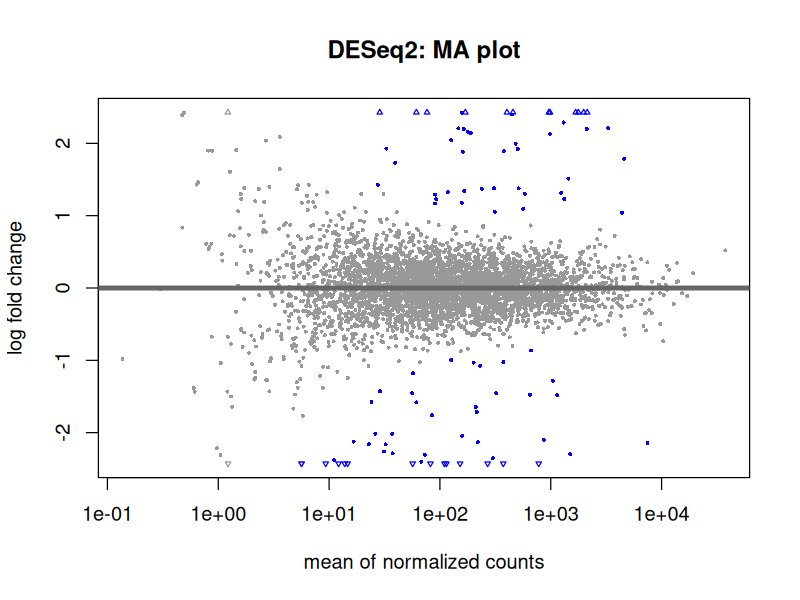
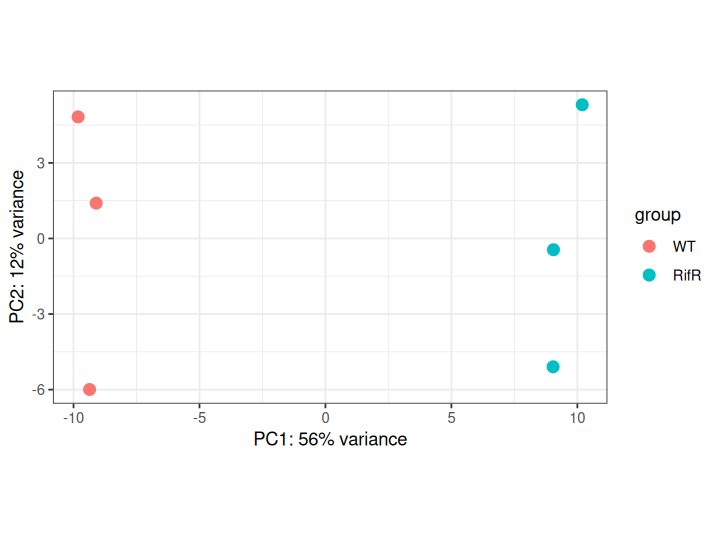

<div dir="rtl">

# درس ۱: کدام ژن‌ها تغییر کرده‌اند؟ اجرای DESeq2

**بخش:** `04_R_Packages` · **ماژول:** `03_Bioc_Examples` · **پیش‌نیاز:** ماژول [اجرای Rscript](../02_Run_Rscript/) · **زمان:** حدود ۵۰ دقیقه · **ابزار:** R 4.6.1، DESeq2 1.52.0، ggplot2 4.0.3؛ Python 3.13 + pandas برای ساختن داده · **آخرین اجرا:** 2026-10-20

> ⚠️ **داده‌ی این درس شبیه‌سازی‌شده است.** شمار ریدها با یک اسکریپت پایتون ساخته شده و ۱۰۰ ژنِ «تغییرکرده» **تصادفی** برگزیده شده‌اند، نه از روی زیست‌شناسی واقعی. سودش این است که **پاسخ درست را می‌دانیم** و می‌توانیم ببینیم DESeq2 چقدر درست کار کرد. کار پژوهشی واقعی، داده‌ی RNA-seq واقعی با شمار ریدهای به‌دست‌آمده از هم‌ترازی (بخش‌های ۰۶ و ۱۰) می‌خواهد.
>
> آمار پشت DESeq2 (مدل دوجمله‌ای منفی، آزمون Wald، اصلاح آزمون‌های چندگانه) در این دوره درس داده **نمی‌شود**؛ جایش دوره‌ی جداگانه‌ی آمار و R است. این‌جا تنها **اجرا** و **خواندن خروجی** را یاد می‌گیرید.

---

## در یک نگاه

**در پایان این درس می‌توانید:**
1. دو جدول ورودی DESeq2 (شمارش ریدها و اطلاعات نمونه‌ها) را بشناسید و بسازید.
2. اسکریپت آماده‌ی `run_deseq2.R` را اجرا کنید و گروه مرجع را درست بدهید.
3. ستون‌های جدول نتیجه را بخوانید: `baseMean`، `log2FoldChange`، `padj`.
4. نمودار MA و PCA را تفسیر کنید.
5. نتیجه را با پاسخ معلوم بسنجید و ببینید DESeq2 کجا اشتباه می‌کند.

**پیش از آغاز:**

<div dir="ltr">

```bash
conda activate r_packages          # R, DESeq2
mkdir -p ~/r_practice/deseq2 && cd ~/r_practice/deseq2
P=~/Bioinformatics_Learning-main/04_R_Packages/99_scripts_data
D=~/Bioinformatics_Learning-main/01_Linux/99_scripts_data/data
```

</div>

---

## ۱. داستان: سویه‌ی مقاوم به ریفامپیسین چه ژن‌هایی را کم و زیاد کرده است؟

در سراسر دوره داستان یک E. coli مقاوم به ریفامپیسین را دنبال کردید: جهش H526Y در ژن rpoB، زیرواحد β آنزیم RNA پلیمراز. چون RNA پلیمراز همه‌ی ژن‌ها را رونویسی می‌کند، جهش در آن می‌تواند **بیان** بسیاری از ژن‌ها را هم تغییر دهد.

برای سنجیدن این، آزمایشگر از ۳ کشت سویه‌ی وحشی (**WT**) و ۳ کشت سویه‌ی مقاوم (**RifR**) RNA استخراج و توالی‌یابی می‌کند (**RNA-seq**)، و برای هر ژن می‌شمارد چند رید از آن آمده است. پرسش: **کدام ژن‌ها در RifR به‌طور معنادار بیشتر یا کمتر بیان شده‌اند؟** این کار **تحلیل بیان افتراقی** (*differential expression*) نام دارد و DESeq2 رایج‌ترین ابزار آن است.

---

## ۲. مفهوم به زبان ساده: چرا مقایسه‌ی ساده‌ی شمارش‌ها کافی نیست؟

فرض کنید ژن X در WT ۱۰۰ رید و در RifR ۲۰۰ رید دارد. آیا بیانش دو برابر شده است؟ سه دلیل که شاید نه:

1. **عمق توالی‌یابی:** اگر نمونه‌ی RifR روی‌هم‌رفته دو برابر رید داشته باشد، همه‌ی ژن‌ها دو برابر رید می‌گیرند. DESeq2 نخست این را **هم‌سان** (*normalize*) می‌کند (پیام `estimating size factors`).
2. **پراکندگی طبیعی:** سه کشت یکسان هم شمارش یکسان ندارند (۸۵، ۱۰۸، ۱۱۰). DESeq2 برای هر ژن می‌سنجد چقدر **نوسان** میان تکرارها طبیعی است (`estimating dispersions`).
3. **هزاران آزمون:** با ۴٬۲۹۰ ژن، برخی تنها از بخت بد «تفاوت» نشان می‌دهند. DESeq2 این را با **p تعدیل‌شده** (*padj*) در نظر می‌گیرد.

خروجی DESeq2 برای هر ژن، به زبان ساده، دو چیز می‌گوید: **چقدر** تغییر کرد (`log2FoldChange`) و **چقدر می‌توان به آن تغییر اعتماد کرد** (`padj`).

### ‏log2FoldChange در یک جدول

| log2FoldChange | یعنی بیان در RifR نسبت به WT |
| :---: | :--- |
| ‏0 | بی‌تغییر |
| ‏1 | ۲ برابر |
| ‏2 | ۴ برابر |
| ‏3 | ۸ برابر |
| ‏‎-1 | نصف |
| ‏‎-2 | یک‌چهارم |

لگاریتم پایه‌ی ۲ برای این است که افزایش و کاهش هم‌اندازه دیده شوند: دو برابر = ‎+1، نصف = ‎-1.

---

## ۳. ورودی‌ها: دو جدول

### ساختن داده (یک بار)

<div dir="ltr">

```bash
python3 $P/03_Bioc_Examples/scripts/make_counts.py $D/ecoli_k12.gff
```

</div>

<div dir="ltr">

```text
wrote counts.tsv (4290 genes x 6 samples), samples.tsv, truth.tsv (100 changed genes)
```

</div>

اسکریپت ژن‌های پروتئین‌ساز E. coli را از GFF بخش ۰۱ برداشت و برای هر کدام شمار رید ساخت. ‏`truth.tsv` **پاسخ‌نامه** است؛ تا پایان درس به آن نگاه نکنید.

### جدول ۱: شمارش ریدها (`counts.tsv`)

<div dir="ltr">

```bash
head -4 counts.tsv
```

</div>

<div dir="ltr">

```text
gene_id	WT_1	WT_2	WT_3	RifR_1	RifR_2	RifR_3
b0001	9	15	14	13	27	20
b0002	69	90	136	42	66	73
b0003	222	584	401	399	554	361
```

</div>

- هر **سطر** یک ژن (`b0001` = locus tag ژن thrL در E. coli K-12).
- هر **ستون** یک نمونه.
- هر خانه شمار **خام** ریدها: عدد درست، نه درصد و نه عدد هم‌سان‌شده. **DESeq2 تنها شمارش خام می‌پذیرد.**

### جدول ۲: اطلاعات نمونه‌ها (`samples.tsv`)

<div dir="ltr">

```bash
cat samples.tsv
```

</div>

<div dir="ltr">

```text
sample	condition
WT_1	WT
WT_2	WT
WT_3	WT
RifR_1	RifR
RifR_2	RifR
RifR_3	RifR
```

</div>

ستون `sample` باید **دقیقاً** همان نام ستون‌های `counts.tsv` باشد؛ ستون `condition` گروه هر نمونه است.

<details>
<summary>✋ امتحان کن: در داده‌ی خودتان ۴ نمونه‌ی «شاهد» و ۴ نمونه‌ی «تیمار» دارید. <code>samples.tsv</code> چند سطر دارد؟</summary>

۹ سطر: یک سرستون + ۸ نمونه. هر نمونه یک سطر، با گروهش (`control` یا `treated`) در ستون `condition`.

</details>

---

## ۴. اجرا

نخست سرآیند اسکریپت (ماژول ۰۲، بخش ۲):

<div dir="ltr">

```bash
head -7 $P/03_Bioc_Examples/scripts/run_deseq2.R
```

</div>

<div dir="ltr">

```text
# run_deseq2.R: which genes change between two groups of RNA-seq samples? (DESeq2)
# Usage: Rscript run_deseq2.R counts.tsv samples.tsv WT deseq2
#   counts.tsv  : first column gene_id, then one column of read counts per sample
#   samples.tsv : columns sample and condition; sample names = column names of counts.tsv
#   WT          : the reference (control) group; log2FoldChange = other group vs this one
#   deseq2      : prefix of the output files
# Writes: <prefix>_results.tsv, <prefix>_MA.png, <prefix>_PCA.png
```

</div>

ورودی سوم، **گروه مرجع**، مهم است: `log2FoldChange` همیشه «گروه دیگر نسبت به مرجع» است. ما می‌خواهیم «RifR نسبت به WT»، پس مرجع = `WT`.

<div dir="ltr">

```bash
Rscript $P/03_Bioc_Examples/scripts/run_deseq2.R counts.tsv samples.tsv WT deseq2
```

</div>

<div dir="ltr">

```text
genes: 4290  samples: 6 

  WT RifR 
   3    3 
estimating size factors
estimating dispersions
gene-wise dispersion estimates
mean-dispersion relationship
final dispersion estimates
fitting model and testing

out of 4288 with nonzero total read count
adjusted p-value < 0.05
LFC > 0 (up)       : 47, 1.1%
LFC < 0 (down)     : 46, 1.1%
outliers [1]       : 0, 0%
low counts [2]     : 0, 0%
(mean count < 0)
[1] see 'cooksCutoff' argument of ?results
[2] see 'independentFiltering' argument of ?results

using ntop=500 top features by variance
saved deseq2_results.tsv deseq2_MA.png deseq2_PCA.png 
```

</div>

(روی یک لپ‌تاپ معمولی چند ثانیه.) خط‌به‌خط:

| بخش خروجی | یعنی |
| :--- | :--- |
| ‏`genes: 4290 samples: 6` و `WT 3 / RifR 3` | ورودی درست خوانده شد: ۳ نمونه در هر گروه. **همیشه این را وارسی کنید** |
| ‏`estimating size factors` | هم‌سان کردن عمق توالی‌یابی (بخش ۲، دلیل ۱) |
| ‏`estimating dispersions` تا `final dispersion estimates` | سنجیدن نوسان طبیعی هر ژن (دلیل ۲) |
| ‏`fitting model and testing` | آزمون آماری برای هر ژن |
| ‏`out of 4288 with nonzero total read count` | ۲ ژن در هیچ نمونه‌ای رید نداشتند و کنار رفتند |
| ‏`LFC > 0 (up) : 47` | ‏۴۷ ژن با padj < 0.05 در RifR **بیشتر** بیان شده‌اند |
| ‏`LFC < 0 (down) : 46` | ‏۴۶ ژن **کمتر** |
| ‏`outliers`، `low counts` | ژن‌هایی که به خاطر یک نمونه‌ی ناهنجار یا شمار بسیار کم آزموده نشدند؛ این‌جا صفر |
| ‏`using ntop=500 …` | برای نمودار PCA، ۵۰۰ ژنِ پرنوسان‌تر به کار رفت |

**روی‌هم‌رفته ۹۳ ژن «تغییرکرده» گزارش شد.** می‌دانیم ۱۰۰ ژن واقعاً تغییر کرده‌اند؛ بخش ۷ می‌سنجد کدام‌ها درست بودند.

> 📺 **فیلم:** *DESeq2 workflow tutorial: Differential Gene Expression Analysis*: https://www.youtube.com/watch?v=OzNzO8qwwp0 (Bioinformagician)
> 📄 **مرجع:** Love MI, Huber W, Anders S (2014). *DESeq2.* Genome Biology 15:550. https://doi.org/10.1186/s13059-014-0550-8

---

## ۵. خواندن جدول نتیجه

<div dir="ltr">

```bash
wc -l deseq2_results.tsv
cut -f1,2,3,7 deseq2_results.tsv | head -6
```

</div>

<div dir="ltr">

```text
4291 deseq2_results.tsv
gene_id	baseMean	log2FoldChange	padj
b1609	402.475737010673	2.81775721366337	3.90728184368213e-29
b1858	1773.78505205801	2.86271066717719	6.6519762967533e-27
b1001	456.02843373607	2.53093633877614	3.00997423092011e-24
b0792	2132.17706565013	2.7383358273901	4.05351884685695e-24
b1512	1678.6404370039	2.5902342189351	3.51517812184203e-23
```

</div>

جدول برای همه‌ی ۴٬۲۹۰ ژن است (+ سرستون)، مرتب‌شده از کوچک‌ترین `padj`.

| ستون | یعنی | نمونه: b1609 |
| :--- | :--- | :--- |
| `gene_id` | شناسه‌ی ژن | ‏b1609 (ژن rstB) |
| `baseMean` | میانگین شمار هم‌سان‌شده در همه‌ی نمونه‌ها: ژن چقدر «پربیان» است | ‏۴۰۲ رید |
| `log2FoldChange` | اندازه‌ی تغییر (بخش ۲) | ‏2.82 ← کمابیش ۷ برابر بیشتر در RifR |
| `lfcSE`، `stat`، `pvalue` | خطای معیار، آماره‌ی آزمون، p خام | (در دوره‌ی آمار) |
| `padj` | ‏p تعدیل‌شده: هر چه کوچک‌تر، اعتماد بیشتر. **ستونی که برای گزینش به کار می‌رود** | ‏`3.9e-29` = ۳٫۹ × ۱۰⁻²⁹، بسیار کوچک |

**نوشتار علمی اعداد:** `3.90728184368213e-29` یعنی ۳٫۹ ضرب در ۱۰ به توان ‎−۲۹. `e-05` یعنی ۰٫۰۰۰۰۱ و `e+03` یعنی ۱۰۰۰.

با شمارش‌های خام بسنجید:

<div dir="ltr">

```bash
grep -w b1609 counts.tsv
```

</div>

<div dir="ltr">

```text
b1609	85	108	110	587	822	758
```

</div>

‏WT نزدیک به ۱۰۰، RifR نزدیک به ۷۰۰: هم‌خوان با ۷ برابر.

### ‏`NA` در جدول

<div dir="ltr">

```bash
grep -P "\tNA" deseq2_results.tsv | cut -f1-3,7
```

</div>

<div dir="ltr">

```text
b4749	0	NA	NA
b4680	0	NA	NA
```

</div>

‏`baseMean = 0`: هیچ ریدی نداشتند (همان ۲ ژن «nonzero total read count»). DESeq2 برایشان آزمونی نکرد و `NA` (= مقدار ندارد) گذاشت. ‏`NA` **خطا نیست**؛ هنگام گزینش، این سطرها را کنار بگذارید.

### گزینش ژن‌های معنادار با awk

<div dir="ltr">

```bash
awk -F'\t' 'NR > 1 && $7 != "NA" && $7 < 0.05' deseq2_results.tsv | wc -l
awk -F'\t' 'NR > 1 && $7 != "NA" && $7 < 0.05 && $3 > 0' deseq2_results.tsv | wc -l
```

</div>

<div dir="ltr">

```text
93
47
```

</div>

همان ۹۳ و ۴۷ خلاصه‌ی DESeq2. (`$7` = ستون padj، `$3` = log2FoldChange.)

<details>
<summary>✋ امتحان کن: چند ژن دست‌کم ۴ برابر <b>کاهش</b> یافته‌اند و معنادارند؟</summary>

۴ برابر کاهش = `log2FoldChange` کمتر از ‎-2:

<div dir="ltr">

```bash
awk -F'\t' 'NR > 1 && $7 != "NA" && $7 < 0.05 && $3 < -2' deseq2_results.tsv | wc -l
```

</div>

پاسخ را در فایل پاسخ‌ها (تمرین ۳) بسنجید.

</details>

> 📺 **فیلم:** *StatQuest: DESeq2, part 1, Library Normalization*: https://www.youtube.com/watch?v=UFB993xufUU
> 📄 **مرجع:** DESeq2 vignette: https://bioconductor.org/packages/release/bioc/vignettes/DESeq2/inst/doc/DESeq2.html

---

## ۶. نمودارها

### نمودار MA



- هر نقطه یک ژن.
- محور افقی: `baseMean` (پربیانی، مقیاس لگاریتمی).
- محور عمودی: `log2FoldChange`.
- **آبی** = معنادار (padj < 0.05)، **خاکستری** = نه.
- سه‌گوش‌ها در لبه‌ها ژن‌هایی‌اند که بیرون از قاب افتادند.

دو چیز را ببینید:
1. بیشتر ژن‌ها گرد خط صفرند: بیشتر ژن‌ها **تغییر نکرده‌اند**. اگر ابر خاکستری بالا یا پایین خط صفر بود، هم‌سان‌سازی درست انجام نشده بود.
2. در **چپ** نمودار (ژن‌های کم‌بیان)، نقطه‌های خاکستری تا ‎±2 پخش‌اند ولی آبی نیستند: با شمار رید کم، حتی تغییر بزرگ هم **قابل اعتماد نیست**.

### نمودار PCA



هر نقطه یک **نمونه** است و نمونه‌های هم‌مانند نزدیک هم می‌افتند. سه WT در چپ و سه RifR در راست‌اند و محور یکم (PC1) ۵۶٪ تفاوت میان نمونه‌ها را می‌گوید: **تفاوت دو گروه، بزرگ‌ترین منبع تفاوت است.** این نخستین وارسی کیفیت در هر RNA-seq است. اگر یک نمونه‌ی WT کنار RifRها می‌افتاد، شاید برچسبش جابه‌جا شده بود.

---

## ۷. سنجیدن با پاسخ معلوم

<div dir="ltr">

```bash
python3 $P/03_Bioc_Examples/scripts/compare_truth.py deseq2_results.tsv truth.tsv
```

</div>

<div dir="ltr">

```text
padj < 0.05: 93 genes called changed; 100 truly changed
found (true positives):  88
false alarms:            5
missed:                  12
wrote missed.tsv
```

</div>

- **۸۸ از ۱۰۰** ژن تغییرکرده پیدا شدند.
- **۵ هشدار کاذب**: از ۹۳ ژن گزارش‌شده، ۵ تا (۵٫۴٪) واقعاً تغییر نکرده بودند. این همان معنای `padj < 0.05` است: **پذیرفتن نزدیک به ۵٪ هشدار کاذب در میان ژن‌های گزارش‌شده.**
- **۱۲ ژن از دست رفتند.** چرا؟

<div dir="ltr">

```bash
column -t missed.tsv | head -8
```

</div>

<div dir="ltr">

```text
gene_id  name  true_log2FC  baseMean  log2FoldChange  padj
b1605    ydgI  1.23         30.974    1.299           0.054
b0800    ybiB  -2.37        5.589     -2.595          0.166
b1044    ymdA  -1.16        65.784    -1.025          0.216
b1534    ydeE  1.96         19.53     1.298           0.253
b3643    rph   -1.0         59.552    -0.847          0.498
b3344    tusC  -1.5         349.307   -0.586          0.519
b1591    dmsD  -2.54        5.793     -1.766          0.53
```

</div>

دو الگو:
- **کم‌بیان** (`baseMean` کمتر از ۲۰، مانند ybiB و dmsD): تغییر بزرگ است، ولی با چند رید نمی‌توان مطمئن بود (همان چپ نمودار MA).
- **تغییر کوچک** (`true_log2FC` نزدیک ‎±1، مانند rph): با تنها ۳ تکرار، تغییر دو برابری گاهی در نوسان طبیعی گم می‌شود.

**درس کاربردی:** «معنادار نبود» یعنی «نتوانستیم نشان دهیم»، **نه** «تغییر نکرد». تکرار بیشتر و توالی‌یابی عمیق‌تر، ژن‌های کمتری را از دست می‌دهند.

---

## ۸. سه اشتباه رایج

**۱. گروه مرجع نادرست.** اگر به‌جای `WT` بنویسید `RifR`، همه‌ی علامت‌ها برعکس می‌شوند:

<div dir="ltr">

```bash
Rscript $P/03_Bioc_Examples/scripts/run_deseq2.R counts.tsv samples.tsv RifR flipped 2>/dev/null | grep -A2 "adjusted"
head -2 flipped_results.tsv | cut -f1-3
```

</div>

<div dir="ltr">

```text
adjusted p-value < 0.05
LFC > 0 (up)       : 46, 1.1%
LFC < 0 (down)     : 47, 1.1%
b1609	402.475737010673	-2.81775677199624
```

</div>

همان ژن rstB، حالا ‎−2.82: «در WT کمتر از RifR». نتیجه نادرست نیست، ولی اگر یادتان نباشد مرجع چه بود، **تفسیرتان وارونه** می‌شود. نام گروه هم به بزرگی و کوچکی حرف حساس است: `wt` پیام `'ref' must be an existing level` می‌دهد.

**۲. نام نمونه‌ها در دو جدول جور نیست.** یک خطای تایپی در `samples.tsv`:

<div dir="ltr">

```text
These samples are in bad_samples.tsv but not in counts.tsv : RifR3
```

</div>

(این پیام را اسکریپت می‌دهد. بسیاری از اسکریپت‌ها چنین وارسی‌ای ندارند و خطای DESeq2 گنگ‌تر است.)

**۳. دادن داده‌ی هم‌سان‌شده (TPM، FPKM، درصد) به‌جای شمار خام.** DESeq2 خودش هم‌سان می‌کند و تنها **عدد درست** می‌پذیرد. با عدد اعشاری خطای `some values in assay are not integers` می‌گیرید؛ اگر عددها را گرد کنید خطا نمی‌گیرید ولی نتیجه **نادرست** است.

---

## 📘 برای کنجکاوها

- **تغییر آستانه:** در اسکریپت بلوک `# ---- settings you may change ----` هست با `padj_cutoff <- 0.05`. با ۰٫۰۱، هشدار کاذب به ۲ کم می‌شود ولی ۱۸ ژن از دست می‌رود (تمرین ۵): میان «هشدار کاذب کمتر» و «ژن از دست‌رفته‌ی کمتر» همیشه باید یکی را برگزید.
- ‏**‏edgeR و limma-voom** دو ابزار رایج دیگر برای همین کارند (هر دو در Bioconductor). در بیشتر داده‌ها نتیجه‌ی همانندی می‌دهند.
- **از کجا شمار رید بگیریم؟** با هم‌ترازی ریدها روی ژنوم (بخش ۰۶) و شمردن با featureCounts، یا با Salmon (بخش ۱۰). خروجی هر دو جدولی همانند `counts.tsv` است.
- ‏**‏vignette رسمی DESeq2** همه‌ی گام‌ها را با یک داده‌ی واقعی (airway) نشان می‌دهد؛ نشانی در منابع.

---

## جمع‌بندی

- ‏DESeq2 دو جدول می‌خواهد: **شمار خام** (ژن × نمونه) و **اطلاعات نمونه‌ها** (نمونه، گروه).
- گروه مرجع جهت `log2FoldChange` را تعیین می‌کند: ‎+1 = دو برابر نسبت به مرجع.
- برای گزینش، ستون **`padj`** را به کار ببرید و سطرهای `NA` را کنار بگذارید.
- نمودار PCA کیفیت نمونه‌ها را می‌سنجد؛ نمودار MA نشان می‌دهد ژن‌های کم‌بیان کمتر قابل اعتمادند.
- روی داده‌ی شبیه‌سازی‌شده: ۸۸/۱۰۰ پیدا، ۵ هشدار کاذب، ۱۲ از دست‌رفته (بیشتر کم‌بیان یا با تغییر کوچک).

---

## کارت دستورهای این درس

<div dir="ltr">

```bash
# inputs: raw counts (gene x sample) + sample table (sample, condition)
Rscript run_deseq2.R counts.tsv samples.tsv WT deseq2     # WT = reference group
cut -f1,2,3,7 deseq2_results.tsv | head                   # gene, baseMean, log2FC, padj
awk -F'\t' 'NR>1 && $7!="NA" && $7<0.05' deseq2_results.tsv | wc -l   # significant genes
awk -F'\t' 'NR>1 && $7!="NA" && $7<0.05 && $3>0' deseq2_results.tsv   # up in the other group
```

</div>

---

## واژه‌نامه‌ی درس

| واژه | معنی |
| :--- | :--- |
| ‏RNA-seq | توالی‌یابی RNA برای سنجیدن بیان ژن‌ها |
| بیان افتراقی (*differential expression*) | تفاوت بیان یک ژن میان دو گروه نمونه |
| شمار خام (*raw counts*) | شمار ریدهای هر ژن، پیش از هر هم‌سان‌سازی |
| هم‌سان‌سازی (*normalization*) | حذف اثر عمق توالی‌یابی متفاوت نمونه‌ها |
| تکرار زیستی (*biological replicate*) | کشت یا نمونه‌ی جداگانه از یک گروه |
| ‏log2FoldChange | لگاریتم پایه‌ی ۲ نسبت بیان؛ ‎+1 = دو برابر |
| ‏padj | ‏p تعدیل‌شده برای هزاران آزمون؛ آستانه‌ی رایج ۰٫۰۵ |
| ‏baseMean | میانگین شمار هم‌سان‌شده‌ی یک ژن |
| گروه مرجع (*reference level*) | گروهی که بقیه با آن سنجیده می‌شوند (شاهد) |
| ‏MA plot | نمودار تغییر (M) در برابر پربیانی (A) |
| ‏PCA | نمایش نمونه‌ها در دو بعد، تا نمونه‌های هم‌مانند نزدیک هم بیفتند |
| هشدار کاذب (*false positive*) | ژنی که «تغییرکرده» گزارش شد ولی تغییر نکرده بود |

---

## منابع

**مستند و مقاله**
- Love MI, Huber W, Anders S (2014). *Moderated estimation of fold change and dispersion for RNA-seq data with DESeq2.* Genome Biology 15:550. https://doi.org/10.1186/s13059-014-0550-8
- DESeq2 vignette (Bioconductor): https://bioconductor.org/packages/release/bioc/vignettes/DESeq2/inst/doc/DESeq2.html
- DESeq2 package page: https://bioconductor.org/packages/DESeq2/

**کتاب**
- ‏Holmes S, Huber W (2019). *Modern Statistics for Modern Biology*. Cambridge University Press. (فصل ۸: داده‌ی شمارشی توان‌بالا)

**فیلم و دوره‌ی آموزشی**
- Coursera: *Bioconductor for Genomic Data Science* (Johns Hopkins University): https://www.coursera.org/learn/bioconductor
- edX: *Introduction to Bioconductor* (HarvardX PH525.5x): https://www.edx.org/learn/data-science/harvard-university-introduction-to-bioconductor
- YouTube: *DESeq2 workflow tutorial | Differential Gene Expression Analysis* (Bioinformagician): https://www.youtube.com/watch?v=OzNzO8qwwp0
- ‏YouTube: *StatQuest: DESeq2, part 1, Library Normalization* (StatQuest with Josh Starmer), برای شهود هم‌سان‌سازی: https://www.youtube.com/watch?v=UFB993xufUU

<sub>نشانی‌های YouTube در 2026-10-20 با oEmbed وارسی شدند. نشانی‌های Coursera و edX از نمایه‌ی جست‌وجو در همان تاریخ گرفته شدند؛ وارسی مستقیم آن‌ها در پایان دوره انجام می‌شود.</sub>

</div>
