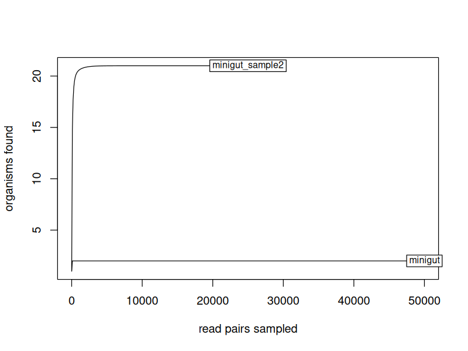

<div dir="rtl">

# درس ۲: تنوع جامعه‌ی میکروبی با vegan

**بخش:** `04_R_Packages` · **ماژول:** `03_Bioc_Examples` · **پیش‌نیاز:** [درس ۱](01_lesson_deseq2.md) · **زمان:** حدود ۴۰ دقیقه · **ابزار:** R 4.6.1، vegan 2.7.6 · **آخرین اجرا:** 2026-10-20

> ⚠️ داده‌ی این درس دو نمونه‌ی **شبیه‌سازی‌شده** با ترکیب معلوم است (`ground_truth.tsv` بخش ۰۱). در پژوهش واقعی، جدول ورودی از ابزارهای طبقه‌بندی مانند Kraken2/Bracken یا QIIME 2 (بخش ۰۶) می‌آید و نمونه‌ها ده‌ها یا صدها تا‌اند. آمار سنجش تفاوت گروه‌ها (PERMANOVA و مانند آن) در دوره‌ی جداگانه‌ی آمار است.

---

## در یک نگاه

**در پایان این درس می‌توانید:**
1. بگویید vegan چه جدولی می‌خواهد (**ماتریس جامعه**) و اسکریپت آماده چگونه آن را می‌سازد.
2. ‏`diversity.R` را اجرا کنید و غنا، شانون، سیمپسون و یکنواختی را بخوانید.
3. فاصله‌ی **Bray–Curtis** میان دو نمونه را تفسیر کنید.
4. نمودار **منحنی نادرسازی** (*rarefaction curve*) را بخوانید.
5. ببینید چرا **سطح طبقه‌بندی** (گونه یا جنس) نتیجه را عوض می‌کند.

**پیش از آغاز:**

<div dir="ltr">

```bash
conda activate r_packages
mkdir -p ~/r_practice/vegan && cd ~/r_practice/vegan
P=~/Bioinformatics_Learning-main/04_R_Packages/99_scripts_data
cp ~/Bioinformatics_Learning-main/01_Linux/99_scripts_data/data/ground_truth.tsv .
```

</div>

---

## ۱. داستان: کدام نمونه متنوع‌تر است؟

دو نمونه‌ی «روده»ی دوره را به یاد بیاورید: `minigut` (تنها دو باکتری) و `minigut_sample2` (بیست و یک موجود، که یکی، Acinetobacter، بیشترِ ریدها را دارد). پرسش‌های رایج میکروبیوم:
- **درون هر نمونه:** چند موجود هست و چقدر **یکنواخت** پخش‌اند؟ (تنوع **آلفا**)
- **میان نمونه‌ها:** دو نمونه چقدر **متفاوت**‌اند؟ (تنوع **بتا**)

بسته‌ی **vegan** (از CRAN، در اصل برای بوم‌شناسی گیاهان نوشته شد) ابزار استاندارد هر دو پرسش در R است. phyloseq و QIIME 2 هم پشت صحنه همین سنجه‌ها را حساب می‌کنند.

---

## ۲. مفهوم به زبان ساده: چهار عدد برای یک نمونه

دو باغ را در نظر بگیرید، هر کدام ۱۰۰ درخت:
- باغ الف: ۵۰ سیب، ۵۰ گلابی.
- باغ ب: ۹۸ سیب، ۱ گلابی، ۱ آلو.

کدام متنوع‌تر است؟ باغ ب **سه** گونه دارد ولی در واقع «باغ سیب» است. پس یک عدد کافی نیست:

| سنجه | پرسش | الف | ب |
| :--- | :--- | :---: | :---: |
| **غنا** (*richness*) | چند گونه؟ | ۲ | ۳ |
| **یکنواختی** (*evenness*) | فراوانی‌ها چقدر هم‌اندازه‌اند؟ (۰ تا ۱) | ۱ (کاملاً یکنواخت) | نزدیک به ۰ |
| **شانون** (*Shannon*) | غنا و یکنواختی با هم؛ هر چه بیشتر، متنوع‌تر | بیشتر | کمتر |
| **سیمپسون** (*Simpson*) | احتمال آنکه دو فرد تصادفی از دو گونه‌ی **متفاوت** باشند (۰ تا ۱) | ۰٫۵ | نزدیک به ۰٫۰۴ |

(برای کنجکاوها: شانون = ‎−Σ pᵢ ln pᵢ؛ سیمپسون = ‎1 − Σ pᵢ²؛ یکنواختی پیلو = شانون ÷ ln غنا؛ pᵢ سهم گونه‌ی i است.)

**میان دو نمونه، Bray–Curtis:** عددی از ۰ (ترکیب یکسان) تا ۱ (هیچ موجود مشترکی ندارند).

---

## ۳. ورودی: از جدول «بلند» به ماتریس جامعه

‏`ground_truth.tsv` جدولی **بلند** است: هر سطر = یک موجود در یک نمونه.

<div dir="ltr">

```text
sample	read_pairs	accession	organism
minigut	28912	NC_006347.1	Bacteroides fragilis YCH46
minigut	21088	NC_000913.3	Escherichia coli K-12 MG1655
minigut_sample2	16154	CP009257.1	Acinetobacter baumannii strain AB030
...
```

</div>

‏vegan جدولی **پهن** می‌خواهد به نام **ماتریس جامعه** (*community matrix*): هر سطر یک نمونه، هر ستون یک موجود، هر خانه شمار رید (و صفر اگر موجود در آن نمونه نیست):

<div dir="ltr">

```text
                 Acinetobacter…  Bacteroides fragilis…  Escherichia coli K-12 MG1655  …
minigut                       0                  28912                         21088  …
minigut_sample2           16154                      0                             0  …
```

</div>

اسکریپت `diversity.R` این تبدیل را خودش می‌کند (خط `xtabs(...)`)؛ شما تنها جدول بلند را می‌دهید. **نکته‌ی مهم:** در ماتریس جامعه، **سطرها نمونه‌اند**. برخی ابزارها (مانند خروجی Bracken یا QIIME 2) جدول را وارونه (ستون = نمونه) می‌دهند و باید پیش از vegan ترانهاده شود.

---

## ۴. اجرا

<div dir="ltr">

```bash
head -5 $P/03_Bioc_Examples/scripts/diversity.R
Rscript $P/03_Bioc_Examples/scripts/diversity.R ground_truth.tsv diversity
```

</div>

<div dir="ltr">

```text
# diversity.R: how diverse is each microbial sample, and how different are the samples? (vegan)
# Usage: Rscript diversity.R ground_truth.tsv diversity [organism|genus]
#   input: long table with columns sample, read_pairs, organism (one row per organism per sample)
#   organism (default): every organism name counts separately; genus: first word of the name
# Writes: <prefix>_alpha.tsv, <prefix>_bray.tsv, <prefix>_rarecurve.png
level: organism  samples: 2  taxa: 23 
          sample reads richness shannon simpson evenness
         minigut 50000        2   0.681   0.488    0.982
 minigut_sample2 24993       21   1.608   0.572    0.528

Bray-Curtis dissimilarity (0 = same, 1 = nothing shared):
                minigut
minigut_sample2       1
Warning message:
In rarecurve(as.matrix(comm), step = 100, xlab = "read pairs sampled",  :
  most observed count data have counts 1, but smallest count is 24
saved diversity_alpha.tsv diversity_bray.tsv diversity_rarecurve.png 
```

</div>

### تنوع آلفا

| نمونه | ریدها | غنا | شانون | سیمپسون | یکنواختی |
| :--- | ---: | ---: | ---: | ---: | ---: |
| ‏minigut | ۵۰٬۰۰۰ | ۲ | ۰٫۶۸۱ | ۰٫۴۸۸ | **۰٫۹۸۲** |
| ‏minigut_sample2 | ۲۴٬۹۹۳ | **۲۱** | **۱٫۶۰۸** | ۰٫۵۷۲ | ۰٫۵۲۸ |

- ‏`minigut_sample2` بسیار **غنی‌تر** است (۲۱ در برابر ۲) و شانونش بیشتر.
- ولی `minigut` **یکنواخت‌تر** است (۰٫۹۸): دو باکتری کمابیش هم‌اندازه (۵۸٪ و ۴۲٪). در `minigut_sample2`، Acinetobacter به‌تنهایی ۶۵٪ ریدهاست، پس یکنواختی ۰٫۵۳ است.
- سیمپسون دو نمونه نزدیک است (۰٫۴۹ و ۰٫۵۷): سیمپسون بیشتر به موجودات **چیره** حساس است تا به شمار موجودات کمیاب.

**وارسی با دست** برای `minigut` (سهم‌ها ۰٫۵۷۸ و ۰٫۴۲۲): سیمپسون = ‎1 − (0.578² + 0.422²) = 1 − (0.334 + 0.178) = 0.488. همان عدد vegan.

### تنوع بتا

‏Bray–Curtis = **1**: «هیچ موجود مشترکی ندارند»! ولی هر دو نمونه E. coli K-12 MG1655 دارند… بخش ۵ را ببینید.

### هشدار `rarecurve`

‏`Warning` است، نه خطا (ماژول ۰۲). vegan می‌گوید در داده‌های واقعی میکروبی، بسیاری از موجودات **تنها یک** رید دارند و این‌جا کمینه ۲۴ است. معنایش این است که داده **شبیه‌سازی‌شده** است و موجودات کمیاب را ندارد؛ برای این درس اشکالی ندارد.

<details>
<summary>✋ امتحان کن: اگر سه نمونه داشتیم، جدول <code>diversity_bray.tsv</code> چند عدد غیرصفر داشت؟</summary>

ماتریس ۳×۳ است؛ قطر (هر نمونه با خودش) صفر است و ۶ خانه‌ی دیگر سه جفت را دو بار می‌نویسند (الف–ب و ب–الف یکسان‌اند). پس ۶ خانه‌ی غیرصفر، با ۳ عدد متفاوت (اگر هیچ دو نمونه‌ای کاملاً یکسان نباشند).

</details>

> 📺 **فیلم:** *Using vegan to calculate alpha diversity metrics within the tidyverse in R*: https://www.youtube.com/watch?v=wq1SXGQYgCs (Riffomonas Project)
> 📄 **مرجع:** vegan vignette, *Diversity analysis in vegan*: https://cran.r-project.org/web/packages/vegan/vignettes/diversity-vegan.pdf

---

## ۵. سطح طبقه‌بندی: گونه یا جنس؟

نام E. coli در دو نمونه **یکسان نوشته نشده است**:

<div dir="ltr">

```bash
grep -i "escherichia" ground_truth.tsv | cut -f1,4
```

</div>

<div dir="ltr">

```text
minigut	Escherichia coli K-12 MG1655
minigut_sample2	Escherichia coli str. K-12 substr. MG1655
```

</div>

برای vegan این دو **دو ستون جدا**‌اند، پس «مشترک» شمرده نشدند. این مشکل در داده‌ی واقعی بسیار رایج است: نام‌های گوناگون برای یک موجود، یا سویه‌های گوناگون از یک گونه. راه: کار در **سطح بالاتر** (جنس). اسکریپت ورودی سوم اختیاری `genus` دارد:

<div dir="ltr">

```bash
Rscript $P/03_Bioc_Examples/scripts/diversity.R ground_truth.tsv diversity_genus genus 2>/dev/null
```

</div>

<div dir="ltr">

```text
level: genus  samples: 2  taxa: 18 
          sample reads richness shannon simpson evenness
         minigut 50000        2   0.681   0.488    0.982
 minigut_sample2 24993       18   1.535   0.569    0.531

Bray-Curtis dissimilarity (0 = same, 1 = nothing shared):
                minigut
minigut_sample2   0.969
saved diversity_genus_alpha.tsv diversity_genus_bray.tsv diversity_genus_rarecurve.png 
```

</div>

- غنای `minigut_sample2` از ۲۱ به **۱۸** رسید: دو Staphylococcus و سه Streptococcus هر کدام یک جنس شدند.
- ‏Bray–Curtis از ۱ به **۰٫۹۶۹**: حالا Escherichia و Bacteroides مشترک‌اند، ولی سهمشان در `minigut_sample2` کوچک است (۲٪ و ۲٫۶٪)، پس دو نمونه هنوز **بسیار** متفاوت‌اند.

**وارسی با دست:** Bray–Curtis = ‎1 − 2 × (جمع کمینه‌های مشترک) ÷ (جمع همه‌ی ریدهای دو نمونه). کمینه‌ها: Escherichia ۴۹۹، Bacteroides ۶۴۵ ← ۱٬۱۴۴. پس ‎1 − 2 × 1144 ÷ (50000 + 24993) = 1 − 0.031 = **0.969**.

**درس کاربردی:** پیش از هر سنجه‌ی تنوع بپرسید «در کدام سطح؟» و آن را در گزارش بنویسید. عددها در سطح گونه، جنس یا ASV یکسان نیستند.

---

## ۶. منحنی نادرسازی



‏vegan از هر نمونه، به‌طور تصادفی ۱۰۰، ۲۰۰، ۳۰۰… رید برمی‌دارد و می‌شمارد چند موجود پیدا شد.
- محور افقی: شمار ریدهای برداشته‌شده.
- محور عمودی: شمار موجودات یافته‌شده.

اگر منحنی **صاف** شود (به سقف برسد)، توالی‌یابی کافی بوده و موجود تازه‌ای پنهان نمانده است. هر دو منحنی خیلی زود صاف شده‌اند: `minigut_sample2` با کمتر از ۵٬۰۰۰ رید به ۲۱ رسید. اگر منحنی هنوز رو به بالا بود، با رید بیشتر موجودات بیشتری پیدا می‌شد و **غنای گزارش‌شده کمتر از واقع** بود.

**چرا مهم است:** نمونه‌ای با ۵۰٬۰۰۰ رید و نمونه‌ای با ۵٬۰۰۰ رید را نمی‌توان مستقیم در غنا سنجید؛ نمونه‌ی پرریدتر موجودات کمیاب بیشتری «می‌بیند». منحنی نادرسازی نشان می‌دهد آیا این خطر هست.

> 📺 **فیلم:** *Vegan R Package Tutorial*: https://www.youtube.com/watch?v=zzoO8f4nkv4
> 📄 **مرجع:** vegan (CRAN): https://cran.r-project.org/package=vegan

---

## ۷. سه اشتباه رایج

**۱. ماتریس وارونه.** اگر ستون‌ها نمونه باشند، vegan بی‌خطا تنوع **موجودات در میان نمونه‌ها** را حساب می‌کند، که بی‌معناست. همیشه بسنجید: شمار سطرهای خروجی آلفا = شمار نمونه‌ها؟

**۲. سنجیدن نمونه‌ها با عمق بسیار متفاوت.** غنا با شمار رید بالا می‌رود. منحنی نادرسازی را ببینید؛ اگر صاف نشده، سنجش غنا گمراه‌کننده است.

**۳. نام‌های ناهمسان.** همان مشکل E. coli در بخش ۵: Bray–Curtis = 1 در حالی که موجود مشترک هست. پیش از تحلیل، نام‌ها را یکدست کنید یا در سطح جنس کار کنید.

---

## 📘 برای کنجکاوها

- ‏**‏phyloseq** (Bioconductor) جدول شمارش، طبقه‌بندی و درخت را در یک شیء گرد می‌آورد و برای تنوع از vegan بهره می‌برد. در بخش ۰۶ خروجی QIIME 2 همین سنجه‌ها را می‌دهد.
- ‏**‏Faith PD** تنوعی است که خویشاوندی موجودات را هم در نظر می‌گیرد (به درخت نیاز دارد)؛ **UniFrac** نسخه‌ی تبارشناختی Bray–Curtis است. هر دو در بخش ۰۶.
- **داده‌ی ترکیبی:** شمار رید، نسبی است (کل ریدها را دستگاه تعیین می‌کند). روش‌هایی مانند CLR برای این ساخته شده‌اند؛ در دوره‌ی آمار.

---

## جمع‌بندی

- ‏vegan ماتریس جامعه می‌خواهد: **سطر = نمونه**، ستون = موجود، خانه = شمار.
- آلفا: **غنا** (چند تا)، **یکنواختی** (چقدر هم‌اندازه)، **شانون** و **سیمپسون** (ترکیب این دو).
- بتا: **Bray–Curtis** از ۰ (یکسان) تا ۱ (بی موجود مشترک).
- سطح طبقه‌بندی عددها را عوض می‌کند (۲۱ ← ۱۸ موجود؛ ۱ ← ۰٫۹۶۹).
- منحنی نادرسازی صاف = توالی‌یابی کافی.

---

## کارت دستورهای این درس

<div dir="ltr">

```bash
Rscript diversity.R ground_truth.tsv diversity              # organism level
Rscript diversity.R ground_truth.tsv diversity_genus genus  # genus level
column -t diversity_alpha.tsv                               # richness, shannon, simpson, evenness
cat diversity_bray.tsv                                      # Bray-Curtis matrix
```

</div>

---

## واژه‌نامه‌ی درس

| واژه | معنی |
| :--- | :--- |
| تنوع آلفا | تنوع درون یک نمونه |
| تنوع بتا | تفاوت ترکیب میان نمونه‌ها |
| غنا (*richness*) | شمار موجودات (گونه، جنس…) در یک نمونه |
| یکنواختی (*evenness*) | هم‌اندازه بودن فراوانی‌ها؛ ۰ تا ۱ |
| شاخص شانون | سنجه‌ی تنوع که غنا و یکنواختی را با هم می‌سنجد |
| شاخص سیمپسون | احتمال آنکه دو رید تصادفی از دو موجود متفاوت باشند |
| ‏Bray–Curtis | ناهمسانی دو نمونه؛ ۰ تا ۱ |
| ماتریس جامعه (*community matrix*) | جدول نمونه × موجود با شمار رید |
| منحنی نادرسازی (*rarefaction curve*) | شمار موجودات یافته‌شده در برابر شمار ریدهای برداشته‌شده |
| سطح طبقه‌بندی (*taxonomic rank*) | گونه، جنس، خانواده… |

---

## منابع

**مستند و مقاله**
- vegan package (CRAN): https://cran.r-project.org/package=vegan
- vegan vignette *Diversity analysis in vegan*: https://cran.r-project.org/web/packages/vegan/vignettes/diversity-vegan.pdf
- vegan development site: https://vegandevs.github.io/vegan/

**کتاب**
- Borcard D, Gillet F, Legendre P (2018). *Numerical Ecology with R*, 2nd ed. Springer.
- Magurran AE (2004). *Measuring Biological Diversity*. Blackwell.

**فیلم و دوره‌ی آموزشی**
- ‏Coursera: *Bioconductor for Genomic Data Science* (Johns Hopkins University). دوره‌ای ویژه‌ی vegan در Coursera نیافتیم؛ این نزدیک‌ترین دوره‌ی کار با بسته‌های زیستی R است: https://www.coursera.org/learn/bioconductor
- ‏edX: *Introduction to Bioconductor* (HarvardX PH525.5x). دوره‌ای ویژه‌ی تنوع میکروبی در edX نیافتیم؛ نزدیک‌ترین: https://www.edx.org/learn/data-science/harvard-university-introduction-to-bioconductor
- YouTube: *Using vegan to calculate alpha diversity metrics within the tidyverse in R* (Riffomonas Project): https://www.youtube.com/watch?v=wq1SXGQYgCs
- YouTube: *Vegan R Package Tutorial* (Pickles): https://www.youtube.com/watch?v=zzoO8f4nkv4

<sub>نشانی‌های YouTube در 2026-10-20 با oEmbed وارسی شدند. نشانی‌های Coursera و edX از نمایه‌ی جست‌وجو در همان تاریخ گرفته شدند؛ وارسی مستقیم آن‌ها در پایان دوره انجام می‌شود.</sub>

</div>
