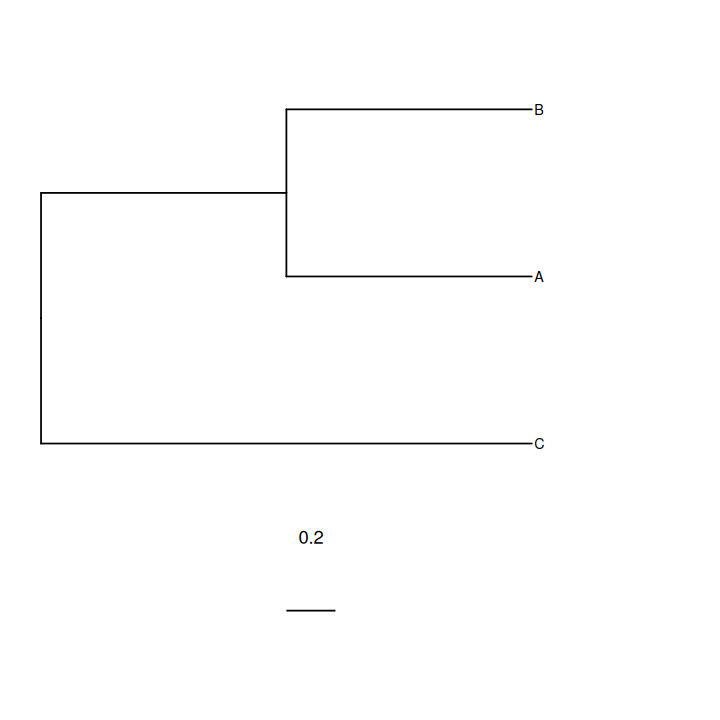
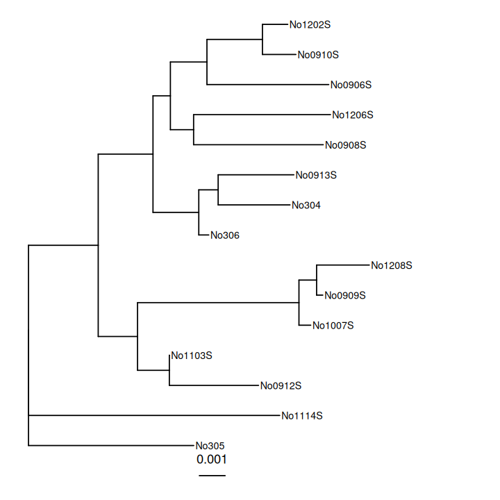
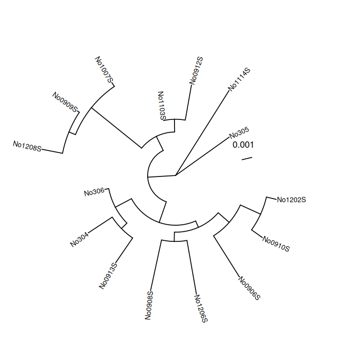

<div dir="rtl">

# درس ۳: رسم درخت تبارشناختی با ggtree

**بخش:** `04_R_Packages` · **ماژول:** `03_Bioc_Examples` · **پیش‌نیاز:** [درس ۲](02_lesson_vegan.md) · **زمان:** حدود ۳۵ دقیقه · **ابزار:** R 4.6.1، ape 5.8.1، ggtree 4.2.0 · **آخرین اجرا:** 2026-10-20

> ⚠️ این درس تنها **رسم** یک درخت آماده را یاد می‌دهد. **ساختن** درخت درست (هم‌ترازی چندگانه، برگزیدن مدل، IQ-TREE، bootstrap) در بخش ۰۸ است. درخت این درس با روش ساده‌ی NJ از یک داده‌ی آماده‌ی بسته‌ی ape ساخته می‌شود، تنها برای اینکه فایلی برای رسم داشته باشیم.

---

## در یک نگاه

**در پایان این درس می‌توانید:**
1. فرمت **Newick** را بخوانید: درخت در یک خط متن.
2. یک فایل درخت را با اسکریپت آماده‌ی `plot_tree.R` (بسته‌ی **ggtree**) به نمودار تبدیل کنید.
3. چیدمان درخت را (مستطیلی یا دایره‌ای) با یک ورودی عوض کنید.
4. درخت را بخوانید: برگ، گره، طول شاخه، مقیاس.
5. خطای فایل Newick خراب را بشناسید.

**پیش از آغاز:**

<div dir="ltr">

```bash
conda activate r_packages
mkdir -p ~/r_practice/tree && cd ~/r_practice/tree
P=~/Bioinformatics_Learning-main/04_R_Packages/99_scripts_data
```

</div>

---

## ۱. داستان: نمودار درخت برای مقاله

بیشتر ابزارهای ساختن درخت (IQ-TREE، RAxML، FastTree، MEGA) خروجی را در یک **فایل متنی** به فرمت Newick می‌دهند، نه یک تصویر آماده. برای شکل مقاله باید درخت را **رسم** کنید: نام‌ها خوانا، مقیاس روشن، و در کارهای پیشرفته‌تر رنگ‌بندی بر پایه‌ی میزبان، کشور یا ژن مقاومت. **ggtree** (از Bioconductor) رایج‌ترین بسته‌ی رسم درخت در R است و بر پایه‌ی ggplot2 (ماژول ۰۲) ساخته شده است.

داده‌ی این درس: ۱۵ توالی ژن میتوکندریایی **سیتوکروم b** از موش‌های جنگلی (*Apodemus sylvaticus*)، که همراه بسته‌ی ape می‌آید (Michaux و همکاران، ۲۰۰۳). روش کار برای درخت ۱۵ سویه‌ی باکتری دقیقاً همین است. در بخش ۰۸ درخت سویه‌های باکتری را خودتان می‌سازید.

---

## ۲. مفهوم به زبان ساده: درخت در یک خط

یک درخت کوچک با سه برگ:

<div dir="ltr">

```text
((A:1,B:1):1,C:2);
```

</div>



بخوانیم:

| تکه | یعنی |
| :--- | :--- |
| `(A:1,B:1)` | ‏**‏A و B** با هم یک گروه‌اند (خواهر یکدیگر)؛ هر کدام شاخه‌ای به طول ۱ تا نیای مشترکشان |
| `(…):1` | شاخه‌ی آن نیای مشترک، به طول ۱، تا ریشه |
| `C:2` | ‏C مستقیم به ریشه، با شاخه‌ی ۲ |
| ‏`( … , … )` بیرونی | ریشه: دو شاخه، یکی گروه (A,B) و دیگری C |
| `;` | **پایان درخت**: باید باشد |

- **برگ** (*tip*): موجودات واقعی (A، B، C)؛ همان توالی‌های ورودی.
- **گره** (*node*): نیای مشترک فرضی؛ هر جفت پرانتز یک گره.
- **طول شاخه**: اندازه‌ی تغییر (برای نمونه، شمار جایگزینی در هر جایگاه). طول **افقی** خط‌ها در نمودار همین است؛ فاصله‌ی **عمودی** معنایی ندارد.
- **مقیاس** (خط زیر نمودار با عدد `0.2`): طول شاخه‌ای که آن اندازه تغییر را نشان می‌دهد.

**نکته‌ی تفسیر:** A و B به هم نزدیک‌ترند تا هر کدام به C، چون **نیای مشترک** نزدیک‌تری دارند. ترتیب بالا و پایین برگ‌ها (B بالای A) معنایی ندارد؛ شاخه‌ها را می‌توان مانند لولا چرخاند.

<details>
<summary>✋ امتحان کن: در <code>((A:1,B:1):1,C:2);</code> فاصله‌ی A تا C روی درخت چقدر است؟</summary>

از A تا نیای (A,B): ۱؛ تا ریشه: ۱؛ از ریشه تا C: ۲. روی‌هم ۱ + ۱ + ۲ = **۴**. فاصله‌ی A تا B: ۱ + ۱ = ۲.

</details>

---

## ۳. ساختن فایل درخت (آماده)

<div dir="ltr">

```bash
Rscript $P/03_Bioc_Examples/scripts/make_tree.R woodmouse.nwk
cat woodmouse.nwk
```

</div>

<div dir="ltr">

```text
alignment: 15 sequences x 965 bp
saved woodmouse.nwk 
((((((No304:0.002690651238,No0913S:0.002834266855):0.0007255702818,No306:0.0003733003133):0.001714771416,((No0908S:0.004853986229,No1206S:0.005125078315):0.0008698575081,((No0910S:0.001252824374,No1202S:0.000948305551):0.002078914455,No0906S:0.004562027045):0.001368619218):0.000651574945):0.002051412111,((No0912S:0.003339227304,No1103S:0):0.001192033027,((No0909S:0.0002302399844,No1208S:0.00197240675):0.0006610200204,No1007S:0.0004403033465):0.006045839188):0.001472060999):0.002611039283,No1114S:0.00940739897):0,No305:0.006187692833);
```

</div>

همان ساختار بخش ۲، ولی با ۱۵ برگ (نام‌هایی مانند `No304`، شماره‌ی نمونه‌ی موش‌ها) و طول شاخه‌های کوچک (۰٫۰۰۳ = سه جایگزینی در هر هزار جایگاه): این موش‌ها هم‌گونه‌اند و توالی‌هایشان بسیار همانند است. خواندن چنین خطی با چشم ناممکن است؛ برای همین رسمش می‌کنیم.

---

## ۴. رسم

<div dir="ltr">

```bash
head -3 $P/03_Bioc_Examples/scripts/plot_tree.R
Rscript $P/03_Bioc_Examples/scripts/plot_tree.R woodmouse.nwk woodmouse_tree.png
```

</div>

<div dir="ltr">

```text
# plot_tree.R: draw a phylogenetic tree from a Newick file (ggtree)
# Usage: Rscript plot_tree.R woodmouse.nwk woodmouse_tree.png [rectangular|circular]

tips (leaves): 15 
first tips: No304 No0913S No306 No0908S No1206S 
Warning message:
Using `size` aesthetic for lines was deprecated in ggplot2 3.4.0.
ℹ Please use `linewidth` instead.
ℹ The deprecated feature was likely used in the ggtree package.
  Please report the issue at <https://github.com/YuLab-SMU/ggtree/issues>. 
saved woodmouse_tree.png 
```

</div>

- ‏`tips (leaves): 15`: هر ۱۵ برگ خوانده شد. **این را با شمار توالی‌های ورودی بسنجید.**
- ‏`Warning … deprecated`: ggtree درون خودش شیوه‌ای کهنه از ggplot2 را به کار برده است. پیام خودش می‌گوید «شاید در بسته‌ی ggtree» و نشانی گزارش اشکال را می‌دهد. **کار شما نیست و بر نمودار اثری ندارد.** این گونه هشدارها هنگام جفت شدن نسخه‌های تازه‌ی دو بسته رایج‌اند.



خواندن نمودار:
- درخت **ریشه‌دار** است: اسکریپت `No305` را برون‌گروه (*outgroup*) گرفت، پس آن در پایین و جدا افتاده است.
- دو گروه بزرگ دیده می‌شود: بالا (۸ برگ، از No1202S تا No306) و پایین (No1208S، No0909S، No1007S، No1103S، No0912S).
- ‏`No1103S` شاخه‌ای کمابیش به طول صفر دارد: توالی‌اش با نیای گروه خود یکسان است.

### چیدمان دایره‌ای

ورودی سوم اختیاری:

<div dir="ltr">

```bash
Rscript $P/03_Bioc_Examples/scripts/plot_tree.R woodmouse.nwk woodmouse_circular.png circular 2>/dev/null
```

</div>



همان درخت است؛ تنها شکل نمایش عوض شده. چیدمان دایره‌ای برای درخت‌های **بزرگ** (صدها سویه) جا را بهتر پر می‌کند. (`2>/dev/null` هشدار تکراری بالا را پنهان کرد؛ ماژول ۰۲ بخش ۵.)

<details>
<summary>✋ امتحان کن: ggtree چه چیدمان‌های دیگری دارد؟</summary>

در صفحه‌ی مستند ggtree («Tree Visualization» در کتاب Data Integration, Manipulation and Visualization of Phylogenetic Trees) فهرست آمده است، از جمله `slanted`، `fan`، `equal_angle` و `daylight`. هر کدام را می‌توانید به‌جای `circular` بدهید؛ برای نمونه `fan` بی‌خطا اجرا می‌شود.

</details>

---

## ۵. درخت خراب

یک `;` پایانی و یک `)` جاافتاده:

<div dir="ltr">

```bash
printf '((A:1,B:1):1,C:2\n' > broken.nwk
Rscript $P/03_Bioc_Examples/scripts/plot_tree.R broken.nwk b.png
```

</div>

<div dir="ltr">

```text
Warning message:
In read.tree(tree_file) : no semicolon(s) [end(s) of tree] found
tips (leaves): 0 
first tips: 
...
Error in reorder.default(phy, order = "postorder") : 
  argument "X" is missing, with no default
Calls: xlim ... <Anonymous> -> reorder -> reorder.default -> tapply
Execution halted
```

</div>

خط `Error` گنگ است («argument X is missing»). ولی **نخستین** پیام، یک هشدار، علت را روشن می‌گوید: `no semicolon(s) … found`، و `tips (leaves): 0` تأیید می‌کند که هیچ برگی خوانده نشد. همان قاعده‌ی ماژول ۰۲: **همه‌ی پیام را از بالا بخوانید.**

---

## ۶. سه اشتباه رایج

**۱. فایل نادرست به‌جای Newick.** برخی ابزارها چند فایل می‌سازند (IQ-TREE: `.treefile`، `.contree`، `.log`، `.iqtree`). تنها `.treefile` (یا `.contree`) Newick است. با `head -c 200 فایل` بسنجید که با `(` آغاز و با `;` پایان می‌یابد.

**۲. تفسیر فاصله‌ی عمودی یا ترتیب برگ‌ها.** تنها طول **افقی** شاخه‌ها و **گره‌های مشترک** معنا دارند. دو برگ که در نمودار کنار هم‌اند، لزوماً نزدیک‌ترین خویشاوند نیستند (No1114S و No305 را ببینید).

**۳. ریشه‌گذاری.** درخت بی‌ریشه را می‌توان از هر جا آویخت و «کدام گروه کهن‌تر است» با ریشه عوض می‌شود. ریشه را با یک **برون‌گروه** شناخته‌شده می‌گذارند (در `make_tree.R`: `root(tree, outgroup = "No305")`). در بخش ۰۸ بیشتر.

---

## 📘 برای کنجکاوها

- ‏ggtree می‌تواند به هر برگ اطلاعات دیگری بچسباند (میزبان، کشور، ژن مقاومت از بخش ۰۸) و برگ‌ها را رنگ کند یا کنار درخت یک نقشه‌ی گرمایی بکشد. این‌ها در کتاب رایگان ggtree آمده‌اند (منابع).
- بسته‌ی **treeio** فرمت‌های دیگر درخت (BEAST، MrBayes، فرمت NEXUS) را می‌خواند؛ ggtree پشت صحنه از آن بهره می‌برد.
- ابزارهای وب مانند **iTOL** همین کار را با کلیک می‌کنند. برتری اسکریپت این است که برای ۵۰ درخت، یک حلقه کافی است (ماژول ۰۴).

---

## جمع‌بندی

- ‏**Newick**: درخت در یک خط متن؛ پرانتز = گروه، `:عدد` = طول شاخه، `;` = پایان.
- ‏`plot_tree.R درخت.nwk خروجی.png [circular]` درخت را با ggtree رسم می‌کند.
- همیشه `tips (leaves)` را با شمار توالی‌ها بسنجید.
- تنها طول افقی و گره‌های مشترک معنا دارند؛ ترتیب برگ‌ها نه.
- هشدار `deprecated` از درون یک بسته، کار شما نیست؛ هشدار `no semicolon` هست.

---

## کارت دستورهای این درس

<div dir="ltr">

```bash
Rscript make_tree.R woodmouse.nwk                                  # practice tree (ape, NJ)
Rscript plot_tree.R woodmouse.nwk tree.png                         # rectangular
Rscript plot_tree.R woodmouse.nwk tree_circ.png circular 2>/dev/null
head -c 200 my.treefile                                            # is it Newick? starts "(" ends ";"
```

</div>

---

## واژه‌نامه‌ی درس

| واژه | معنی |
| :--- | :--- |
| درخت تبارشناختی (*phylogenetic tree*) | نمودار خویشاوندی توالی‌ها یا موجودات |
| ‏Newick | فرمت متنی یک‌خطی برای درخت |
| برگ (*tip, leaf*) | پایانه‌ی درخت؛ یک توالی یا موجود واقعی |
| گره (*node*) | نیای مشترک فرضی |
| طول شاخه (*branch length*) | اندازه‌ی تغییر در طول یک شاخه |
| ریشه (*root*) | کهن‌ترین نیای مشترک در درخت |
| برون‌گروه (*outgroup*) | توالی دورتر که برای گذاشتن ریشه به کار می‌رود |
| ‏NJ (*neighbour-joining*) | روشی سریع و ساده برای ساختن درخت از فاصله‌ها |
| چیدمان (*layout*) | شکل نمایش درخت: مستطیلی، دایره‌ای… |

---

## منابع

**مستند و مقاله**
- Yu G, Smith DK, Zhu H, Guan Y, Lam TTY (2017). *ggtree: an R package for visualization and annotation of phylogenetic trees with their covariates and other associated data.* Methods in Ecology and Evolution 8:28–36. https://doi.org/10.1111/2041-210X.12628
- ‏Yu G. *Data Integration, Manipulation and Visualization of Phylogenetic Trees* (کتاب رایگان ggtree): https://yulab-smu.top/treedata-book/
- ggtree package page (Bioconductor): https://bioconductor.org/packages/ggtree/
- Michaux JR et al. (2003). *Mitochondrial phylogeography of the Woodmouse (Apodemus sylvaticus) in the Western Palearctic region.* Molecular Ecology 12:685–697. https://doi.org/10.1046/j.1365-294X.2003.01752.x

**فیلم و دوره‌ی آموزشی**
- ‏Coursera: *Bioconductor for Genomic Data Science* (Johns Hopkins University). دوره‌ای ویژه‌ی ggtree در Coursera نیافتیم؛ نزدیک‌ترین: https://www.coursera.org/learn/bioconductor
- ‏edX: *Introduction to Bioconductor* (HarvardX PH525.5x). دوره‌ای ویژه‌ی رسم درخت در edX نیافتیم؛ نزدیک‌ترین: https://www.edx.org/learn/data-science/harvard-university-introduction-to-bioconductor
- YouTube: *R for Bioinformatics | How to Visualize Phylogenetic Trees using ggtree* (Bioinformatics Coach): https://www.youtube.com/watch?v=3swFCSt2_x4
- YouTube: *1.6 Phylogenetic trees with R/ape* (profbiot): https://www.youtube.com/watch?v=uAf0DCGynTk

<sub>نشانی‌های YouTube در 2026-10-20 با oEmbed وارسی شدند. نشانی‌های Coursera و edX از نمایه‌ی جست‌وجو در همان تاریخ گرفته شدند؛ وارسی مستقیم آن‌ها در پایان دوره انجام می‌شود.</sub>

</div>
