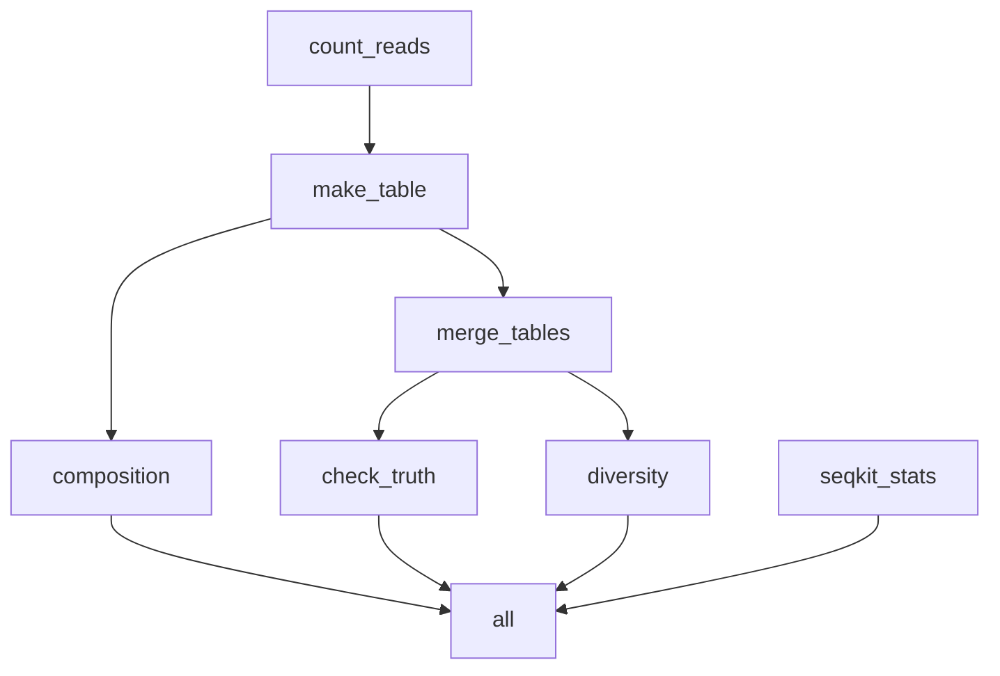

<div dir="rtl">

# درس: یک گردش کار کامل؛ از FASTQ تا نمودار و تنوع

**بخش:** `05_Reproducible_Work` · **ماژول:** `04_Snakemake_Pipeline` · **پیش‌نیاز:** ماژول [نخستین گردش کار](../03_Snakemake_First/) · **زمان:** حدود ۷۵ دقیقه · **ابزار:** Snakemake 9.25.2، seqkit 2.13.0، Python 3، R 4.6.1 (ggplot2 4.0.3، vegan 2.7.6) · **آخرین اجرا:** 2026-10-21

---

## در یک نگاه

**در پایان این درس می‌توانید:**
1. تنظیم‌ها (نمونه‌ها، پارامترها، نشانی‌ها) را از Snakefile به یک فایل **‏`config.yaml`** ببرید.
2. اسکریپت‌های **پایتون** و **R** بخش‌های ۰۳ و ۰۴ را در قاعده‌ها اجرا کنید، با `params` و `log`.
3. چند ورودی و چند خروجی را با **نام** (`input.counts`، `output.png`) بنویسید و خروجی همه‌ی نمونه‌ها را در یک قاعده **ادغام** کنید.
4. یک قاعده‌ی **وارسی خودکار** بگذارید که اگر نتیجه با پاسخ معلوم نخواند، گردش کار را بایستاند.
5. پیش‌بینی کنید پس از عوض کردن یک پارامتر یا افزودن یک نمونه، چه چیزی دوباره اجرا می‌شود.
6. گردش کار را در Git بگذارید.

**پیش از آغاز:** یک پوشه‌ی پروژه‌ی تازه بسازید و چیزهای لازم را در آن کپی کنید:

<div dir="ltr">

```bash
conda activate workflow
mkdir -p ~/smk_pipeline && cd ~/smk_pipeline
C=~/Bioinformatics_Learning-main
cp -r $C/05_Reproducible_Work/99_scripts_data/04_Snakemake_Pipeline/workflow/. .
cp -r $C/01_Linux/99_scripts_data/data/fastq .
cp $C/01_Linux/99_scripts_data/data/ground_truth.tsv .
cp $C/04_R_Packages/99_scripts_data/02_Run_Rscript/scripts/composition.R scripts/
cp $C/04_R_Packages/99_scripts_data/03_Bioc_Examples/scripts/diversity.R scripts/
ls -R
```

</div>

<div dir="ltr">

```text
.:
config.yaml
fastq
ground_truth.tsv
names.tsv
scripts
Snakefile

./fastq:
minigut_R1.fastq.gz
minigut_R2.fastq.gz
minigut_sample2_R1.fastq.gz
minigut_sample2_R2.fastq.gz

./scripts:
composition.R
diversity.R
make_table.py
```

</div>

‏`cp -r پوشه/. .` = «**محتوای** پوشه را این‌جا کپی کن» (بی `/.`، خود پوشه‌ی `workflow` کپی می‌شد). دو اسکریپت R همان اسکریپت‌های بخش ۰۴‌اند؛ هیچ چیز تازه‌ای در R نمی‌نویسیم.

---

## ۱. داستان: همه‌ی بخش‌ها در یک گردش کار

تا این‌جا هر گام را جدا اجرا کردید: شمارش ریدها با Bash (بخش ۰۱)، ساختن جدول با پایتون (بخش ۰۳)، نمودار ترکیب و تنوع با R (بخش ۰۴). در یک پروژه‌ی واقعی این‌ها **یک زنجیره**‌اند و هر بار که نمونه‌ی تازه‌ای می‌رسد یا پارامتری عوض می‌شود، باید درست و بی‌فراموشی دوباره اجرا شوند.

این درس آن‌ها را در یک Snakefile کنار هم می‌گذارد. و چون ریدهای این داده شبیه‌سازی‌شده‌اند و **پاسخ درست** (`ground_truth.tsv`) را داریم، گردش کار در پایان **خودش را می‌آزماید**.

---

## ۲. نقشه‌ی گردش کار

‏Snakemake می‌تواند نقشه‌ی قاعده‌ها را بکشد:

<div dir="ltr">

```bash
snakemake --rulegraph mermaid-js
```

</div>

خروجی این دستور متنی به زبان **Mermaid** است که GitHub آن را به شکل زیر نشان می‌دهد:

<div dir="ltr">



</div>

‏(خط‌های `style` رنگ‌ها را می‌گویند و برای کوتاهی برداشته شده‌اند. پیکان از ورودی به خروجی است.)

| قاعده | کار | ابزار (بخش) |
| :--- | :--- | :--- |
| ‏`count_reads` | شمار رید هر accession در هر نمونه | Bash (۰۱) |
| ‏`make_table` | افزودن نام موجود؛ جدولی همانند `ground_truth.tsv` | Python (۰۳) |
| ‏`composition` | نمودار ترکیب هر نمونه | ‏R + ggplot2 (۰۴) |
| ‏`merge_tables` | یکی کردن جدول همه‌ی نمونه‌ها | awk (۰۱) |
| ‏`diversity` | تنوع آلفا و Bray–Curtis | ‏R + vegan (۰۴) |
| ‏`check_truth` | سنجیدن با پاسخ معلوم | ‏`diff` (۰۱) |
| ‏`seqkit_stats` | آمار فایل‌های FASTQ | seqkit (۰۲) |

‏`--dag mermaid-js` (به‌جای `--rulegraph`) هر **کار** را جدا می‌کشد (برای نمونه `count_reads - sample: minigut`)؛ برای گردش کارهای بزرگ شلوغ می‌شود.

---

## ‏۳. ‏`config.yaml`: تنظیم‌ها جدا از قاعده‌ها

<div dir="ltr">

```bash
cat config.yaml
```

</div>

<div dir="ltr">

```yaml
# config.yaml: everything you may change, in one place (part 05, module 04)
samples:
  - minigut
  - minigut_sample2

fastq_dir: fastq              # folder with <sample>_R1.fastq.gz and <sample>_R2.fastq.gz
names: names.tsv              # accession -> organism lookup table
ground_truth: ground_truth.tsv
diversity_level: genus        # organism or genus (diversity.R, part 04)
```

</div>

‏**YAML** همان قالب فایل‌های محیط conda (`envs/*.yml`، بخش ۰۲) است:

| نوشتار YAML | در پایتون می‌شود |
| :--- | :--- |
| `fastq_dir: fastq` | یک کلید و مقدار: `config["fastq_dir"]` ← `"fastq"` |
| ‏`samples:` و زیرش خط‌های `- …` | یک فهرست: `config["samples"]` ← `["minigut", "minigut_sample2"]` |
| ‏`# …` | یادداشت |

در Snakefile:

<div dir="ltr">

```python
configfile: "config.yaml"           # ①

SAMPLES = config["samples"]         # ②
FASTQ = config["fastq_dir"]
```

</div>

- ① فایل را بخوان؛ محتوایش در یک **دیکشنری** پایتون به نام `config` است (بخش ۰۳).
- ② از این پس، Snakefile **هیچ نام نمونه یا نشانی‌ای** درون خودش ندارد.

**چرا مهم است؟** برای داده‌ی تازه، همکارتان **تنها `config.yaml`** را عوض می‌کند و به Snakefile دست نمی‌زند. همان جداسازی «بلوک تنظیم» در اسکریپت DESeq2 بخش ۰۴، ولی برای کل گردش کار.

---

## ۴. قاعده‌ها، یکی‌یکی

فایل کامل: [`99_scripts_data/04_Snakemake_Pipeline/workflow/Snakefile`](../99_scripts_data/04_Snakemake_Pipeline/workflow/Snakefile). تنها چیزهای **تازه** را می‌بینیم.

### ‏`make_table`: چند ورودی با نام، و یک اسکریپت پایتون

<div dir="ltr">

```python
rule make_table:
    input:
        counts="counts/{sample}.tsv",                # ①
        names=config["names"],                       # ②
    output:
        "tables/{sample}.tsv",
    shell:
        "python3 scripts/make_table.py {input.counts} {input.names} {wildcards.sample} {output}"   # ③
```

</div>

| نشانه | یعنی |
| :---: | :--- |
| ① | ورودی **نام‌دار**: در دستور با `{input.counts}` به آن اشاره می‌شود |
| ② | ورودی دوم، نشانی‌اش از `config` |
| ③ | ‏`{wildcards.sample}` = خود نام نمونه (مانند `minigut`)، نه نام فایل |

اسکریپت `make_table.py` تنها پایتون بخش ۰۳ است (فایل، دیکشنری، `split`): هر خط `  28912 NC_006347.1` را با نام موجود از `names.tsv` به سطر `minigut	28912	NC_006347.1	Bacteroides fragilis YCH46` تبدیل می‌کند؛ یعنی **همان ستون‌های `ground_truth.tsv`**، پس اسکریپت‌های R بخش ۰۴ بی‌تغییر روی آن کار می‌کنند.

### ‏`composition`: اسکریپت R، چند خروجی، و `log`

<div dir="ltr">

```python
rule composition:
    input:
        "tables/{sample}.tsv",
    output:
        png="plots/{sample}_composition.png",
        tsv="plots/{sample}_genus.tsv",
    log:
        "logs/composition/{sample}.log",
    shell:
        "Rscript --vanilla scripts/composition.R {input} {wildcards.sample} {output.png} {output.tsv} > {log} 2>&1"
```

</div>

- **همه‌ی** فایل‌هایی را که دستور می‌سازد در `output` بنویسید. `composition.R` جدول را هم می‌سازد؛ ورودی چهارم اختیاری اسکریپت (بخش ۰۴) جای آن را به `plots/` می‌برد.
- ‏`log:` یک فایل گزارش برای هر کار. `> {log} 2>&1` (بخش ۰۱) همه‌ی پیام‌های R را در آن می‌نویسد. فرق `log` با `output`: اگر کار شکست بخورد، Snakemake خروجی‌ها را پاک می‌کند ولی **گزارش را نگه می‌دارد**، تا علت را بخوانید (بخش ۷).
- این همان دستور `Rscript` ماژول ۰۴ بخش ۰۴ است؛ Snakemake تنها جای `run_all.sh` را گرفته.

### ‏`merge_tables`: همه‌ی نمونه‌ها در یک فایل

<div dir="ltr">

```python
rule merge_tables:
    input:
        expand("tables/{sample}.tsv", sample=SAMPLES),
    output:
        "tables/all_samples.tsv",
    shell:
        "awk 'FNR > 1 || NR == 1' {input} > {output}"
```

</div>

- ورودی با `expand` = همه‌ی نمونه‌ها؛ خروجی **بی wildcard** = یک فایل. پس این قاعده منتظر می‌ماند تا `make_table` برای **همه** تمام شود.
- ‏awk: `NR` شماره‌ی خط در **همه‌ی** فایل‌ها، `FNR` شماره‌ی خط در **فایل کنونی**. پس سرستون تنها یک بار (از فایل یکم) می‌آید. (آکولادی ندارد، پس دوتایی کردن لازم نیست.)

### ‏`diversity`: پارامتر از `config` با `params`

<div dir="ltr">

```python
rule diversity:
    input:
        "tables/all_samples.tsv",
    output:
        "diversity/diversity_alpha.tsv",
        "diversity/diversity_bray.tsv",
        "diversity/diversity_rarecurve.png",
    params:
        level=config["diversity_level"],
    log:
        "logs/diversity.log",
    shell:
        "Rscript --vanilla scripts/diversity.R {input} diversity/diversity {params.level} > {log} 2>&1"
```

</div>

‏`params` برای چیزهایی است که **فایل نیستند** (عدد، واژه، گزینه). چرا نه مستقیم `{config[...]}` در `shell`؟ چون Snakemake `params` را **به یاد می‌سپارد** و اگر عوض شود، کار را دوباره اجرا می‌کند (بخش ۶).

### ‏`check_truth`: گردش کاری که خودش را می‌آزماید

<div dir="ltr">

```python
rule check_truth:
    input:
        mine="tables/all_samples.tsv",
        truth=config["ground_truth"],
    output:
        "check/ground_truth_check.txt",
    shell:
        "diff <(cut -f1-3 {input.mine} | sort) <(cut -f1-3 {input.truth} | sort) "
        "&& echo 'identical: sample, read_pairs and accession match the ground truth' > {output}"
```

</div>

‏`diff` اگر تفاوتی ببیند، آن را چاپ می‌کند و کد خروج **۱** می‌دهد؛ پس `echo` اجرا نمی‌شود، Snakemake کار را شکست‌خورده می‌داند و می‌ایستد. ستون ۴ (نام موجود) سنجیده نمی‌شود، چون `names.tsv` نام‌ها را یکدست کرده است (بخش ۵).

---

## ۵. اجرا

<div dir="ltr">

```bash
snakemake -n
```

</div>

<div dir="ltr">

```text
Building DAG of jobs...
Job stats:
job             count
------------  -------
count_reads         2
seqkit_stats        1
make_table          2
composition         2
merge_tables        1
check_truth         1
diversity           1
all                 1
total              11
...
```

</div>

<div dir="ltr">

```bash
snakemake -c 2
cat check/ground_truth_check.txt
cat diversity/diversity_alpha.tsv
```

</div>

<div dir="ltr">

```text
...
11 of 11 steps (100%) done
identical: sample, read_pairs and accession match the ground truth
sample	reads	richness	shannon	simpson	evenness
minigut	50000	2	0.681	0.488	0.982
minigut_sample2	24993	18	1.535	0.569	0.531
```

</div>

- ۱۱ کار، روی یک لپ‌تاپ چند ثانیه.
- **وارسی گذشت:** شمارش از روی FASTQ دقیقاً با پاسخ معلوم برابر است.
- عددهای تنوع **همان** درس vegan بخش ۰۴ در سطح جنس‌اند (غنا ۱۸، شانون ۱٫۵۳۵): زنجیره‌ی تازه همان نتیجه‌ی کار دستی را داد.

فایل‌های ساخته‌شده:

<div dir="ltr">

```bash
ls -R counts tables plots diversity check stats logs
```

</div>

<div dir="ltr">

```text
check:
ground_truth_check.txt

counts:
minigut_sample2.tsv
minigut.tsv

diversity:
diversity_alpha.tsv
diversity_bray.tsv
diversity_rarecurve.png

logs:
composition
diversity.log

logs/composition:
minigut.log
minigut_sample2.log

plots:
minigut_composition.png
minigut_genus.tsv
minigut_sample2_composition.png
minigut_sample2_genus.tsv

stats:
seqkit_stats.tsv

tables:
all_samples.tsv
minigut_sample2.tsv
minigut.tsv
```

</div>

هفت پوشه، هجده فایل؛ همه را Snakemake ساخت. هر پوشه = خروجی یک یا دو قاعده.

هشدار `rarecurve` (درس vegan) کجا رفت؟ در `logs/diversity.log`؛ صفحه تمیز ماند.

<details>
<summary>✋ امتحان کن: چرا <code>merge_tables</code> پیش از <code>make_table</code> اجرا نمی‌شود، با آنکه ترتیب قاعده‌ها در فایل مهم نیست؟</summary>

چون ورودی‌اش (`tables/minigut.tsv` و `tables/minigut_sample2.tsv`) خروجی `make_table` است. Snakemake ترتیب را از **وابستگی فایل‌ها** درمی‌آورد، نه از جای قاعده در فایل. (تنها قاعده‌ی **نخست** مهم است: هدف پیش‌فرض، `all`.)

</details>

---

## ۶. چه چیزی دوباره اجرا می‌شود؟

### پارامتر عوض شد

در `config.yaml`، `diversity_level: genus` را به `organism` تغییر دهید:

<div dir="ltr">

```bash
snakemake -n
```

</div>

<div dir="ltr">

```text
rule diversity:
    reason: Params have changed since last execution: Union of exclusive params before and now across all output: before: 'genus' now: 'organism' 
rule all:
    reason: Input files updated by another job: diversity/diversity_alpha.tsv
total            2
Some jobs were triggered by provenance information, see 'reason' section in the rule displays above.
```

</div>

**تنها** `diversity`. شمارش‌ها، جدول‌ها و نمودارها دست نمی‌خورند، چون به این پارامتر وابسته نیستند. پس از اجرا:

<div dir="ltr">

```bash
snakemake -c 2 -q
cat diversity/diversity_bray.tsv
```

</div>

<div dir="ltr">

```text
minigut	minigut_sample2
minigut	0	0.987
minigut_sample2	0.987	0
```

</div>

در درس vegan بخش ۰۴، Bray–Curtis در سطح موجود **دقیقاً ۱** شد، چون E. coli در دو نمونه با دو نام نوشته شده بود. این‌جا **۰٫۹۸۷** است: `names.tsv` برای هر accession **یک** نام دارد، پس E. coli در هر دو نمونه یک ستون شد. یکدست کردن نام‌ها با یک جدول، مشکل آن درس را حل کرد. (`diversity_level` را به `genus` برگردانید.)

### نمونه‌ی تازه رسید

یک نمونه‌ی ساختگی `gut3` (کپی `minigut`) بسازید و به `config.yaml` بیفزایید:

<div dir="ltr">

```bash
cp fastq/minigut_R1.fastq.gz fastq/gut3_R1.fastq.gz
cp fastq/minigut_R2.fastq.gz fastq/gut3_R2.fastq.gz
nano config.yaml          # add the line "  - gut3" under samples
snakemake -n
```

</div>

<div dir="ltr">

```text
Job stats:
job             count
------------  -------
count_reads         1
seqkit_stats        1
make_table          1
composition         1
merge_tables        1
check_truth         1
diversity           1
all                 1
total               8
```

</div>

‏`count_reads`، `make_table` و `composition` **تنها برای gut3** (۱، نه ۳)؛ قاعده‌های «همه‌ی نمونه‌ها» (`merge_tables`، `diversity`، `seqkit_stats`، `check_truth`) دوباره. اجرا:

<div dir="ltr">

```bash
snakemake -c 2
```

</div>

<div dir="ltr">

```text
...
1,2d0
< gut3	21088	NC_000913.3
< gut3	28912	NC_006347.1
RuleException:
CalledProcessError in file ".../Snakefile", line 87:
Command 'set -euo pipefail;  diff <(cut -f1-3 tables/all_samples.tsv | sort) <(cut -f1-3 ground_truth.tsv | sort) && echo '...' > check/ground_truth_check.txt' returned non-zero exit status 1.
...
WorkflowError:
At least one job did not complete successfully.
```

</div>

**وارسی کارش را کرد!** `gut3` در پاسخ معلوم نیست، پس `diff` دو سطر اضافه یافت (`<` = تنها در فایل یکم) و گردش کار ایستاد. در داده‌ی واقعی پاسخ معلومی نیست، ولی **همین الگو** برای وارسی‌های دیگر کار می‌کند: «آیا شمار ریدها پس از هر گام کمتر یا برابر است؟»، «آیا هیچ نمونه‌ای تهی نیست؟».

‏`gut3` را از `config.yaml` پاک کنید و فایل‌هایش را هم (`rm fastq/gut3_*`):

<div dir="ltr">

```text
rule merge_tables:
    reason: Set of input files has changed since last execution
rule seqkit_stats:
    reason: Set of input files has changed since last execution
...
total               5
```

</div>

‏Snakemake فهمید که **فهرست** ورودی‌ها کوتاه‌تر شده است. پس از اجرا، وارسی دوباره `identical` می‌دهد.

| چه عوض شد | کدام کارها دوباره |
| :--- | :--- |
| یک پارامتر در `config` (از راه `params`) | تنها قاعده‌هایی که آن پارامتر را دارند، و پایین‌دستشان |
| نمونه‌ی تازه | کارهای همان نمونه، و قاعده‌های «همه‌ی نمونه‌ها» |
| نمونه حذف شد | قاعده‌های «همه‌ی نمونه‌ها» (`Set of input files has changed`) |
| یک فایل ورودی تازه‌تر | همه‌ی کارهای پایین‌دست آن فایل (برای فایل‌های کوچک‌تر از ۱ مگابایت، تنها اگر **محتوا** عوض شده باشد؛ تمرین ۱) |

---

## ۷. سه اشتباه رایج

**۱. خطا در اسکریپتی که خروجی‌اش به `log` می‌رود.** اگر اسکریپت R شکست بخورد، روی صفحه تنها این را می‌بینید:

<div dir="ltr">

```text
Error in rule composition:
    message: None
    jobid: 1
    input: tables/minigut.tsv
    output: plots/minigut_composition.png, plots/minigut_genus.tsv
    log: logs/composition/minigut.log (check log file(s) for error details)
    shell:
        Rscript --vanilla scripts/composition.R tables/minigut.tsv minigut plots/minigut_composition.png plots/minigut_genus.tsv > logs/composition/minigut.log 2>&1
        (command exited with non-zero exit code)
```

</div>

پیام R در گزارش است؛ Snakemake خودش می‌گوید: `check log file(s) for error details`.

<div dir="ltr">

```bash
cat logs/composition/minigut.log
```

</div>

<div dir="ltr">

```text
Error in library(ggplot) : there is no package called ‘ggplot’
Calls: suppressPackageStartupMessages -> withCallingHandlers -> library
Execution halted
```

</div>

(این‌جا، برای نمایش، نام بسته در یک کپی از اسکریپت عمداً نادرست نوشته شده بود؛ بخش ۰۴، ماژول ۰۱.) **قاعده: وقتی `log:` هست، نخست همان فایل را بخوانید.**

**۲. خروجی‌های کهنه‌ی نمونه‌ای که حذف شد.** پس از پاک کردن `gut3` از `config`، فایل‌های `plots/gut3_composition.png` و `counts/gut3.tsv` **هنوز هستند**: Snakemake فایلی را که دیگر نمی‌خواهید پاک نمی‌کند. اگر بعداً `ls plots/` را می‌شمارید، آن‌ها را هم می‌شمارید. پاکشان کنید (`rm plots/gut3_* counts/gut3.tsv tables/gut3.tsv logs/composition/gut3.log`).

**۳. همه‌ی خروجی‌های یک دستور را در `output` ننوشتن.** اگر `composition.R` جدولش را در جایی بنویسد که در `output` نیامده، Snakemake از آن فایل خبر ندارد: اگر دستور شکست بخورد پاکش نمی‌کند، و قاعده‌ی دیگری نمی‌تواند آن را ورودی بگیرد. هر فایلی که دستور می‌سازد و لازم دارید = یک خط در `output`.

---

## ۸. گردش کار را در Git بگذارید

گردش کار **کد** است؛ ماژول‌های ۰۱ و ۰۲ اکنون به کار می‌آیند. داده و خروجی‌ها بیرون از Git:

<div dir="ltr">

```bash
git init -b main .
printf 'fastq/\n.snakemake/\ncounts/\ntables/\nplots/\ndiversity/\ncheck/\nstats/\nlogs/\n' > .gitignore
git status --short
```

</div>

<div dir="ltr">

```text
?? .gitignore
?? Snakefile
?? config.yaml
?? ground_truth.tsv
?? names.tsv
?? scripts/
```

</div>

<div dir="ltr">

```bash
git add .
git commit -m "Add composition and diversity workflow"
```

</div>

<div dir="ltr">

```text
[main (root-commit) 9386c29] Add composition and diversity workflow
 8 files changed, 268 insertions(+)
 create mode 100644 .gitignore
 create mode 100644 Snakefile
 create mode 100644 config.yaml
 create mode 100644 ground_truth.tsv
 create mode 100644 names.tsv
 create mode 100644 scripts/composition.R
 create mode 100644 scripts/diversity.R
 create mode 100644 scripts/make_table.py
```

</div>

‏(شناسه‌ی commit شما، `9386c29`، دیگر خواهد بود؛ ماژول ۰۱.) ۸ فایل و ۲۶۸ خط متن، و **هر** نتیجه‌ی این پروژه با `git clone` + دانلود FASTQ + `snakemake -c 2` دوباره ساخته می‌شود. پوشه‌ی پنهان `.snakemake/` هم بیرون است: حافظه‌ی Snakemake روی همین کامپیوتر است، نه بخشی از کد.

---

## 📘 برای کنجکاوها

- ‏**‏`script:` به‌جای `shell:`**: Snakemake می‌تواند یک اسکریپت R یا پایتون را مستقیم اجرا کند و `snakemake@input` (در R) یا `snakemake.input` (در پایتون) را درون آن در دسترس بگذارد؛ آن‌گاه اسکریپت به `commandArgs` نیاز ندارد. ما `shell: "Rscript …"` را برگزیدیم تا اسکریپت‌های بخش ۰۴ **بی‌تغییر** و بیرون از Snakemake هم کار کنند.
- ‏**‏`conda:` در هر قاعده**: هر قاعده می‌تواند فایل محیط خودش را داشته باشد (`conda: "envs/r.yml"`) و با `snakemake --use-conda` Snakemake خودش محیط‌ها را می‌سازد. برای ابزارهای ناسازگار (بخش ۰۶: QIIME 2) سودمند است.
- ‏**‏`threads:`** به Snakemake می‌گوید یک قاعده چند هسته می‌خواهد (`threads: 4` و `{threads}` در دستور)، تا با `-c` بخش ۰۳ درست زمان‌بندی کند.
- ‏**‏`--forcerun نام_قاعده`** همان قاعده و پایین‌دستش را به‌زور دوباره می‌سازد؛ وقتی اسکریپتی را (نه Snakefile را) عوض کرده‌اید، Snakemake **خودش** نمی‌فهمد، چون تنها متن `shell` را دنبال می‌کند، نه محتوای `scripts/composition.R`. راه بهتر: خود اسکریپت را هم در `input` بنویسید (تمرین ۵).

---

## جمع‌بندی

- تنظیم‌ها در `config.yaml`؛ در Snakefile با `configfile:` و `config["…"]`.
- ورودی و خروجی نام‌دار (`{input.counts}`، `{output.png}`)؛ `{wildcards.sample}` برای نام نمونه.
- ‏`params` برای مقدارهای غیرفایل (و دوباره‌سازی هنگام تغییر)؛ `log` برای گزارش هر کار.
- قاعده‌ی ادغام: ورودی `expand(...)`، خروجی بی wildcard.
- یک قاعده‌ی وارسی، گردش کار را هنگام نتیجه‌ی نادرست می‌ایستاند.
- ‏Snakefile + config + اسکریپت‌ها در Git؛ داده و خروجی‌ها در `.gitignore`.

---

## کارت دستورهای این درس

<div dir="ltr">

```bash
snakemake -n                          # what and why
snakemake -c 2                        # run with 2 cores
snakemake --rulegraph mermaid-js      # map of rules (GitHub can draw it)
snakemake --dag mermaid-js            # map of every job
snakemake -c 2 --forcerun composition # rebuild one rule (e.g. after editing its script)
cat logs/<rule>/<sample>.log          # first place to look when a rule fails
```

</div>

<div dir="ltr">

```python
configfile: "config.yaml"
SAMPLES = config["samples"]
rule name:
    input:  counts="counts/{sample}.tsv", names=config["names"],
    output: png="plots/{sample}.png", tsv="plots/{sample}.tsv",
    params: level=config["diversity_level"],
    log:    "logs/name/{sample}.log",
    shell:  "Rscript script.R {input.counts} {wildcards.sample} {output.png} {params.level} > {log} 2>&1"
```

</div>

---

## واژه‌نامه‌ی درس

| واژه | معنی |
| :--- | :--- |
| ‏`config.yaml` | فایل تنظیم گردش کار (نمونه‌ها، پارامترها، نشانی‌ها) |
| ‏YAML | قالب متنی ساده برای کلید و مقدار و فهرست |
| ‏`params` | مقدارهای غیرفایل یک قاعده |
| ‏`log` | فایل گزارش هر کار؛ پس از شکست پاک نمی‌شود |
| ‏`{wildcards.sample}` | مقدار wildcard در دستور |
| قاعده‌ی ادغام (*aggregation rule*) | قاعده‌ای که خروجی همه‌ی نمونه‌ها را با هم می‌گیرد |
| ‏rulegraph / DAG | نقشه‌ی قاعده‌ها / نقشه‌ی همه‌ی کارها |
| ‏Mermaid | زبان متنی کشیدن نمودار که GitHub آن را نمایش می‌دهد |

---

## منابع

**مقاله و مستند**
- Köster J, Rahmann S (2012). *Snakemake—a scalable bioinformatics workflow engine.* Bioinformatics 28(19):2520–2522. https://doi.org/10.1093/bioinformatics/bts480
- Mölder F, et al. (2021). *Sustainable data analysis with Snakemake.* F1000Research 10:33. https://doi.org/10.12688/f1000research.29032.2
- Snakemake documentation, *Configuration*: https://snakemake.readthedocs.io/en/stable/snakefiles/configuration.html
- Snakemake documentation, *Rules* (params، log، external scripts): https://snakemake.readthedocs.io/en/stable/snakefiles/rules.html

**فیلم و دوره‌ی آموزشی**
- ‏Coursera: *Command Line Tools for Genomic Data Science* (Johns Hopkins University). دوره‌ای ویژه‌ی Snakemake در Coursera نیافتیم؛ نزدیک‌ترین: https://www.coursera.org/learn/genomic-tools
- ‏edX: *Introduction to Linux* (The Linux Foundation). دوره‌ای ویژه‌ی Snakemake در edX نیافتیم؛ نزدیک‌ترین: https://www.edx.org/learn/computer-programming/the-linux-foundation-introduction-to-linux
- YouTube: *An introduction to snakemake: a tool for automating and streamlining your analyses* (CompBio Skills Seminar UC Berkeley): https://www.youtube.com/watch?v=tUTcfoMQl98
- YouTube: *An introduction to Snakemake tutorial for beginners (CC248)* (Riffomonas Project): https://www.youtube.com/watch?v=r9PWnEmz_tc

<sub>نشانی‌های YouTube در 2026-10-21 با oEmbed وارسی شدند. نشانی‌های Coursera و edX پیش‌تر در دوره به کار رفته‌اند؛ وارسی مستقیم همه‌ی نشانی‌ها در پایان دوره انجام می‌شود.</sub>

</div>
