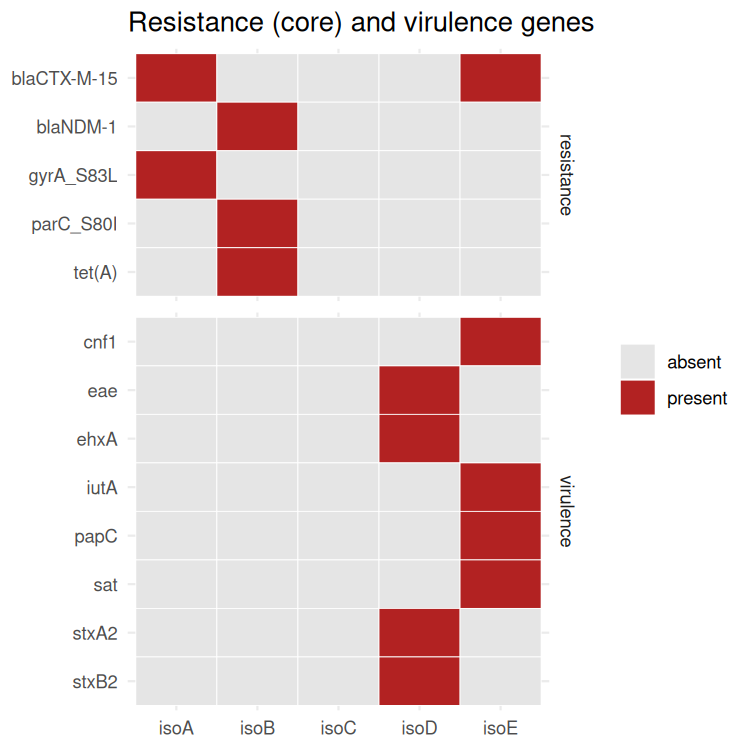

<div dir="rtl">

# درس ۲: پایگاه VFDB با BLAST، ابزارهای گونه‌محور، و نقشه‌ی مقاومت و بیماری‌زایی

**بخش:** `08_AMR_Virulence_Phylogeny` · **ماژول:** `02_Virulence_Factors` · **پیش‌نیاز:** [درس ۱](01_lesson_virulence_amrfinder.md)؛ BLAST وب از ماژول [00/03](../../00_Orientation/03_Web_Tools/)؛ اجرای اسکریپت R از بخش [۰۴](../../04_R_Packages/) · **زمان:** حدود ۶۰ دقیقه · **ابزار:** BLAST+ 2.17.0 (همراه محیط `amr`)، VFDB setA (نسخه‌ی همراه ABRicate، commit `e2064df`، ‏2026-07-18)، R + ggplot2؛ ABRicate و Kleborate از مستندات · **آخرین بازبینی:** 2026-10-24

> **وضعیت:** بخش‌های ۳، ۴ و ۶ ✅ اجرا شده‌اند و خروجی واقعی دارند (هر BLAST کمتر از ۱ ثانیه، نزدیک به ۱۸۵ مگابایت؛ اسکریپت R نزدیک به ۱۷۰ مگابایت). بخش ۵ (ABRicate و Kleborate) ✍️ تنها از مستندات است؛ این دو ابزار روی سرور ما نصب نیستند.

---

## در یک نگاه

**در پایان این درس می‌توانید:**
1. فرق VFDB core (setA) و full (setB) را بگویید.
2. ‏`makeblastdb` و `blastn` را در خط فرمان اجرا کنید و خروجی جدولی (`-outfmt 6`) را بخوانید.
3. همان کار ABRicate را با دست انجام دهید: فیلتر همانندی و پوشش.
4. دو دام BLAST را بشناسید: `-max_target_seqs` و تکه‌تکه شدن هم‌ردیفی.
5. یک نقشه‌ی حرارتی (heatmap) از ژن‌های مقاومت و بیماری‌زایی همه‌ی ایزوله‌ها بسازید.

<div dir="ltr">

```bash
conda activate amr
cd ~/amr
P=~/Bioinformatics_Learning-main/08_AMR_Virulence_Phylogeny/99_scripts_data
```

</div>

---

## ۱. داستان

همکارتان K-12 (همان isoC) را با VFDB بررسی کرده و نگران است: «این سویه‌ی آزمایشگاهی بیش از شصت ژن بیماری‌زایی دارد! مگر بی‌خطر نیست؟» در این درس خودتان این را اجرا می‌کنید و می‌بینید چرا هم او درست می‌گوید و هم K-12 بی‌خطر است.

---

## ۲. مفهوم به زبان ساده: VFDB

‏**VFDB** (Virulence Factor Database، پکن) بزرگ‌ترین پایگاه عامل‌های بیماری‌زایی باکتری‌هاست و دو مجموعه دارد:

| مجموعه | چه دارد |
| :--- | :--- |
| **setA (core)** | تنها عامل‌هایی که نقششان **در آزمایش** نشان داده شده |
| **setB (full)** | ‏setA به‌اضافه‌ی همه‌ی ژن‌های **پیش‌بینی‌شده** و هم‌خانواده |

هر توالی در VFDB به یک **عامل** (VF، برای نمونه «Type 1 fimbriae») و یک **رده** (VFC، برای نمونه «Adherence») پیوند دارد. فرق مهم با AMRFinderPlus: VFDB هر ژنی را که در **یک** سویه‌ی بیماری‌زا نقش داشته می‌آورد، حتی اگر همه‌ی سویه‌های بی‌خطر آن گونه هم داشته باشند (مانند فلاژل).

> 📺 **فیلم:** *Secretion Systems: Types of Virulence factors for microorganisms*: https://www.youtube.com/watch?v=RC5M6J3ixgM
> 📄 **مرجع:** Liu B, Zheng D, Zhou S, Chen L, Yang J (2022). *VFDB 2022: a general classification scheme for bacterial virulence factors.* Nucleic Acids Research 50:D912–D917. https://doi.org/10.1093/nar/gkab1107 · VFDB: http://www.mgc.ac.cn/VFs/

---

## ۳. گام ۱: ساختن پایگاه BLAST از VFDB

**چرا خودمان BLAST می‌زنیم؟** ‏ABRicate با پایگاه `vfdb` دقیقاً همین کار را می‌کند: ‏`blastn` با آستانه‌ی ۸۰٪ همانندی و ۸۰٪ پوشش روی VFDB setA. اگر یک بار آن را با دست انجام دهید، خروجی هر ابزار مبتنی بر BLAST را می‌فهمید. ‏BLAST+ همراه AMRFinderPlus در محیط `amr` نصب شده است.

فایل رسمی VFDB (`VFDB_setA_nt.fas.gz`) از سایت VFDB گرفته می‌شود. سایت VFDB از سرور ما پاسخ نداد؛ پس نسخه‌ای از همان فایل را که ABRicate در مخزن GitHub خود نگه می‌دارد برداشتیم:

<div dir="ltr">

```bash
mkdir -p vfdb
curl -sS -o vfdb/vfdb_setA.fna https://raw.githubusercontent.com/tseemann/abricate/master/db/vfdb/sequences
grep -c ">" vfdb/vfdb_setA.fna
head -1 vfdb/vfdb_setA.fna
```

</div>

**خروجی واقعی:**

<div dir="ltr">

```
4592
>vfdb~~~AAA92657~~~AAA92657~~~ (AAA92657) unknown protein [TraJ (VF0241) - Invasion (VFC0083)] [Escherichia coli]
```

</div>

‏۴۵۹۲ توالی. سرآیند با `~~~` تکه‌تکه شده: نام پایگاه، **نام ژن**، شناسه، و سپس توضیح با نام عامل `[TraJ (VF0241) …]`، رده `(VFC0083)` و گونه.

حالا آن را به **پایگاه BLAST** بدل می‌کنیم. ‏BLAST نمی‌تواند مستقیم در فایل FASTA بگردد؛ نخست یک نمایه (index) می‌سازد:

<div dir="ltr">

```bash
makeblastdb -in vfdb/vfdb_setA.fna -dbtype nucl -out vfdb/vfdb_setA
```

</div>

| بخش | کار |
| :--- | :--- |
| ‏`-in` | فایل FASTA |
| ‏`-dbtype nucl` | توالی‌ها DNA‌اند (برای پروتئین: `prot`) |
| ‏`-out` | پیشوند نام فایل‌های پایگاه |

**خروجی واقعی** (چند سطر میانی، از جمله مسیر کامل، کنار گذاشته شده):

<div dir="ltr">

```
Building a new DB, current time: 10/24/2026 20:10:31
New DB title:  vfdb/vfdb_setA.fna
Sequence type: Nucleotide
Adding sequences from FASTA; added 4592 sequences in 0.0534539 seconds.
```

</div>

با `ls vfdb` چند فایل تازه با پسوندهای `.nhr`، `.nin`، `.nsq` و مانند این‌ها می‌بینید؛ این‌ها خود پایگاه‌اند.

> 📺 **فیلم:** *Antimicrobial Resistance Genes Detection using ABRicate tutorial* (همین منطق BLAST روی پایگاه ژن): https://www.youtube.com/watch?v=cmhuWRorCTg
> 📄 **مرجع:** BLAST Command Line Applications User Manual (NCBI): https://www.ncbi.nlm.nih.gov/books/NBK279690/

---

## ۴. گام ۲: ‏blastn و فیلتر ۸۰/۸۰

<div dir="ltr">

```bash
for i in isoC isoD isoE; do
  blastn -query genomes/$i.fna -db vfdb/vfdb_setA -perc_identity 80 \
      -max_target_seqs 10000 -num_threads 2 \
      -outfmt "6 qseqid qstart qend pident length slen stitle" -out $i.vfdb.tsv
done
wc -l iso[CDE].vfdb.tsv
```

</div>

**تکه‌به‌تکه:**

| بخش | کار |
| :--- | :--- |
| ‏`-query` | ژنوم ما (هر contig یک query) |
| ‏`-db` | پایگاهی که ساختیم |
| ‏`-perc_identity 80` | تنها هم‌ردیفی‌های با همانندی ≥ ۸۰٪ |
| ‏`-max_target_seqs 10000` | بیشینه‌ی توالی‌های پایگاه که برای **هر query** نگه داشته می‌شود (پایین را ببینید) |
| ‏`-outfmt "6 …"` | خروجی جدولی (tab) با همین ستون‌ها: نام contig، آغاز و پایان روی contig، درصد همانندی، **طول هم‌ردیفی**، **طول ژن پایگاه**، سرآیند ژن |

**خروجی واقعی:**

<div dir="ltr">

```
   87 isoC.vfdb.tsv
   92 isoD.vfdb.tsv
  102 isoE.vfdb.tsv
  281 total
```

</div>

هر سطر یک هم‌ردیفی (HSP) است. حالا پوشش را حساب می‌کنیم: ‏`length / slen`. فیلتر ۸۰٪ پوشش را با `awk` می‌گذاریم و نام ژن را (تکه‌ی دوم با جداکننده‌ی `~~~`) جدا می‌کنیم:

<div dir="ltr">

```bash
for i in isoC isoD isoE; do
  awk -F'\t' '$5/$6 >= 0.8' $i.vfdb.tsv | awk -F'~~~' '{print $2}' | sort -u > $i.vf.txt
  echo "$i $(wc -l < $i.vf.txt)"
done
```

</div>

**خروجی واقعی:**

<div dir="ltr">

```
isoC 65
isoD 69
isoE 68
```

</div>

‏**K-12 (isoC) ‏۶۵ ژن VFDB دارد.** کدام گروه‌ها؟

<div dir="ltr">

```bash
awk -F'\t' '$5/$6 >= 0.8' isoC.vfdb.tsv | grep -oE " - [^]]*\(VFC[0-9]+\)\]" | sort | uniq -c | sort -k1,1nr
```

</div>

<div dir="ltr">

```
     23  - Adherence (VFC0001)]
     18  - Nutritional/Metabolic factor (VFC0272)]
     17  - Effector delivery system (VFC0086)]
      7  - Motility (VFC0204)]
      4  - Invasion (VFC0083)]
      3  - Regulation (VFC0301)]
      2  - Immune modulation (VFC0258)]
      1  - Antimicrobial activity/Competitive advantage (VFC0325)]
```

</div>

(این‌ها شمار **سطرهای** هم‌ردیفی‌اند، نه ژن‌های یکتا.) چسبیدن (فیمبریه‌ی نوع ۱، curli)، آهن‌گیری (انتروباکتین)، حرکت (فلاژل)… این‌ها ژن‌های **عمومی** *E. coli*‌اند که هر سویه‌ی روده‌ای دارد. پاسخ داستان: **VFDB می‌گوید «این ژن در جایی به بیماری‌زایی کمک کرده»، نه «این سویه بیماری‌زاست».** برای فهم بیماری‌زایی، باید ژن‌های **ویژه** را ببینید: آن‌هایی که در isoD و isoE هست و در K-12 نیست.

<div dir="ltr">

```bash
cat isoC.vf.txt isoC.vf.txt isoD.vf.txt | sort | uniq -u
cat isoC.vf.txt isoC.vf.txt isoE.vf.txt | sort | uniq -u
```

</div>

‏`isoC.vf.txt` را دو بار می‌آوریم تا هر ژن K-12 دست‌کم دو بار شمرده شود و `uniq -u` تنها ژن‌هایی را نگه دارد که **تنها** در ایزوله‌ی دوم‌اند.

**خروجی واقعی:**

<div dir="ltr">

```
eae
hlyA
stx2A
stx2B
cnf1
iutA
sat
```

</div>

دو نکته‌ی واقعی در این خروجی هست:

**۱. نام‌ها فرق دارند.** ‏`ehxA` (نام AMRFinderPlus) در VFDB `hlyA` نام دارد (همولیزین EHEC)، و `stxA2` در VFDB ‏`stx2A` است. اگر جدول دو ابزار را با نام بسنجید، این‌ها «ناهمخوان» دیده می‌شوند. همان اشتباه رایج ماژول ۰۱ است.

‏**۲. ‏`papC` در isoE گم شد**، در حالی که AMRFinderPlus آن را `EXACTX` یافت. چرا؟

<div dir="ltr">

```bash
grep "~~~papC~~~" isoE.vfdb.tsv | cut -f1-6 | head -3
```

</div>

<div dir="ltr">

```
isoE_PAI	2001	3549	99.290	1549	2511
isoE_PAI	3629	4511	99.773	883	2511
isoE_PAI	3542	3636	100.000	95	2511
```

</div>

‏BLAST هم‌ردیفی ژن ۲۵۱۱ بازی را **سه تکه** کرده است (۱۵۴۹ + ۸۸۳ + ۹۵ باز). آلل papC در VFDB با آلل ما در یک ناحیه‌ی کوتاه فرق دارد و BLAST در همان‌جا هم‌ردیفی را بریده است. فیلتر ساده‌ی ما **هر تکه را جدا** با ۸۰٪ می‌سنجد و هیچ‌کدام از ۸۰٪ نمی‌گذرد (۱۵۴۹ / ۲۵۱۱ = ۶۲٪). ابزارهای بهتر تکه‌ها را با هم می‌شمارند. README خود ABRicate هم هشدار می‌دهد که محاسبه‌ی پوشش آن کاستی‌هایی دارد. **درس:** ژنی که با یک ابزار «نیست»، شاید تنها در محاسبه گم شده باشد؛ پیش از گفتن «ندارد»، خروجی خام را ببینید.

### دام دیگر: `-max_target_seqs`

همین دستور را با `-max_target_seqs 5` روی isoC اجرا کردیم: تنها **۵** سطر (به جای ۸۷). چون کل کروموزوم یک query است و BLAST برای هر query تنها ۵ توالی پایگاه را نگه می‌دارد. این گزینه «۵ بهترین» را هم تضمین نمی‌کند؛ تنها جست‌وجو را زود می‌بُرد. وقتی query یک ژنوم کامل است، این عدد را بزرگ بگذارید.

<details>
<summary>✋ امتحان کن: اگر فیلتر را از ۰٫۸ به ۰٫۶ پایین بیاورید، papC در isoE پیدا می‌شود؟ هزینه‌اش چیست؟</summary>

بله؛ تکه‌ی ۱۵۴۹ بازی (۶۲٪) از ۰٫۶ می‌گذرد. شمار ژن‌های isoE از ۶۸ به ۶۹ می‌رسد و K-12 در همین داده همان ۶۵ می‌ماند (تمرین ۴). ولی در ژنوم‌های واقعی، آستانه‌ی پایین ژن‌های ناقص و خویشاوندهای دور را هم «بودن» می‌شمارد. راه درست، جمع کردن تکه‌های یک ژن است، نه پایین آوردن آستانه برای همه.

</details>

---

## ‏۵. ‏ABRicate و ابزارهای گونه‌محور (از مستندات)

### ‏۵.۱ ‏ABRicate با پایگاه‌های بیماری‌زایی

<div dir="ltr">

```bash
conda activate abricate
abricate --db vfdb genomes/iso*.fna > abricate_vfdb.tsv
abricate --db ecoli_vf genomes/iso*.fna > abricate_ecoli_vf.tsv
abricate --summary abricate_vfdb.tsv > abricate_vfdb_summary.tsv
```

</div>

‏`vfdb` در ABRicate همان **setA** است (اسکریپت `abricate-get_db` فایل `VFDB_setA_nt.fas.gz` را دانلود می‌کند). ‏`ecoli_vf` پایگاه ویژه‌ی *E. coli* است. پیش‌فرض‌ها: ‏`--minid 80` و `--mincov 80` (ماژول ۰۱، درس ۲). **پیش‌بینی (اجرا نشده):** شمار ژن‌ها نزدیک به بخش ۴ این درس خواهد بود ولی شاید دقیقاً یکی نباشد (ABRicate تکه‌ها را جور دیگری می‌شمارد)؛ این را در تمرین ۶ بسنجید.

### ‏۵.۲ ‏Kleborate برای *Klebsiella pneumoniae*

برای برخی گونه‌ها ابزار **گونه‌محور** هست که ژن‌ها را در قالب مفهوم‌های بالینی همان گونه گزارش می‌کند. مشهورترینش **Kleborate** برای کمپلکس *K. pneumoniae* (KpSC) است: گونه، ST، لوکوس‌های بیماری‌زایی (`ybt` یرسینیاباکتین، `clb` کولیباکتین، `iuc` آئروباکتین، `iro` سالموکلین، `rmpADC`)، ژن‌های مقاومت، و آنتی‌ژن‌های K و O. نسخه‌ی ۳ به جای BLAST از minimap2 کار می‌کند. دستور از مستند رسمی:

<div dir="ltr">

```bash
kleborate -a *.fasta.gz -o kleborate_results -p kpsc --trim_headers
```

</div>

‏`-p` یک «پیش‌تنظیم» است: `kpsc`، `kosc` (*K. oxytoca*) یا `escherichia` (که برای *E. coli* تنها MLST و چند ماژول محدود دارد).

‏Kleborate دو **امتیاز** می‌دهد (از مستند رسمی):

| امتیاز بیماری‌زایی | معنا | | امتیاز مقاومت | معنا |
| :---: | :--- | :--- | :---: | :--- |
| 0 | نه ybt، نه clb، نه iuc | | 0 | نه ESBL، نه کارباپنماز |
| 1 | تنها یرسینیاباکتین | | 1 | ‏ESBL بی کارباپنماز |
| 2 | یرسینیاباکتین و کولیباکتین (یا تنها کولیباکتین) | | 2 | کارباپنماز بی مقاومت به کولیستین |
| 3 | آئروباکتین (بی ybt و clb) | | 3 | کارباپنماز با مقاومت به کولیستین |
| 4 | آئروباکتین با یرسینیاباکتین (بی clb) | | | |
| 5 | هر سه | | | |

**هم‌گرایی در *Klebsiella*:** سویه‌ای با امتیاز بیماری‌زایی ۳ یا بیشتر (آئروباکتین، نشانگر hvKp) **و** امتیاز مقاومت ۲ یا ۳ (کارباپنماز)، همان **hvKp مقاوم به کارباپنم** است که سازمان‌های بهداشتی درباره‌اش هشدار داده‌اند. مستند Kleborate می‌گوید آئروباکتین را به این دلیل در امتیاز اولویت می‌دهد که با رشد در خون پیوند دارد و پیش‌بینی‌کننده‌ی قوی‌تری برای فنوتیپ hypervirulent است.

> 📺 **فیلم:** *A genomic surveillance framework and genotyping tool for Klebsiella pneumoniae*: https://www.youtube.com/watch?v=pkOhtPQ2PW0 · *Genomic characterization of emerging carbapenem-resistant Klebsiella pneumoniae*: https://www.youtube.com/watch?v=uL9HwPzZoFg
> 📄 **مرجع:** Lam MMC, Wick RR, Watts SC, Cerdeira LT, Wyres KL, Holt KE (2021). *A genomic surveillance framework and genotyping tool for Klebsiella pneumoniae and its related species complex.* Nature Communications 12:4188. https://doi.org/10.1038/s41467-021-24448-3 · مستند Kleborate: https://kleborate.readthedocs.io/en/latest/ · ABRicate: https://github.com/tseemann/abricate

---

## ۶. گام ۳: نقشه‌ی مقاومت و بیماری‌زایی همه‌ی ایزوله‌ها

حالا جدول‌های AMRFinderPlus هر پنج ایزوله (ماژول ۰۱ و درس ۱) را در یک تصویر می‌گذاریم. اسکریپت R `amr_vir_heatmap.R` سطرهای `core` (مقاومت بالینی) و همه‌ی سطرهای `VIRULENCE` را نگه می‌دارد، ژن‌های پس‌زمینه‌ی K-12 را کنار می‌گذارد، و با ggplot2 (بخش ۰۴) یک heatmap می‌کشد. سطر `stx2a_operon` را هم برمی‌دارد، چون همان `stxA2` و `stxB2` را تکرار می‌کند.

<div dir="ltr">

```bash
conda activate r_packages
Rscript $P/02_Virulence_Factors/scripts/amr_vir_heatmap.R amr_vir \
    isoA.amr.tsv isoB.amr.tsv isoC.amr.tsv isoD.amr.tsv isoE.amr.tsv
cat amr_vir_matrix.tsv
```

</div>

**خروجی واقعی:**

<div dir="ltr">

```
isolates: 5  genes: 13 
written: amr_vir_matrix.tsv amr_vir_heatmap.png 
gene	isoA	isoB	isoC	isoD	isoE
blaCTX-M-15	1	0	0	0	1
blaNDM-1	0	1	0	0	0
gyrA_S83L	1	0	0	0	0
parC_S80I	0	1	0	0	0
tet(A)	0	1	0	0	0
cnf1	0	0	0	0	1
eae	0	0	0	1	0
ehxA	0	0	0	1	0
iutA	0	0	0	0	1
papC	0	0	0	0	1
sat	0	0	0	0	1
stxA2	0	0	0	1	0
stxB2	0	0	0	1	0
```

</div>



**تفسیر:** ‏isoC (K-12) ستونی کاملاً خالی است. ‏isoD تنها ژن‌های بیماری‌زایی STEC را دارد و هیچ ژن مقاومت core ندارد؛ یعنی برای درمان، مقاومت مشکل نیست، ولی خطر HUS هست. ‏isoE تنها ایزوله‌ای است که در **هر دو** پنل خانه‌ی پر دارد: هم‌گرایی. ‏`blaCTX-M-15` در isoA و isoE هست؛ آیا این دو ایزوله خویشاوندند، یا ژن با پلاسمید جابه‌جا شده؟ این پرسش ماژول‌های ۰۳ (پلاسمید) و ۰۴ (فیلوژنی) است.

<details>
<summary>✋ امتحان کن: چرا <code>tet(A)</code> ناقص isoB در نقشه «1» است؟ آیا این درست است؟</summary>

اسکریپت هر سطر `core` را «بودن» می‌شمارد و به Method نگاه نمی‌کند؛ `tet(A)` با `PARTIALX` هم core است. برای گزارش بالینی، بهتر است ژن‌های `PARTIAL…` را با رنگ یا نشانه‌ی جدا نشان دهید. این را در تمرین ۷ (فکری) بررسی می‌کنید.

</details>

> 📺 **فیلم:** دوره‌ی DTU در Coursera، بخش تفسیر ژن‌های مقاومت و بیماری‌زایی: https://www.coursera.org/learn/wgs-bacteria
> 📄 **مرجع:** ggplot2 `geom_tile`: https://ggplot2.tidyverse.org/reference/geom_tile.html

---

## ۷. سه اشتباه رایج

1. **شمردن ژن‌های VFDB به‌عنوان «خطر».** ‏K-12 ‏۶۵ ژن VFDB دارد. ژن‌های ویژه را با سنجیدن با یک کنترل یا با ابزار گونه‌محور جدا کنید.
2. ‏**‏`-max_target_seqs` کوچک برای query بزرگ.** کل کروموزوم یک query است؛ با عدد کوچک، بیشتر ژن‌ها بی هیچ هشداری گم می‌شوند.
3. **باور کردن «نیست» بی نگاه به خروجی خام.** ‏papC به دلیل تکه‌تکه شدن هم‌ردیفی گم شد، نه چون نبود.

---

## 📘 برای کنجکاوها

- ‏BLAST برای هم‌ردیفی‌ها **E-value** هم می‌دهد (ستون `evalue` در `-outfmt 6`). در جست‌وجوی ژن در ژنوم، با آستانه‌ی همانندی و پوشش بالا، E-value در بسیاری از موارد بسیار کوچک است و تصمیم را تغییر نمی‌دهد.
- ‏VFDB یک ابزار وب به نام **VFanalyzer** دارد که برای گونه‌های پرشمار، ژن‌های ویژه را از ژن‌های عمومی جدا می‌کند و تکه‌های ژن را هم با هم می‌شمارد.

---

## جمع‌بندی

- ‏VFDB setA عامل‌های آزموده‌شده را دارد؛ بسیاری از آن‌ها در سویه‌های بی‌خطر هم هستند. ‏K-12: ‏۶۵ ژن.
- ‏`makeblastdb` + `blastn -outfmt 6` + فیلتر `length/slen` همان کاری است که ABRicate می‌کند.
- دو دام: `-max_target_seqs` کوچک، و هم‌ردیفی تکه‌تکه (papC).
- نام یک ژن در پایگاه‌های گوناگون فرق دارد (`ehxA` = `hlyA`).
- ‏Kleborate برای *Klebsiella* امتیاز بیماری‌زایی (۰ تا ۵) و مقاومت (۰ تا ۳) می‌دهد؛ ترکیب بالای هر دو یعنی هم‌گرایی.
- نقشه‌ی حرارتی، isoE را تنها ایزوله‌ی مقاوم و بیماری‌زا نشان داد.

---

## کارت دستورهای این درس

<div dir="ltr">

```bash
makeblastdb -in DB.fna -dbtype nucl -out DB
blastn -query ASM.fna -db DB -perc_identity 80 -max_target_seqs 10000 \
    -outfmt "6 qseqid qstart qend pident length slen stitle" -out ID.hits.tsv
awk -F'\t' '$5/$6 >= 0.8' ID.hits.tsv                 # coverage >= 80 %
cat A.txt A.txt B.txt | sort | uniq -u                # lines only in B
Rscript amr_vir_heatmap.R PREFIX iso*.amr.tsv
```

</div>

---

## واژه‌نامه‌ی درس

| واژه | معنا |
| :--- | :--- |
| ‏VFDB setA / setB | مجموعه‌ی آزموده‌شده (core) / همه‌ی ژن‌های شناخته و پیش‌بینی‌شده (full) |
| ‏VF / VFC | یک عامل بیماری‌زایی / رده‌ی آن در VFDB |
| ‏query / subject | توالی‌ای که می‌جوییم / توالی پایگاه |
| ‏HSP | یک تکه‌ی هم‌ردیفی پیوسته در BLAST؛ یک ژن می‌تواند چند HSP داشته باشد |
| ‏`-outfmt 6` | خروجی جدولی BLAST |
| ‏`makeblastdb` | ساختن نمایه‌ی BLAST از یک FASTA |
| ‏hvKp | ‏*K. pneumoniae* با بیماری‌زایی بالا (hypervirulent) |
| یرسینیاباکتین / آئروباکتین | دو سیدروفور (مولکول آهن‌گیر)؛ نشانگرهای بیماری‌زایی در *Klebsiella* |
| نقشه‌ی حرارتی (heatmap) | جدولی که مقدار هر خانه را با رنگ نشان می‌دهد |

---

## منابع

**مستند و مقاله**
- Liu B, et al. (2022). *VFDB 2022: a general classification scheme for bacterial virulence factors.* Nucleic Acids Research 50:D912–D917. https://doi.org/10.1093/nar/gkab1107 · VFDB: http://www.mgc.ac.cn/VFs/
- Lam MMC, et al. (2021). *A genomic surveillance framework and genotyping tool for Klebsiella pneumoniae and its related species complex.* Nature Communications 12:4188. https://doi.org/10.1038/s41467-021-24448-3
- Kleborate documentation (Usage, KpSC modules): https://kleborate.readthedocs.io/en/latest/ · source: https://github.com/klebgenomics/Kleborate
- ABRicate (README, `abricate-get_db`): https://github.com/tseemann/abricate
- BLAST Command Line Applications User Manual: https://www.ncbi.nlm.nih.gov/books/NBK279690/

**کتاب**
- Wilson BA, Winkler ME, Ho BT (2019). *Bacterial Pathogenesis: A Molecular Approach*, 4th ed. ASM Press.

**فیلم و دوره‌ی آموزشی**
- ‏Coursera: *Whole genome sequencing of bacterial genomes – tools and applications* (DTU): https://www.coursera.org/learn/wgs-bacteria
- ‏edX: دوره‌ای ویژه در edX نیافتیم؛ نزدیک‌ترین: *Microbiology* (SNHU، MicroBachelors): https://www.edx.org/learn/microbiology/southern-new-hampshire-university-microbiology
- ‏YouTube: *Secretion Systems: Types of Virulence factors for microorganisms*: https://www.youtube.com/watch?v=RC5M6J3ixgM
- ‏YouTube: *Antimicrobial Resistance Genes Detection using ABRicate tutorial*: https://www.youtube.com/watch?v=cmhuWRorCTg
- ‏YouTube: *A genomic surveillance framework and genotyping tool for Klebsiella pneumoniae*: https://www.youtube.com/watch?v=pkOhtPQ2PW0
- ‏YouTube: *Genomic characterization of emerging carbapenem-resistant Klebsiella pneumoniae*: https://www.youtube.com/watch?v=uL9HwPzZoFg

<sub>سایت VFDB در 2026-10-24 از سرور ما پاسخ نداد؛ فایل setA از مخزن ABRicate (commit `e2064df`) گرفته شد. امتیازهای Kleborate از `docs/source/kpsc_modules.rst` و دستور از `docs/source/Usage.rst` در مخزن رسمی (2026-10-24) خوانده شد. نشانی‌های فیلم از جست‌وجوی وب‌اند و در وارسی پایان دوره سنجیده می‌شوند.</sub>

</div>
