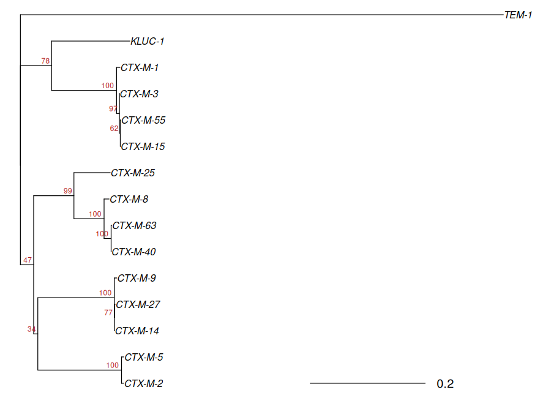

<div dir="rtl">

# درس ۱: هم‌ردیفی چندگانه و نخستین درخت (NJ و bootstrap)

**بخش:** `08_AMR_Virulence_Phylogeny` · **ماژول:** `04_Phylogenetic_Trees` · **پیش‌نیاز:** ماژول‌های [۰۱](../01_AMR_Resistance_Genes/) تا [۰۳](../03_Mobile_Elements_CRISPR/)؛ اجرای اسکریپت R (بخش [۰۴](../../04_R_Packages/)) · **زمان:** حدود ۶۰ دقیقه · **ابزار:** MAFFT 7.525، R با بسته‌ی ape 5.8.1 · **آخرین بازبینی:** 2026-10-24

> ✅ **وضعیت: اجرا شده.** همه‌ی خروجی‌ها واقعی‌اند (2026-10-24). ‏MAFFT روی ۱۵ ژن کمتر از یک ثانیه، و اسکریپت R با ۱۰۰ تکرار bootstrap نزدیک به ۰٫۳ ثانیه و ۱۰۰ مگابایت حافظه.

---

## در یک نگاه

**در پایان این درس می‌توانید:**
1. بگویید هم‌ردیفی چندگانه (MSA) چیست و چرا پایه‌ی هر درخت است.
2. ‏MAFFT را اجرا کنید و خروجی آن را بخوانید.
3. فاصله‌ی ژنتیکی و مدل جایگزینی را به زبان ساده توضیح دهید.
4. با روش NJ درخت بسازید، آن را با یک outgroup ریشه‌دار کنید و bootstrap را تفسیر کنید.
5. یک درخت را بخوانید: خوشه (clade)، طول شاخه و پشتیبانی.

**پیش از آغاز:** یک محیط برای ابزارهای فیلوژنی؛ برای R همان محیط بخش ۰۴ (`r_packages`، که ape و ggtree را دارد):

<div dir="ltr">

```bash
conda create -n phylo -c conda-forge -c bioconda mafft iqtree
mkdir -p ~/phylo && cd ~/phylo
P=~/Bioinformatics_Learning-main/08_AMR_Virulence_Phylogeny/99_scripts_data
cp $P/data/ctxm_alleles.fna .
```

</div>

---

## ۱. داستان

در ماژول ۰۱ با `blaCTX-M-15` آشنا شدید. ولی CTX-M یک **خانواده** است با بیش از ۲۰۰ آلل: CTX-M-14 در شرق آسیا فراوان است و CTX-M-15 در بیشتر جهان. آیا همه‌ی این‌ها از یک نیا آمده‌اند؟ پاسخ را یک درخت می‌دهد. در این درس از ۱۳ آلل CTX-M، ژن **KLUC-1** (بتالاکتاماز کروموزومی باکتری *Kluyvera cryocrescens*) و **TEM-1** (یک بتالاکتاماز دور) درخت می‌سازیم. توالی‌ها از پایگاه AMRFinderPlus (ماژول ۰۱) برداشته شده‌اند.

---

## ۲. مفهوم به زبان ساده

### ۲.۱ هم‌ردیفی چندگانه

پیش از سنجیدن چند توالی، باید بدانیم کدام باز در یک ژن با کدام باز در ژن دیگر **هم‌ریشه** است. هم‌ردیفی چندگانه توالی‌ها را زیر هم می‌چیند و هر جا یکی بازی افزوده یا کم دارد، **شکاف** (`-`) می‌گذارد:

<div dir="ltr">

```
CTX-M-1  ATGGTTAAAAAATCACTGCGT...
TEM-1    ATGAGTATTCAACATTTTC---...---GTGTCG...
                          ↑ شکاف: این ناحیه در TEM-1 نیست
```

</div>

هر **ستون** هم‌ردیفی، یک جایگاه هم‌ریشه است. درخت از روی تفاوت‌های همین ستون‌ها ساخته می‌شود؛ پس هم‌ردیفی بد = درخت بد.

### ۲.۲ فاصله و مدل جایگزینی

ساده‌ترین فاصله، **شمار تفاوت‌ها**ست (p-distance). ولی در یک جایگاه شاید دو جهش پشت سر هم رخ داده باشد (A→G→A) و ما هیچ تفاوتی نبینیم. **مدل‌های جایگزینی** این جهش‌های پنهان را تخمین می‌زنند:

| مدل | فرض |
| :--- | :--- |
| ‏JC69 | همه‌ی جایگزینی‌ها هم‌احتمال‌اند |
| ‏K80 | ‏transition (A↔G، C↔T) و transversion احتمال جدا دارند |
| ‏TN93 | دو نوع transition جدا، و فراوانی بازها نابرابر |

برای ژن‌های خیلی نزدیک، همه‌ی مدل‌ها کمابیش یک نتیجه می‌دهند؛ برای ژن‌های دور (CTX-M در برابر TEM)، مدل اهمیت پیدا می‌کند.

### ‏۲.۳ ‏NJ و bootstrap

‏**Neighbor-Joining (NJ)** ماتریس فاصله را می‌گیرد و گام‌به‌گام دو توالی (یا دو گروه) نزدیک را به هم می‌پیوندد تا یک درخت بسازد. سریع است و برای فاصله‌های «جمع‌پذیر» دقیقاً درخت درست را می‌دهد (درس ۳).

‏**Bootstrap:** ستون‌های هم‌ردیفی را تصادفی و با جایگذاری دوباره برمی‌داریم (هم‌ردیفی تازه‌ای به همان طول)، درخت را دوباره می‌سازیم، و این را ۱۰۰ بار تکرار می‌کنیم. عدد کنار هر گره = چند درصد درخت‌های تکراری همین گروه را داشتند. **تشبیه:** مانند پرسیدن یک پرسش از ۱۰۰ نمونه‌ی تصادفی از داده: اگر ۹۹ تا یک پاسخ دهند، به آن پاسخ اطمینان داریم.

### ۲.۴ ریشه

‏NJ درختی **بی‌ریشه** می‌دهد: می‌گوید چه کسی کنار چه کسی است، ولی نمی‌گوید نیا کجاست. با یک **outgroup** (توالی‌ای که می‌دانیم بیرون از گروه است، این‌جا TEM-1)، ریشه را روی شاخه‌ی آن می‌گذاریم.

> 📺 **فیلم:** *Additive trees and the Neighbor-Joining algorithm* (درس دانشگاهی، با بخش bootstrap): https://www.youtube.com/watch?v=B-oHOoYvE6E · *Multiple Sequence Alignments*: https://www.youtube.com/watch?v=XTmp_uG46Bo
> 📄 **مرجع:** Saitou N, Nei M (1987). *The neighbor-joining method: a new method for reconstructing phylogenetic trees.* Molecular Biology and Evolution 4:406–425. https://doi.org/10.1093/oxfordjournals.molbev.a040454 · Felsenstein J (1985). *Confidence limits on phylogenies: an approach using the bootstrap.* Evolution 39:783–791. https://doi.org/10.1111/j.1558-5646.1985.tb00420.x

---

## ۳. گام ۱: هم‌ردیفی با MAFFT

<div dir="ltr">

```bash
conda activate phylo
grep ">" ctxm_alleles.fna | cut -d' ' -f1 | tr '\n' ' '; echo
mafft --auto ctxm_alleles.fna > ctxm_aln.fna
```

</div>

‏`--auto` یعنی MAFFT خودش بر پایه‌ی شمار و اندازه‌ی توالی‌ها روش را برگزیند. هم‌ردیفی به خروجی استاندارد (`>`) می‌رود و گزارش کار به صفحه (stderr).

**خروجی واقعی** (سطر نخست از `grep`، و پایان گزارش MAFFT):

<div dir="ltr">

```
>CTX-M-1 >CTX-M-3 >CTX-M-15 >CTX-M-55 >KLUC-1 >CTX-M-2 >CTX-M-5 >CTX-M-8 >CTX-M-40 >CTX-M-63 >CTX-M-9 >CTX-M-14 >CTX-M-27 >CTX-M-25 >TEM-1
...
Strategy:
 L-INS-i (Probably most accurate, very slow)
 Iterative refinement method (<16) with LOCAL pairwise alignment information
```

</div>

**توضیح خروجی:** چون کمتر از ۱۶ توالی داریم، MAFFT دقیق‌ترین روش خود، **L-INS-i**، را برگزید («very slow» برای هزاران توالی است؛ این‌جا کمتر از یک ثانیه). هم‌ردیفی ۱۵ توالی با طول **۸۷۸** ستون است: بلندترین ژن ۸۷۶ باز است، پس تنها چند شکاف افزوده شده. ‏۲۲ ستون دست‌کم یک شکاف دارند و ۶۲۰ ستون از ۸۷۸ **متغیر**‌اند؛ بیشتر به خاطر TEM-1 که از CTX-Mها بسیار دور است (بی TEM-1، ‏۴۱۲ ستون متغیر).

<div dir="ltr">

```bash
head -3 ctxm_aln.fna
```

</div>

<div dir="ltr">

```
>CTX-M-1 NG_048897.1 WP_013188473.1 source=AMRFinderPlus_db_2026-08-07.1
atggttaaaaaatcactgcgtcagttcacgctgatggcgacggcaaccgtcacgctgttg
ttaggaagtgtgccgctgtatgcgcaaacggcggacgtacagcaaaaacttgccgaatta
```

</div>

‏MAFFT حروف را کوچک می‌نویسد؛ این تفاوتی ایجاد نمی‌کند.

<details>
<summary>✋ امتحان کن: چرا برای ژن‌های کدکننده‌ی پروتئینِ دور، گاهی هم‌ردیفی را روی پروتئین می‌سازند و سپس به DNA برمی‌گردانند؟</summary>

چون شکاف‌ها در DNA ژن کدکننده باید مضرب ۳ باشند (یک کدون کامل) تا چارچوب خواندن به هم نریزد. هم‌ردیفی پروتئینی این را خودبه‌خود رعایت می‌کند و برای توالی‌های دور دقیق‌تر است، چون اسید آمینه‌ها کندتر از بازها تغییر می‌کنند. ابزارهایی مانند MACSE یا PAL2NAL این کار را انجام می‌دهند. برای CTX-Mهای نزدیک به هم، هم‌ردیفی DNA بس است.

</details>

> 📺 **فیلم:** *Multiple Sequence Alignment using MAFFT* (خط فرمان): https://www.youtube.com/watch?v=DWdD_0G1dBc
> 📄 **مرجع:** Katoh K, Standley DM (2013). *MAFFT multiple sequence alignment software version 7: improvements in performance and usability.* Molecular Biology and Evolution 30:772–780. https://doi.org/10.1093/molbev/mst010 · MAFFT: https://mafft.cbrc.jp/alignment/software/

---

## ۴. گام ۲: فاصله‌ها

پیش از درخت، ببینیم ژن‌ها چقدر با هم فرق دارند. ‏`dist.dna(…, model = "N")` در ape **شمار** تفاوت‌ها را می‌دهد (بی مدل):

<div dir="ltr">

```bash
conda activate r_packages
Rscript -e 'library(ape); a <- read.dna("ctxm_aln.fna", format = "fasta"); rownames(a) <- sub(" .*", "", rownames(a)); k <- c("CTX-M-15","CTX-M-3","CTX-M-1","CTX-M-14","KLUC-1","TEM-1"); print(as.matrix(dist.dna(a, model = "N", pairwise.deletion = TRUE))[k, k])'
```

</div>

**خروجی واقعی:**

<div dir="ltr">

```
         CTX-M-15 CTX-M-3 CTX-M-1 CTX-M-14 KLUC-1 TEM-1
CTX-M-15        0       1      11      230    186   480
CTX-M-3         1       0      10      229    185   479
CTX-M-1        11      10       0      233    186   477
CTX-M-14      230     229     233        0    247   466
KLUC-1        186     185     186      247      0   463
TEM-1         480     479     477      466    463     0
```

</div>

**توضیح خروجی:**
- ‏**CTX-M-15 و CTX-M-3 تنها در ۱ باز** فرق دارند. این همان یک اسید آمینه (Asp240Gly) است که CTX-M-15 را به سفتازیدیم هم مقاوم‌تر می‌کند؛ یک جهش، یک آلل تازه، و یک فنوتیپ تازه.
- ‏CTX-M-15 با CTX-M-14 (گروه دیگر) ‏۲۳۰ باز فرق دارد، ولی با **KLUC-1** تنها ۱۸۶: یعنی CTX-M-15 به ژن کروموزومی *Kluyvera* نزدیک‌تر است تا به برخی CTX-Mهای دیگر.
- ‏TEM-1 با همه نزدیک به ۴۷۰ باز فرق دارد: یک outgroup مناسب.
- ‏`pairwise.deletion = TRUE` یعنی ستون‌های شکاف‌دار برای هر جفت جدا کنار گذاشته می‌شوند.

---

## ۵. گام ۳: درخت NJ با bootstrap

اسکریپت `nj_tree.R` همه‌ی کارها را انجام می‌دهد: فاصله با مدل TN93، درخت NJ، ‏۱۰۰ تکرار bootstrap، ریشه‌دار کردن با outgroup، نوشتن درخت در قالب **Newick**، و کشیدن آن.

<div dir="ltr">

```bash
Rscript $P/04_Phylogenetic_Trees/scripts/nj_tree.R ctxm_aln.fna TEM-1 ctxm_nj
cat ctxm_nj.nwk
```

</div>

| آرگومان | معنا |
| :--- | :--- |
| ‏`ctxm_aln.fna` | هم‌ردیفی |
| ‏`TEM-1` | ‏outgroup برای ریشه |
| ‏`ctxm_nj` | پیشوند خروجی‌ها |
| (پنجم و ششم، اختیاری) | مدل (پیش‌فرض TN93) و شمار bootstrap (پیش‌فرض ۱۰۰) |

**خروجی واقعی:**

<div dir="ltr">

```
sequences: 15  alignment length: 878 
model: TN93  bootstrap replicates: 100 
written: ctxm_nj.nwk ctxm_nj.png 
(((((CTX-M-2:0.003888859453,CTX-M-5:0.004151280329)100:0.145661655,((CTX-M-14:1.718880356e-06,CTX-M-27:0.001142276272)77:0.0003686686432,CTX-M-9:0.004230008622)100:0.1331574161)34:0.007199276177,(((CTX-M-40:8.264266163e-05,CTX-M-63:0.001065292192)100:0.01226650893,CTX-M-8:0.008735278783)100:0.05245224919,CTX-M-25:0.06317308153)99:0.07003880893)47:0.02306523581,((((CTX-M-15:0.0001626250418,CTX-M-55:0.0009818508278)62:0.00147425786,CTX-M-3:-0.000330262708)97:0.005000052417,CTX-M-1:0.005950799019)100:0.113051848,KLUC-1:0.1362695003)78:0.0541905463):0,TEM-1:0.8402174704);
```

</div>

**خواندن Newick:** هر جفت پرانتز یک گروه است؛ `نام:عدد` یعنی طول شاخه (جایگزینی در هر جایگاه)؛ عدد پس از `)` پشتیبانی bootstrap آن گروه است. برای نمونه `(CTX-M-2:0.0039,CTX-M-5:0.0042)100` یعنی CTX-M-2 و CTX-M-5 در ۱۰۰٪ تکرارها کنار هم بودند.



**تفسیر درخت:**

1. **پنج گروه شناخته‌شده‌ی CTX-M** با پشتیبانی بالا پیدا شدند: گروه ۱ (CTX-M-1، -3، -15، -55؛ ‏۱۰۰)، گروه ۲ (CTX-M-2، -5؛ ‏۱۰۰)، گروه ۹ (CTX-M-9، -14، -27؛ ‏۱۰۰)، گروه ۸ (CTX-M-8، -40، -63؛ ‏۱۰۰) و گروه ۲۵ که با گروه ۸ خوشه می‌سازد (۹۹).
2. ‏**KLUC-1 کنار گروه ۱** نشسته (پشتیبانی ۷۸). این با این دیدگاه همخوان است که CTX-Mهای گروه ۱ از کروموزوم *Kluyvera* به پلاسمیدها رفته‌اند. ژن مقاومت پلاسمیدی، در اصل ژن کروموزومی یک باکتری دیگر بوده است (ماژول ۰۳).
3. **گره‌های ژرف ضعیف‌اند:** پیوند گروه ۲ با گروه ۹ (۳۴) و پیوند این دو با گروه ۸/۲۵ (۴۷). یعنی داده‌ی ما ترتیب جدا شدن گروه‌ها را با اطمینان نمی‌گوید. گروه‌ها روشن‌اند، ولی ترتیب شاخه‌شدنشان نه.
4. **یک طول شاخه‌ی منفی:** ‏`CTX-M-3:-0.00033`. ‏NJ گاهی طول منفی می‌دهد، که از نظر زیستی معنا ندارد؛ این‌جا یعنی «کمابیش صفر». روش‌های maximum likelihood (درس ۲) طول منفی نمی‌دهند.
5. **ریشه:** شاخه‌ی TEM-1 بسیار بلند است (۰٫۸۴). گره بی‌عدد کنار ریشه، گره‌ای است که `root()` ساخته؛ پشتیبانی ندارد.

<details>
<summary>✋ امتحان کن: چرا CTX-M-14 و CTX-M-27 با پشتیبانی تنها ۷۷ کنار هم‌اند، در حالی که گروه ۹ پشتیبانی ۱۰۰ دارد؟</summary>

چون سه عضو گروه ۹ بسیار به هم نزدیک‌اند (شاخه‌های کمتر از ۰٫۰۰۵) و تنها چند ستون آن‌ها را از هم جدا می‌کند. در نمونه‌برداری bootstrap، گاهی همین چند ستون انتخاب نمی‌شوند و ترتیب درون گروه عوض می‌شود. اینکه سه‌تایی یک گروه‌اند قطعی است (۱۰۰)؛ اینکه کدام دو تا نزدیک‌ترند، کمتر.

</details>

> 📺 **فیلم:** *Making a Phylogenetic Tree with Bootstrap Support Values in MEGA* (همین مفهوم با نرم‌افزار گرافیکی): https://www.youtube.com/watch?v=xKS5qZwl1GY
> 📄 **مرجع:** Paradis E, Schliep K (2019). *ape 5.0: an environment for modern phylogenetics and evolutionary analyses in R.* Bioinformatics 35:526–528. https://doi.org/10.1093/bioinformatics/bty633 · Bevan ER, Jones AM, Hawkey PM (2017). *Global epidemiology of CTX-M β-lactamases: temporal and geographical shifts in genotype.* Journal of Antimicrobial Chemotherapy 72:2145–2155. https://doi.org/10.1093/jac/dkx146

---

## ۶. سه اشتباه رایج

1. **«پشتیبانی کم = درخت اشتباه».** پشتیبانی کم تنها می‌گوید داده برای **آن گره** بس نیست. گروه‌های پشتیبانی‌شده را گزارش کنید و درباره‌ی گره‌های ضعیف ادعا نکنید.
2. **خواندن درخت از روی ترتیب برگ‌ها.** دو برگ کنار هم در تصویر لزوماً خویشاوند نزدیک نیستند؛ تنها گره مشترک آن‌ها مهم است. شاخه‌ها را می‌توان دور هر گره چرخاند بی آنکه درخت تغییر کند.
3. ‏**outgroup بیش از اندازه دور یا بیش از اندازه نزدیک.** خیلی دور: هم‌ردیفی و ریشه‌گذاری بد. خیلی نزدیک: شاید خودش درون گروه بیفتد. TEM-1 برای CTX-M دور است ولی هنوز هم‌ردیف می‌شود.

---

## 📘 برای کنجکاوها

- راه دیگر ریشه‌گذاری بی outgroup، **midpoint rooting** است: ریشه در میانه‌ی بلندترین مسیر میان دو برگ. فرضش این است که سرعت تکامل در همه‌ی شاخه‌ها کمابیش یکسان است.
- ‏bootstrap در NJ و ML یک معنا دارد، ولی برای ML نسخه‌های سریع‌تری هست (UFBoot، درس ۲) که آستانه‌ی تفسیرشان فرق دارد.

---

## جمع‌بندی

- هم‌ردیفی چندگانه ستون‌های هم‌ریشه را می‌سازد؛ ‏MAFFT برای کمتر از ۱۶ توالی روش L-INS-i را برمی‌گزیند.
- فاصله = شمار تفاوت‌ها، با مدل جایگزینی برای جهش‌های پنهان تصحیح می‌شود.
- ‏NJ سریع است؛ bootstrap اطمینان هر گروه را می‌سنجد؛ outgroup ریشه را می‌دهد.
- درخت CTX-M پنج گروه را با پشتیبانی بالا و KLUC-1 را کنار گروه ۱ نشان داد؛ ترتیب گروه‌ها نامطمئن ماند.

---

## کارت دستورهای این درس

<div dir="ltr">

```bash
mafft --auto genes.fna > genes_aln.fna
Rscript nj_tree.R genes_aln.fna OUTGROUP PREFIX [MODEL] [N_BOOT]      # MODEL: TN93 (default), K80, JC69, N
Rscript -e 'library(ape); a <- read.dna("genes_aln.fna", format = "fasta"); print(as.matrix(dist.dna(a, model = "N")))'
```

</div>

---

## واژه‌نامه‌ی درس

| واژه | معنا |
| :--- | :--- |
| هم‌ردیفی چندگانه (MSA) | چیدن چند توالی زیر هم، به‌طوری که هر ستون یک جایگاه هم‌ریشه باشد |
| شکاف (gap) | جایی که یک توالی بازی کم دارد |
| مدل جایگزینی | فرض‌های آماری درباره‌ی چگونگی جایگزینی بازها |
| ‏transition / transversion | جایگزینی پورین با پورین (A↔G) یا پیریمیدین با پیریمیدین (C↔T) / پورین با پیریمیدین |
| ‏NJ (Neighbor-Joining) | روش ساخت درخت از ماتریس فاصله |
| ‏bootstrap | نمونه‌برداری دوباره از ستون‌ها برای سنجیدن پشتیبانی هر گروه |
| ‏clade | یک نیا و همه‌ی فرزندانش |
| ‏outgroup | توالی بیرون از گروه، برای ریشه‌گذاری |
| ‏Newick | قالب متنی درخت با پرانتز |

---

## منابع

**مستند و مقاله**
- Katoh K, Standley DM (2013). *MAFFT multiple sequence alignment software version 7.* Mol Biol Evol 30:772–780. https://doi.org/10.1093/molbev/mst010
- Saitou N, Nei M (1987). *The neighbor-joining method.* Mol Biol Evol 4:406–425. https://doi.org/10.1093/oxfordjournals.molbev.a040454
- Felsenstein J (1985). *Confidence limits on phylogenies: an approach using the bootstrap.* Evolution 39:783–791. https://doi.org/10.1111/j.1558-5646.1985.tb00420.x
- Paradis E, Schliep K (2019). *ape 5.0.* Bioinformatics 35:526–528. https://doi.org/10.1093/bioinformatics/bty633
- Bevan ER, Jones AM, Hawkey PM (2017). *Global epidemiology of CTX-M β-lactamases.* J Antimicrob Chemother 72:2145–2155. https://doi.org/10.1093/jac/dkx146

**کتاب**
- ‏Felsenstein J (2004). *Inferring Phylogenies*. Sinauer. (فصل‌های روش‌های فاصله‌ای و bootstrap)
- Lemey P, Salemi M, Vandamme AM (eds.) (2009). *The Phylogenetic Handbook*, 2nd ed. Cambridge University Press.

**فیلم و دوره‌ی آموزشی**
- ‏Coursera: *Molecular Evolution (Bioinformatics IV)* (UC San Diego؛ ساختن درخت تکاملی): https://www.coursera.org/learn/molecularevolution
- ‏edX: *Essentials of Genomics and Biomedical Informatics* (IsraelX؛ یک هفته درباره‌ی هم‌ردیفی چندگانه و درخت فیلوژنی): https://www.edx.org/learn/medicine/israelx-essentials-of-genomics-and-biomedical-informatics
- ‏YouTube: *Additive trees and the Neighbor-Joining algorithm*: https://www.youtube.com/watch?v=B-oHOoYvE6E
- ‏YouTube: *Multiple Sequence Alignments*: https://www.youtube.com/watch?v=XTmp_uG46Bo
- ‏YouTube: *Multiple Sequence Alignment using MAFFT*: https://www.youtube.com/watch?v=DWdD_0G1dBc
- ‏YouTube: *Making a Phylogenetic Tree with Bootstrap Support Values in MEGA*: https://www.youtube.com/watch?v=xKS5qZwl1GY

<sub>توالی‌ها از پایگاه AMRFinderPlus 2026-08-07.1 (`99_scripts_data/data/ctxm_alleles.fna`). نشانی‌های فیلم از جست‌وجوی وب در 2026-10-24‌اند؛ در وارسی پایان دوره سنجیده می‌شوند.</sub>

</div>
