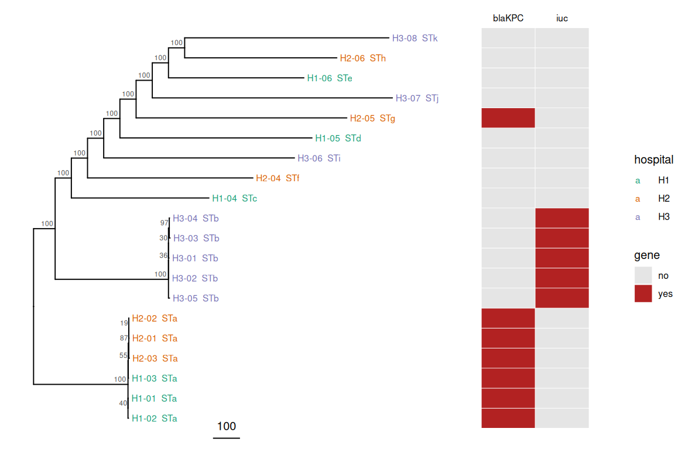

<div dir="rtl">

# درس ۳: درخت شیوع؛ آیا میان بیمارستان‌ها انتقال رخ داده است؟

**بخش:** `08_AMR_Virulence_Phylogeny` · **ماژول:** `04_Phylogenetic_Trees` · **پیش‌نیاز:** درس‌های [۱](01_lesson_msa_nj.md) و [۲](02_lesson_ml_iqtree.md) · **زمان:** حدود ۶۰ دقیقه · **ابزار:** Python، R با ape 5.8.1 و ggtree 4.2.0 · **آخرین بازبینی:** 2026-10-24

> ✅ **وضعیت: اجرا شده.** همه‌ی خروجی‌ها واقعی‌اند (2026-10-24). داده **شبیه‌سازی‌شده** است، با درخت درست معلوم. اسکریپت R روی هم‌ردیفی ۱۰۰ هزار بازی ۲۱ ایزوله نزدیک به ۲ ثانیه و ۲۴۰ مگابایت حافظه.

---

## در یک نگاه

**در پایان این درس می‌توانید:**
1. از یک هم‌ردیفی core genome، جایگاه‌های SNP را جدا و ماتریس فاصله‌ی SNP بسازید.
2. درخت شیوع را بسازید، ریشه‌دار کنید و با metadata (بیمارستان، ST، ژن مقاومت) نمایش دهید.
3. خوشه‌های انتقال را با فاصله‌ی SNP و درخت تشخیص دهید.
4. درخت ساخته‌شده را با درخت درست بسنجید.
5. به سناریوی ۱ ماژول 00/01 پاسخ دهید.

<div dir="ltr">

```bash
cd ~/phylo
P=~/Bioinformatics_Learning-main/08_AMR_Virulence_Phylogeny/99_scripts_data
```

</div>

---

## ۱. داستان

سناریوی ۱ ماژول 00/01 را به یاد بیاورید: **«آزمایشگاهی ۲۰ سویه‌ی *Klebsiella pneumoniae* از سه بیمارستان دارد و می‌خواهد بداند آیا سویه‌ها از یک منشأ مشترک پخش شده‌اند.»** در بیمارستان‌های H1 و H2 چند بیمار با *K. pneumoniae* مقاوم به کارباپنم (KPC) پیدا شده‌اند، و در H3 چند عفونت شدید با سویه‌های hypervirulent. کمیته‌ی کنترل عفونت دو پرسش دارد: (۱) آیا یک سویه میان H1 و H2 جابه‌جا شده؟ (۲) آیا در H3 یک شیوع محلی هست؟

---

## ۲. مفهوم به زبان ساده

### ۲.۱ از ژنوم به SNP

برای ایزوله‌های یک گونه، در بسیاری از موارد همه‌ی ریدها را به یک ژنوم مرجع map می‌کنند (Snippy، ماژول 07/05) و یک **هم‌ردیفی core genome** می‌سازند: هر ایزوله یک ردیف به طول ژنوم مرجع. بیشتر ستون‌ها در همه یکسان‌اند؛ تنها چند هزار ستون **SNP**‌اند. **فاصله‌ی SNP** دو ایزوله = شمار ستون‌هایی که در آن‌ها فرق دارند.

### ۲.۲ چند SNP یعنی «یک شیوع»؟

یک باکتری در سال چند جهش در کل ژنوم می‌گیرد (برای *K. pneumoniae* و *E. coli* در بسیاری از گزارش‌ها از مرتبه‌ی چند SNP در سال). پس دو ایزوله‌ای که در چند ماه از هم جدا شده‌اند، باید تنها **چند** SNP فاصله داشته باشند. بسیاری از پژوهش‌ها برای این گونه‌ها آستانه‌ای نزدیک به **۱۰ تا ۲۰ SNP** به کار می‌برند، ولی **هیچ آستانه‌ی جهانی‌ای نیست**: به گونه، روش ساختن هم‌ردیفی، بازترکیبی و مدت شیوع بستگی دارد. در این درس آستانه‌ی ۱۰ SNP را تنها برای آموزش به کار می‌بریم.

**تشبیه:** فاصله‌ی SNP مانند شمار غلط‌های تایپی است که هر بار رونویسی یک نامه وارد می‌شود. دو نسخه با ۳ غلط متفاوت، از یک رونوشت تازه آمده‌اند؛ دو نسخه با ۸۰۰ غلط متفاوت، قرن‌ها از هم جدا بوده‌اند.

### ۲.۳ داده‌ی این درس

اسکریپت `simulate_outbreak.py` یک «core genome» تصادفی ۱۰۰ هزار بازی را روی یک **درخت معلوم** تکامل می‌دهد: ۲۰ ایزوله با نام‌هایی مانند `H1-01` (بیمارستان ۱، ایزوله‌ی ۱) و یک outgroup به نام `Ref`. هر SNP روی یک جایگاه تازه می‌نشیند، پس فاصله‌ی SNP دو ایزوله **دقیقاً** برابر مجموع طول شاخه‌های میانشان در درخت درست است. درخت درست در `true_tree.nwk` است؛ **تا پایان درس آن را نگاه نکنید.** ‏ST، بودن `blaKPC` و `iuc` (آئروباکتین، ماژول ۰۲) در `metadata.tsv` است.

> 📺 **فیلم:** *Creating and visualizing a phylogenetic tree in Galaxy* (MAFFT ← IQ-TREE ← نمایش با metadata، برای SARS-CoV-2): https://m.youtube.com/watch?v=jQVNsyAnDMo
> 📄 **مرجع:** Schürch AC, Arredondo-Alonso S, Willems RJL, Goering RV (2018). *Whole genome sequencing options for bacterial strain typing and epidemiologic analysis based on single nucleotide polymorphism versus gene-by-gene-based approaches.* Clinical Microbiology and Infection 24:350–354. https://doi.org/10.1016/j.cmi.2017.12.016

---

## ۳. گام ۱: ساختن داده

<div dir="ltr">

```bash
python3 $P/04_Phylogenetic_Trees/scripts/simulate_outbreak.py outbreak
ls outbreak
head -4 outbreak/metadata.tsv
```

</div>

**خروجی واقعی:**

<div dir="ltr">

```
isolates: 21  alignment length: 100000  SNP sites used: 8890
Done: outbreak
core_full.aln  metadata.tsv  true_tree.nwk
isolate	hospital	month	ST	blaKPC	iuc
H1-01	H1	2026-02	STa	yes	no
H1-02	H1	2026-03	STa	yes	no
H1-03	H1	2026-04	STa	yes	no
```

</div>

‏`core_full.aln` نزدیک به ۲ مگابایت است: ‏۲۱ ردیف × ۱۰۰٬۰۰۰ باز. ‏۸۸۹۰ جایگاه در شبیه‌سازی جهش گرفته‌اند. نام STها (`STa`، `STb`، …) ساختگی‌اند.

---

## ۴. گام ۲: ‏SNPها، فاصله‌ها و درخت

اسکریپت `outbreak_tree.R` این کارها را انجام می‌دهد:

1. **جایگاه‌های متغیر** را با `seg.sites()` جدا می‌کند و در `outbreak_nj_snps.fasta` می‌نویسد (همان کاری که snp-sites می‌کند).
2. **ماتریس فاصله‌ی SNP** را با `dist.dna(model = "N")` می‌سازد و در `outbreak_nj_snp_dist.tsv` می‌نویسد.
3. درخت **NJ روی شمار SNP** می‌سازد (پس طول شاخه‌ها به SNP است)، ‏۱۰۰ تکرار bootstrap، و ریشه را روی `Ref` می‌گذارد.
4. با **ggtree** درخت را می‌کشد: رنگ نام = بیمارستان، کنار نام = ST، و دو ستون رنگی برای `blaKPC` و `iuc`. ‏`Ref` برای کشیدن کنار گذاشته می‌شود، چون شاخه‌ی ۱۵۰۰ SNPی آن بقیه‌ی درخت را فشرده می‌کند.

<div dir="ltr">

```bash
conda activate r_packages
Rscript $P/04_Phylogenetic_Trees/scripts/outbreak_tree.R \
    outbreak/core_full.aln outbreak/metadata.tsv Ref outbreak_nj
```

</div>

**خروجی واقعی** (پیش از سطر `written`، چند سطر هشدار ggplot2 درباره‌ی `size`/`linewidth` هم می‌آید که از درون بسته‌ی ggtree است و بر نتیجه اثری ندارد):

<div dir="ltr">

```
isolates: 21  alignment length: 100000  SNP sites: 8890 
written: outbreak_nj_snps.fasta outbreak_nj_snp_dist.tsv outbreak_nj.nwk outbreak_nj.png 
```

</div>

‏`seg.sites()` همان ۸۸۹۰ جایگاه را یافت. پس `outbreak_nj_snps.fasta` تنها ۸۸۹۰ ستون دارد، نه ۱۰۰ هزار (کمتر از ۹٪).



**خواندن تصویر:**
- **سه بخش** در درخت هست: خوشه‌ای از شش ایزوله‌ی **STa** (پایین، H1 و H2، همه `blaKPC`)، خوشه‌ای از پنج ایزوله‌ی **STb** (میانه، همه H3، همه `iuc`)، و ۹ ایزوله‌ی **پراکنده** با شاخه‌های بلند (بالا)، هر کدام با ST جدا.
- شاخه‌های درون دو خوشه آن‌قدر کوتاه‌اند (چند SNP) که در مقیاس ۱۰۰ SNP دیده نمی‌شوند؛ برای دیدنشان باید ماتریس فاصله را خواند (گام ۳).
- ‏**H2-05** هم `blaKPC` دارد، ولی در خوشه‌ی STa نیست: ‏ST دیگری است و با شاخه‌ای بلند جدا افتاده.

---

## ۵. گام ۳: ماتریس فاصله‌ی SNP

<div dir="ltr">

```bash
Rscript -e 'd <- as.matrix(read.delim("outbreak_nj_snp_dist.tsv", row.names = 1, check.names = FALSE)); A <- c("H1-01","H1-02","H1-03","H2-01","H2-02","H2-03"); print(d[A, A]); cat("closest non-STa isolate to H1-01:", min(d["H1-01", !colnames(d) %in% A]), "SNPs\n")'
```

</div>

**خروجی واقعی:**

<div dir="ltr">

```
      H1-01 H1-02 H1-03 H2-01 H2-02 H2-03
H1-01     0     3     3     5     4     6
H1-02     3     0     4     6     5     7
H1-03     3     4     0     4     3     5
H2-01     5     6     4     0     1     3
H2-02     4     5     3     1     0     2
H2-03     6     7     5     3     2     0
closest non-STa isolate to H1-01: 852 SNPs
```

</div>

**توضیح خروجی:** همه‌ی جفت‌های STa، **۷ SNP یا کمتر** فاصله دارند، از جمله جفت‌های **میان دو بیمارستان** (برای نمونه H1-03 و H2-02 تنها ۳ SNP). نزدیک‌ترین ایزوله‌ی غیر STa به H1-01، ‏۸۵۲ SNP فاصله دارد. فاصله‌ی «چند» در برابر «صدها»، مرز روشنی میان شیوع و ایزوله‌های نامرتبط است.

حالا همه‌ی جفت‌های با ۱۰ SNP یا کمتر را بر پایه‌ی بیمارستان می‌شماریم:

<div dir="ltr">

```bash
Rscript -e 'd <- as.matrix(read.delim("outbreak_nj_snp_dist.tsv", row.names = 1, check.names = FALSE)); i <- which(d <= 10 & upper.tri(d), arr.ind = TRUE); print(table(substr(rownames(d)[i[, 1]], 1, 2), substr(colnames(d)[i[, 2]], 1, 2)))'
```

</div>

‏`upper.tri` هر جفت را تنها یک بار می‌شمارد و قطر (فاصله‌ی هر ایزوله با خودش) را کنار می‌گذارد؛ `substr(…, 1, 2)` نام بیمارستان را از نام ایزوله برمی‌دارد.

**خروجی واقعی:**

<div dir="ltr">

```
    
     H1 H2 H3
  H1  3  9  0
  H2  0  3  0
  H3  0  0 10
```

</div>

**توضیح خروجی:** ‏۲۵ جفت نزدیک: ‏۳ جفت درون H1، ‏۳ جفت درون H2، **۹ جفت میان H1 و H2**، و ۱۰ جفت درون H3. هیچ جفت نزدیکی میان H3 و دو بیمارستان دیگر نیست. ‏۱۵ جفت نخست همان ۱۵ جفت شش ایزوله‌ی STa‌اند (۶ × ۵ / ۲)، و ۱۰ جفت H3 همان ۱۰ جفت پنج ایزوله‌ی STb (۵ × ۴ / ۲).

<details>
<summary>✋ امتحان کن: H2-05 هم <code>blaKPC</code> دارد. آیا جزو شیوع STa است؟ اگر نه، <code>blaKPC</code> آن از کجا آمده؟</summary>

نه. فاصله‌ی H2-05 تا H1-01 ‏۱۵۱۲ SNP است (`d["H1-01", "H2-05"]`) و ST آن هم فرق دارد (STg). پس سویه‌ی دیگری است. ‏`blaKPC` آن به احتمال زیاد با یک **پلاسمید** از سویه‌ی STa (یا منبع دیگری) به این سویه رسیده است: همان «شیوع پلاسمیدی» ماژول ۰۳. برای سنجیدن، باید پلاسمید KPC این دو سویه را با هم سنجید (رپلیکون، IS کنار ژن، و بهترین با اسمبلی long-read).

</details>

---

## ۶. گام ۴: جهت انتقال و درخت درست

درخت را دوباره ببینید: درون خوشه‌ی STa، سه ایزوله‌ی H2 یک زیرگروه با پشتیبانی **۸۷** می‌سازند که **درون** تنوع H1 نشسته است (H1-03 نزدیک‌ترین به آن‌هاست). این الگو، همراه با تاریخ‌ها (ایزوله‌های H1 از ماه ۲ تا ۴، ایزوله‌های H2 از ماه ۵ تا ۶؛ ستون `month`)، با **انتقال از H1 به H2** همخوان است، نه برعکس.

حالا درخت ساخته‌شده را با درخت درست می‌سنجیم. ‏`is.monophyletic()` می‌پرسد: «آیا این ایزوله‌ها، و تنها همین‌ها، یک گروه کامل در درخت می‌سازند؟»

<div dir="ltr">

```bash
Rscript -e 'library(ape); t <- read.tree("outbreak_nj.nwk"); tt <- read.tree("outbreak/true_tree.nwk"); A <- c("H1-01","H1-02","H1-03","H2-01","H2-02","H2-03"); B <- paste0("H3-0", 1:5); for (cl in list(A, B, c("H2-01","H2-02","H2-03"))) cat(paste(cl, collapse = ","), " built:", is.monophyletic(t, cl), " true:", is.monophyletic(tt, cl), "\n"); cat("Robinson-Foulds distance:", dist.topo(unroot(t), unroot(tt)), "\n")'
```

</div>

**خروجی واقعی:**

<div dir="ltr">

```
H1-01,H1-02,H1-03,H2-01,H2-02,H2-03  built: TRUE  true: TRUE 
H3-01,H3-02,H3-03,H3-04,H3-05  built: TRUE  true: TRUE 
H2-01,H2-02,H2-03  built: TRUE  true: TRUE 
Robinson-Foulds distance: 4 
```

</div>

**توضیح خروجی:** هر سه گروه مهم (STa، STb و زیرگروه H2) در درخت ساخته‌شده هم هستند، همان‌طور که در درخت درست. پس چرا فاصله‌ی **Robinson-Foulds** (شمار شاخه‌هایی که در یک درخت هستند و در دیگری نه) صفر نیست؟ چون درخت درست چند **چندشاخگی** (polytomy) دارد: برای نمونه در STb، ‏H3-01، H3-02 و H3-05 هم‌زمان از یک نیا جدا شده‌اند. ‏NJ همیشه درخت دوشاخه می‌سازد و این گره‌ها را **دلبخواه** حل می‌کند. پشتیبانی همین گره‌ها در درخت ما پایین است (۱۹، ۳۰، ۳۶، ۴۰). **پشتیبانی پایین اغلب یعنی داده چیزی برای گفتن ندارد؛ و این‌جا واقعاً نداشت.**

اکنون `true_tree.nwk` را باز کنید (`cat outbreak/true_tree.nwk`). طول شاخه‌های درخت ما (`outbreak_nj.nwk`) دقیقاً همان طول‌های درخت درست‌اند (برای نمونه شاخه‌ی ۳۵۰ SNPی خوشه‌ی STa، و ۴۲۰ برای STb)؛ چون فاصله‌های SNP در این شبیه‌سازی کاملاً جمع‌پذیرند و NJ برای چنین فاصله‌هایی درخت درست را می‌دهد. در داده‌ی واقعی، بازترکیبی، خطای توالی‌یابی و هم‌ردیفی ناقص این تطابق را به هم می‌زنند (درس ۲).

---

## ۷. پاسخ به سناریوی ۱

| پرسش | پاسخ | شواهد |
| :--- | :--- | :--- |
| آیا یک سویه میان H1 و H2 جابه‌جا شده؟ | **بله، به احتمال زیاد** | شش ایزوله‌ی STa با ≤ ۷ SNP؛ ۹ جفت نزدیک میان H1 و H2؛ زیرگروه H2 درون تنوع H1 (پشتیبانی ۸۷)؛ ایزوله‌های H1 زودتر |
| آیا در H3 شیوع محلی هست؟ | **بله** | پنج ایزوله‌ی STb با ≤ ۱۰ SNP، همه در H3، همه با `iuc` |
| آیا همه‌ی ۲۰ سویه از یک منشأ‌اند؟ | **نه** | ‏۹ ایزوله‌ی پراکنده با صدها SNP فاصله و ST جدا |
| ‏`blaKPC` در H2-05؟ | انتقال **پلاسمید**، نه سویه | ‏ST دیگر، ‏۱۵۱۲ SNP تا STa |

**یادتان باشد:** ژنوم تنها **خویشاوندی** را نشان می‌دهد. اینکه انتقال از راه دست کارکنان، یک وسیله‌ی پزشکی یا جابه‌جایی بیمار بوده، با **اپیدمیولوژی** (چه کسی، کی، کجا) روشن می‌شود. درخت، پرسش‌های درست را برای آن کار پیش می‌کشد.

> 📺 **فیلم:** دوره‌ی DTU در Coursera (کاربرد WGS در پایش و شیوع): https://www.coursera.org/learn/wgs-bacteria
> 📄 **مرجع:** Yu G, Smith DK, Zhu H, Guan Y, Lam TTY (2017). *ggtree: an R package for visualization and annotation of phylogenetic trees with their covariates and other associated data.* Methods in Ecology and Evolution 8:28–36. https://doi.org/10.1111/2041-210X.12628 · Robinson DF, Foulds LR (1981). *Comparison of phylogenetic trees.* Mathematical Biosciences 53:131–147. https://doi.org/10.1016/0025-5564(81)90043-2

---

## ۸. سه اشتباه رایج

1. **یک آستانه‌ی SNP برای همه.** آستانه به گونه، روش و مدت شیوع بستگی دارد؛ همیشه فاصله‌ها را **همراه با** درخت و اپیدمیولوژی بخوانید.
2. **«همان ژن مقاومت = همان سویه».** ‏H2-05 همان `blaKPC` را دارد ولی سویه‌ی دیگری است.
3. **تفسیر ترتیب درون یک polytomy.** گره‌های با پشتیبانی پایین درون یک شیوع، «چه کسی از چه کسی گرفت» را نمی‌گویند.

---

## 📘 برای کنجکاوها

- برای تخمین «چه کسی از چه کسی»، روش‌هایی مانند **TransPhylo** یا **outbreaker2** درخت و تاریخ نمونه‌برداری را با هم مدل می‌کنند.
- ‏**cgMLST** (شمار آلل‌های متفاوت در صدها ژن core) جایگزین رایج فاصله‌ی SNP در آزمایشگاه‌های بهداشت عمومی است؛ منطق تفسیرش همین است.
- با `ggtree` می‌توان تنها یک خوشه را بزرگ کرد (`viewClade`) یا با `geom_cladelab` روی خوشه‌ها برچسب گذاشت.

---

## جمع‌بندی

- هم‌ردیفی core genome ← جایگاه‌های SNP ← ماتریس فاصله ← درخت ← metadata.
- در داده‌ی شبیه‌سازی‌شده: انتقال STa از H1 به H2، شیوع محلی STb در H3، و ۹ ایزوله‌ی نامرتبط؛ و `blaKPC` در H2-05 از راه پلاسمید.
- ‏NJ روی فاصله‌های جمع‌پذیر، درخت و طول شاخه‌های درست را داد؛ تنها polytomyها دلبخواه حل شدند و پشتیبانی پایین گرفتند.
- ژنوم خویشاوندی را می‌گوید؛ مسیر انتقال را اپیدمیولوژی.

---

## کارت دستورهای این درس

<div dir="ltr">

```bash
python3 simulate_outbreak.py outbreak
Rscript outbreak_tree.R outbreak/core_full.aln outbreak/metadata.tsv Ref outbreak_nj
Rscript -e 'library(ape); is.monophyletic(read.tree("TREE.nwk"), c("TIP1","TIP2"))'
Rscript -e 'library(ape); dist.topo(unroot(read.tree("A.nwk")), unroot(read.tree("B.nwk")))'
iqtree -s outbreak_nj_snps.fasta -m MFP+ASC -B 1000 -alrt 1000 --prefix outbreak_ml   # lesson 2, not run here
```

</div>

---

## واژه‌نامه‌ی درس

| واژه | معنا |
| :--- | :--- |
| ‏core genome alignment | هم‌ردیفی همه‌ی ایزوله‌ها روی بخش مشترک ژنوم |
| فاصله‌ی SNP | شمار جایگاه‌هایی که دو ایزوله در آن‌ها فرق دارند |
| شیوع کلونال / پلاسمیدی | پخش یک سویه / پخش یک پلاسمید میان سویه‌های گوناگون |
| ‏monophyletic | گروهی که یک نیا و **همه‌ی** فرزندانش را دارد |
| ‏polytomy | گره‌ای با بیش از دو شاخه‌ی فرزند |
| ‏Robinson-Foulds | شمار شاخه‌هایی که در یکی از دو درخت هستند و در دیگری نه |
| ‏metadata | داده‌های همراه ایزوله: بیمارستان، تاریخ، ST، ژن‌ها |
| ‏cgMLST | ‏MLST روی صدها ژن core |

---

## منابع

**مستند و مقاله**
- Schürch AC, et al. (2018). *Whole genome sequencing options for bacterial strain typing and epidemiologic analysis based on single nucleotide polymorphism versus gene-by-gene-based approaches.* Clin Microbiol Infect 24:350–354. https://doi.org/10.1016/j.cmi.2017.12.016
- Yu G, et al. (2017). *ggtree.* Methods Ecol Evol 8:28–36. https://doi.org/10.1111/2041-210X.12628
- Paradis E, Schliep K (2019). *ape 5.0.* Bioinformatics 35:526–528. https://doi.org/10.1093/bioinformatics/bty633
- Robinson DF, Foulds LR (1981). *Comparison of phylogenetic trees.* Math Biosci 53:131–147. https://doi.org/10.1016/0025-5564(81)90043-2

**کتاب**
- Lemey P, Salemi M, Vandamme AM (eds.) (2009). *The Phylogenetic Handbook*, 2nd ed. Cambridge University Press.
- Robinson DA, Falush D, Feil EJ (eds.) (2010). *Bacterial Population Genetics in Infectious Disease*. Wiley-Blackwell.

**فیلم و دوره‌ی آموزشی**
- ‏Coursera: *Whole genome sequencing of bacterial genomes – tools and applications* (DTU): https://www.coursera.org/learn/wgs-bacteria
- ‏Coursera: *Molecular Evolution (Bioinformatics IV)* (UC San Diego؛ هفته‌ی ۶: درخت برای ریشه‌یابی یک شیوع ابولا): https://www.coursera.org/learn/molecularevolution
- ‏edX: *Essentials of Genomics and Biomedical Informatics* (IsraelX): https://www.edx.org/learn/medicine/israelx-essentials-of-genomics-and-biomedical-informatics
- ‏YouTube: *Creating and visualizing a phylogenetic tree in Galaxy*: https://m.youtube.com/watch?v=jQVNsyAnDMo

<sub>داده با `simulate_outbreak.py` (seed 2026) ساخته شد؛ md5 فایل‌ها: core_full.aln `10e3624419efe4a40a271a557a8404b9`، metadata.tsv `0e19ef0652f9d6ae0e101e738a24cb4a`، true_tree.nwk `11134bb9a43ab06be7d59b1fbef26706`. نشانی‌های فیلم از جست‌وجوی وب در 2026-10-24‌اند؛ در وارسی پایان دوره سنجیده می‌شوند.</sub>

</div>
