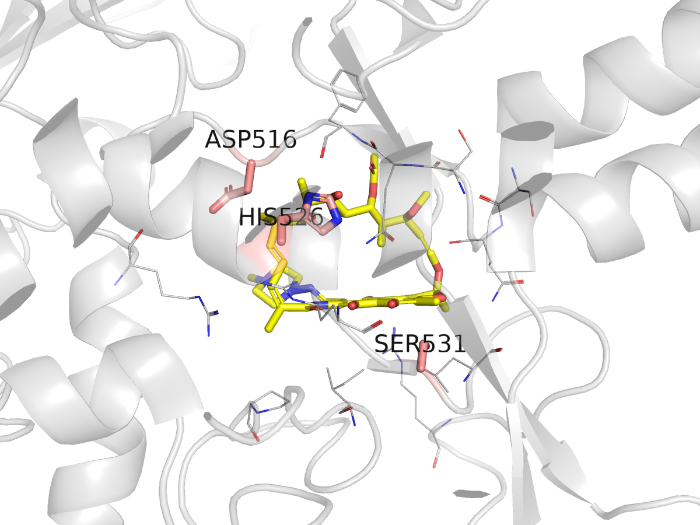

<div dir="rtl">

# درس ۱: ساختار سه‌بعدی پروتئین، بانک PDB و نخستین نگاه به جایگاه ریفامپیسین

**بخش:** `09_Structural_Bioinformatics` · **ماژول:** `01_Protein_Structure` · **پیش‌نیاز:** پایتون (بخش [۰۳](../../03_Python/))؛ ماژول [08/01](../../08_AMR_Virulence_Phylogeny/01_AMR_Resistance_Genes/) (جایگاه‌های rpoB) · **زمان:** حدود ۶۰ دقیقه · **ابزار:** gemmi 0.7.5، PyMOL 3.1.0 (نسخه‌ی متن‌باز) · **آخرین بازبینی:** 2026-10-24

> ✅ **وضعیت: اجرا شده.** همه‌ی خروجی‌ها واقعی‌اند (2026-10-24). هر دستور کمتر از یک ثانیه و کمتر از ۲۳۰ مگابایت حافظه.

---

## در یک نگاه

**در پایان این درس می‌توانید:**
1. سه روش اصلی تعیین ساختار (بلورنگاری پرتو X، cryo-EM و NMR) را از هم جدا کنید و بدانید **وضوح** (resolution) چه می‌گوید.
2. یک ساختار را از PDB دانلود کنید و فرق قالب‌های PDB و mmCIF را بگویید.
3. با پایتون (gemmi) زنجیره‌ها و لیگاندهای یک ساختار را بشمارید و باقی‌مانده‌های پیرامون یک دارو را پیدا کنید.
4. با PyMOL و یک اسکریپت، تصویری تکرارپذیر از جایگاه اتصال دارو بسازید.
5. جهش‌های مقاومت ماژول 08/01 را روی ساختار ببینید.

**پیش از آغاز:** یک محیط برای همه‌ی این بخش (فایل [envs/structural.yml](../../envs/structural.yml)):

<div dir="ltr">

```bash
conda env create -f ~/Bioinformatics_Learning-main/envs/structural.yml
conda activate structural
mkdir -p ~/struct && cd ~/struct
P=~/Bioinformatics_Learning-main/09_Structural_Bioinformatics/99_scripts_data
```

</div>

---

## ۱. داستان

در ماژول 08/01 دیدید AMRFinderPlus در ژن `rpoB` ‏۱۵ جایگاه را می‌سنجد، از جمله `D516`، `H526` و `S531`. جهش در این جایگاه‌ها باکتری را به **ریفامپیسین** مقاوم می‌کند؛ داروی اصلی درمان سل. ولی چرا تنها همین چند جایگاه؟ پاسخ در **شکل سه‌بعدی** پروتئین است: ریفامپیسین درون یک حفره‌ی کوچک در زیرواحد β آنزیم RNA پلیمراز (RNAP) می‌نشیند و این سه اسید آمینه دیواره‌ی همان حفره‌اند. در این درس آن حفره را با چشم خودتان می‌بینید.

---

## ۲. مفهوم به زبان ساده

### ۲.۱ ساختار سه‌بعدی چگونه به دست می‌آید؟

| روش | ایده | مناسب برای | سهم در PDB |
| :--- | :--- | :--- | :--- |
| **بلورنگاری پرتو X** (X-ray) | پروتئین را بلور می‌کنند و از پراش پرتو X نقشه‌ی چگالی الکترون می‌سازند | بیشتر پروتئین‌ها، به شرط بلور شدن | بیشترین |
| **cryo-EM** | هزاران تصویر میکروسکوپ الکترونی از مولکول‌های منجمد را میانگین می‌گیرند | کمپلکس‌های بزرگ (مانند ریبوزوم و RNAP) | رو به رشد سریع |
| **NMR** | از برهم‌کنش هسته‌ها در محلول، فاصله‌ها را می‌سنجند | پروتئین‌های کوچک، در محلول | کم |

**وضوح** (resolution، به آنگستروم، Å) می‌گوید جزئیات نقشه چقدر ریز است: **عدد کوچک‌تر = بهتر**. در ۱٫۵ Å جای تک‌تک اتم‌ها روشن است؛ در ۳٫۸ Å زنجیره‌ی اصلی و شکل کلی زنجیره‌های جانبی دیده می‌شود ولی جای دقیق هر اتم، برآورد مدل‌ساز است. **تشبیه:** عکسی با پیکسل‌های ریز در برابر عکسی تار؛ در عکس تار هنوز چهره را می‌شناسید ولی رنگ چشم را نه.

### ۲.۲ پرونده‌ی ساختار: PDB و mmCIF

یک پرونده‌ی ساختار در اصل **فهرست اتم‌ها با مختصات x، y، z** است، به‌اضافه‌ی اطلاعات تجربی. دو قالب:

- ‏**PDB** (قدیمی، ستون‌های با پهنای ثابت): بیشتر از ۹۹٬۹۹۹ اتم یا ۶۲ زنجیره را نمی‌پذیرد.
- ‏**mmCIF** (قالب استاندارد امروز PDB): بی این محدودیت‌ها. ساختار امروز ما ۵۵ هزار اتم دارد؛ ریبوزوم‌ها بیش از ۲۰۰ هزار.

> 📺 **فیلم:** *Methods for Determining Atomic Structures: X-ray Crystallography* (PDB-101): https://www.youtube.com/watch?v=RUok4O9oovQ · *What is a Protein?* (PDB-101): https://www.youtube.com/watch/wvTv8TqWC48
> 📄 **مرجع:** Berman HM, et al. (2000). *The Protein Data Bank.* Nucleic Acids Research 28:235–242. https://doi.org/10.1093/nar/28.1.235 · راهنمای آموزشی PDB-101: https://pdb101.rcsb.org

---

## ۳. گام ۱: دانلود ساختار RNAP با ریفامپیسین

در PDB چند ساختار از RNA پلیمراز *E. coli* با ریفامپیسین هست. دو تا را برمی‌داریم که از **یک مقاله**‌اند: **5UAC** (آنزیم وحشی) و **5UAL** (همان آنزیم با جهش **S531L**، شایع‌ترین جهش مقاومت به ریفامپیسین در سل).

<div dir="ltr">

```bash
curl -sS -O https://files.rcsb.org/download/5UAC.cif.gz
curl -sS -O https://files.rcsb.org/download/5UAL.cif.gz
ls -lh *.cif.gz
```

</div>

‏`-O` نام فایل را از نشانی برمی‌دارد. ‏`.gz` یعنی فشرده؛ همه‌ی ابزارهای این درس فایل فشرده را مستقیم می‌خوانند. هر فایل نزدیک به ۲٫۸ مگابایت است.

نگاهی به درون فایل (بخش ۰۱: `zcat` و `grep`):

<div dir="ltr">

```bash
zcat 5UAC.cif.gz | grep -m2 "^ATOM"
zcat 5UAC.cif.gz | grep -m2 "^HETATM.*RFP"
zcat 5UAC.cif.gz | grep -c "^ATOM\|^HETATM"
zcat 5UAC.cif.gz | grep -E "^_refine.ls_d_res_high|_refine.ls_R_factor_R_free "
```

</div>

**خروجی واقعی:**

<div dir="ltr">

```
ATOM   1     N  N   . PHE A 1 8    ? 79.257  -0.040   50.820   1.00 157.65 ? 8    PHE A N   1 
ATOM   2     C  CA  . PHE A 1 8    ? 79.676  1.063    49.964   1.00 155.06 ? 8    PHE A CA  1 
HETATM 54985 C  C1  . RFP M 6 .    ? 116.718 26.886   -8.554   1.00 159.40 ? 3001 RFP C C1  1 
HETATM 54986 C  C2  . RFP M 6 .    ? 115.495 26.476   -8.055   1.00 157.57 ? 3001 RFP C C2  1 
55049
_refine.ls_d_res_high                            3.800 
_refine.ls_R_factor_R_free                       0.2955
```

</div>

**توضیح خروجی:**
- هر سطر `ATOM` یک اتم پروتئین است: عنصر (`N`)، نام اتم (`CA` = کربن آلفا)، اسید آمینه (`PHE`)، زنجیره (`A`)، شماره (`8`)، سپس **x، y، z**، اشغال (`1.00`) و **B-factor** (`157.65`).
- ‏`HETATM` اتم‌هایی‌اند که جزو زنجیره‌ی پروتئین نیستند: ‏`RFP` کد سه‌حرفی **ریفامپیسین** در PDB است و به زنجیره‌ی `C` نسبت داده شده.
- ‏**۵۵٬۰۴۹** اتم. وضوح **۳٫۸ Å**، و R-free برابر ۰٫۲۹۵۵ (معیار سنجش مدل با داده‌ای که در ساختن مدل به کار نرفته؛ هر چه کمتر بهتر).
- ‏B-factor نزدیک به ۱۵۰ تا ۱۶۰ بالاست؛ یعنی جای اتم‌ها نامطمئن است، که با وضوح ۳٫۸ Å همخوان است. **این ساختار برای دیدن جای دارو خوب است، ولی برای اندازه‌گیری فاصله‌های دقیق (مانند پیوند هیدروژنی) باید محتاط بود.**

---

## ۴. گام ۲: خواندن ساختار با پایتون (gemmi)

‏**gemmi** یک کتابخانه‌ی پایتون برای خواندن ساختارها (PDB، mmCIF) است. اسکریپت `struct_info.py` زنجیره‌ها و لیگاندها را فهرست می‌کند و اگر نام یک لیگاند را بدهید، باقی‌مانده‌هایی را که کمتر از یک فاصله‌ی معین با آن دارند پیدا می‌کند. برای این کار از `NeighborSearch` در gemmi کار می‌کشد: فضا را به خانه‌های کوچک بخش می‌کند تا لازم نباشد فاصله‌ی همه‌ی ۵۵ هزار اتم با هم سنجیده شود.

<div dir="ltr">

```bash
python3 $P/01_Protein_Structure/scripts/struct_info.py 5UAC.cif.gz RFP 4
```

</div>

**خروجی واقعی:**

<div dir="ltr">

```
entry: 5UAC  method: X-RAY DIFFRACTION  resolution: 3.8 A  models: 1
chain A: 227 residues  first: PHE8
chain B: 214 residues  first: THR6
chain C: 1342 residues  first: MET1
chain D: 1166 residues  first: LEU8
chain E: 89 residues  first: ALA2
chain F: 468 residues  first: THR94
chain G: 224 residues  first: PHE8
chain H: 215 residues  first: THR6
chain I: 1340 residues  first: TYR3
chain J: 1155 residues  first: GLU16
chain K: 79 residues  first: ALA2
chain L: 469 residues  first: THR94
ligands (chain, name, number, atoms): [('C', 'RFP', 3001, 59), ('D', 'MG', 1501, 1), ('D', 'ZN', 1502, 1), ('D', 'ZN', 1503, 1), ('J', 'MG', 1501, 1), ('J', 'ZN', 1502, 1), ('J', 'ZN', 1503, 1)]
residues within 4.0 A of RFP (chain C):
  C SER509  closest 3.6 A
  C GLN510  closest 3.1 A
  C SER512  closest 3.2 A
  C GLN513  closest 3.1 A
  C PHE514  closest 2.8 A
  C ASP516  closest 3.1 A
  C HIS526  closest 3.8 A
  C ARG529  closest 2.7 A
  C SER531  closest 3.2 A
  C LEU533  closest 3.7 A
  C ARG540  closest 3.2 A
  C PRO564  closest 3.9 A
  C ILE572  closest 3.8 A
  C ARG687  closest 3.2 A
```

</div>

**توضیح خروجی:**

1. **دوازده زنجیره = دو نسخه از آنزیم.** بخش `_entity` همین فایل می‌گوید زنجیره‌ها چه پروتئینی‌اند: ‏A و B زیرواحد α، **C زیرواحد β (ژن rpoB)**، D زیرواحد β′، E زیرواحد ω، و F فاکتور σ⁷⁰. ‏G تا L نسخه‌ی دوم همین مجموعه‌اند. بلور در یک «واحد نامتقارن» دو مولکول دارد.
2. **ریفامپیسین تنها در زنجیره‌ی C** است، با ۵۹ اتم (همه‌ی اتم‌های سنگین: ‏C₄₃H₅₈N₄O₁₂ ⇒ ‏۴۳ + ۴ + ۱۲ = ۵۹؛ هیدروژن‌ها در بلورنگاری دیده نمی‌شوند).
3. **زنجیره‌ی C با `MET1` آغاز می‌شود**، پس شماره‌گذاری همان شماره‌گذاری پروتئین *E. coli* است؛ یعنی `SER531` همان `S531` ماژول 08/01 است. (در *M. tuberculosis* همین جایگاه `S450` نام دارد.)
4. **چهارده باقی‌مانده دیواره‌ی جایگاه‌اند، و سه جایگاه مقاومت ماژول 08/01 (D516، H526، S531) همه در این فهرست‌اند.** این توضیح ساختاری آن است که چرا AMRFinderPlus درست همین جایگاه‌ها را می‌سنجد: جهش در دیواره‌ی جایگاه، شکل یا بار حفره را تغییر می‌دهد و دارو کمتر می‌چسبد.
5. ‏`ARG529` با ۲٫۷ Å نزدیک‌ترین است؛ فاصله‌های کمتر از ۳٫۵ Å میان اتم‌های قطبی می‌توانند پیوند هیدروژنی باشند، ولی در وضوح ۳٫۸ Å این را با احتیاط بگویید.

> 📄 **مرجع:** Wojdyr M (2022). *GEMMI: A library for structural biology.* Journal of Open Source Software 7:4200. https://doi.org/10.21105/joss.04200 · مستند gemmi: https://gemmi.readthedocs.io

<details>
<summary>✋ امتحان کن: در 5UAL (جهش S531L) کدام باقی‌مانده‌ها دیگر در فاصله‌ی ۴ Å نیستند و کدام تازه آمده؟</summary>

<div dir="ltr">

```bash
python3 $P/01_Protein_Structure/scripts/struct_info.py 5UAL.cif.gz RFP 4 | tail -13
```

</div>

خروجی واقعی:

<div dir="ltr">

```
residues within 4.0 A of RFP (chain C):
  C GLN510  closest 3.2 A
  C SER512  closest 3.4 A
  C GLN513  closest 3.1 A
  C PHE514  closest 2.6 A
  C ASP516  closest 3.5 A
  C HIS526  closest 3.7 A
  C ARG529  closest 2.4 A
  C LEU531  closest 3.1 A
  C PRO564  closest 3.6 A
  C ILE572  closest 3.9 A
  C ARG687  closest 3.2 A
  C GLN761  closest 4.0 A
```

</div>

جایگاه ۵۳۱ اکنون `LEU` است (جهش دیده می‌شود). ‏`SER509`، `LEU533` و `ARG540` دیگر در فهرست نیستند و `GLN761` تازه آمده است: یعنی دارو در جهش‌یافته کمی **جابه‌جا** نشسته است. به گفته‌ی مقاله‌ی اصلی، جهش S531L هنگام اتصال ریفامپیسین سطح اتصال را «بی‌نظم» می‌کند و همین تمایل دارو را کم می‌کند.

</details>

---

## ۵. گام ۳: تصویر جایگاه با PyMOL

‏**PyMOL** پرکاربردترین نرم‌افزار نمایش ساختار است. می‌توان با موس با آن کار کرد، ولی برای **تکرارپذیری** بهتر است دستورها را در یک اسکریپت (`.pml`) بنویسیم. اسکریپت `rif_pocket.pml`:

- زنجیره‌ی C را به‌صورت **cartoon** نیمه‌شفاف نشان می‌دهد،
- ریفامپیسین را **stick** زرد،
- سه جایگاه مقاومت را stick صورتی با برچسب،
- و باقی‌مانده‌های تا ۴ Å را خط نازک.

<div dir="ltr">

```bash
pymol -cq $P/01_Protein_Structure/scripts/rif_pocket.pml
```

</div>

‏`-c` یعنی بی پنجره (command line) و `-q` یعنی بی پیام آغاز. خروجی فایل `rif_pocket.png` است. چند دستور کلیدی اسکریپت:

<div dir="ltr">

```
select rif, wt and resn RFP                                        # name a selection
select rrdr, wt and chain C and resi 516+526+531
select pocket, byres (wt and chain C and polymer) within 4 of rif  # whole residues within 4 A
util.cnc("rif or rrdr or pocket")                                  # colour N blue, O red
png rif_pocket.png, width=1200, height=900, dpi=150, ray=1
```

</div>



**خواندن تصویر:** ریفامپیسین (کربن زرد) با حلقه‌ی بزرگ («ansa») و هسته‌ی نفتالنی تخت‌اش در حفره نشسته است. ‏`HIS526` و `ASP516` در سوی حلقه‌ی بزرگ‌اند و `SER531` زیر هسته‌ی تخت. این حفره در RNAP روی مسیری است که RNA تازه‌ساخته باید از آن بگذرد؛ ریفامپیسین راه را می‌بندد و رونویسی پس از دو یا سه نوکلئوتید متوقف می‌شود.

<details>
<summary>✋ امتحان کن: چرا اسکریپت `util.cnc` را پس از رنگ کردن زنجیره‌ی C به خاکستری می‌زند؟</summary>

چون ریفامپیسین در این فایل **جزو زنجیره‌ی C** است (`HETATM … RFP C`). دستور `color grey80, wt and chain C` اتم‌های اکسیژن و نیتروژن دارو را هم خاکستری می‌کند. ‏`util.cnc` («color non-carbon») اتم‌های غیر کربن را دوباره به رنگ عنصرشان برمی‌گرداند. ما نخستین بار همین خطا را در تصویر دیدیم و با این خط درستش کردیم.

</details>

> 📺 **فیلم:** *PyMOL 101, Lesson 1: GUI Basics*: https://www.youtube.com/watch?v=2UJ9_cADkek · *PyMOL Tutorials (Long)* (فهرست پخش): https://www.youtube.com/playlist?list=PLZANrlj_zCh9A2G8RdFUnxqojGukq49Q_
> 📄 **مرجع:** PyMOL Wiki (دستورها: select، show، label، png): https://pymolwiki.org · Campbell EA, et al. (2001). *Structural mechanism for rifampicin inhibition of bacterial RNA polymerase.* Cell 104:901–912. https://doi.org/10.1016/S0092-8674(01)00286-0

---

## ۶. سه اشتباه رایج

1. **نادیده گرفتن وضوح.** ساختار ۳٫۸ Å برای «دارو کجاست» خوب است ولی برای «این پیوند هیدروژنی ۲٫۸ Å است» نه. وضوح و R-free را همیشه پیش از تفسیر ببینید.
2. **یکی گرفتن شماره‌گذاری‌ها.** ‏S531 در *E. coli* همان S450 در *M. tuberculosis* است. پیش از سنجیدن، شماره‌گذاری هر ساختار را از نخستین باقی‌مانده و توالی بسنجید.
3. **گمان اینکه همه‌ی زنجیره‌ها یک مولکول‌اند.** 5UAC دو آنزیم کامل در خود دارد و دارو تنها در یکی دیده شده؛ زنجیره‌ی درست را برگزینید.

---

## 📘 برای کنجکاوها

- **واحد نامتقارن** (asymmetric unit) آن چیزی است که در فایل هست؛ **مجموعه‌ی زیستی** (biological assembly) مولکولی است که در سلول کار می‌کند. در RCSB هر دو را می‌توان دانلود کرد.
- ‏**Mol\*** (Molstar) نمایشگر وب RCSB است و بی نصب، همین تصویر را در مرورگر می‌دهد: https://www.rcsb.org/3d-view/5UAC
- ‏ChimeraX نرم‌افزار رایگان دیگری با قدرت بالا برای ساختارهای cryo-EM است.

---

## جمع‌بندی

- ساختار پروتئین با بلورنگاری، cryo-EM یا NMR به دست می‌آید؛ وضوح و B-factor اطمینان به جای اتم‌ها را می‌گویند.
- ‏mmCIF قالب استاندارد است؛ هر سطر `ATOM`/`HETATM` یک اتم با مختصات.
- ساختار 5UAC (۳٫۸ Å) ریفامپیسین را در زیرواحد β نشان می‌دهد؛ ۱۴ باقی‌مانده دیواره‌ی جایگاه‌اند، از جمله D516، H526 و S531.
- اسکریپت PyMOL تصویری تکرارپذیر می‌سازد.

---

## کارت دستورهای این درس

<div dir="ltr">

```bash
curl -sS -O https://files.rcsb.org/download/ID.cif.gz
zcat ID.cif.gz | grep -m2 "^ATOM"
python3 struct_info.py ID.cif.gz LIGAND 4        # chains, ligands, residues within 4 A
pymol -cq script.pml                              # render an image without a window
```

</div>

---

## واژه‌نامه‌ی درس

| واژه | معنا |
| :--- | :--- |
| بلورنگاری پرتو X | تعیین ساختار از پراش پرتو X در بلور پروتئین |
| ‏cryo-EM | میکروسکوپی الکترونی نمونه‌های منجمد |
| وضوح (resolution) | ریزترین جزئیات نقشه‌ی تجربی، به آنگستروم؛ کوچک‌تر = بهتر |
| ‏R-free | معیار سنجش مدل با داده‌ی کنار گذاشته‌شده |
| ‏B-factor | میزان نامطمئنی یا لرزش جای یک اتم |
| ‏mmCIF / PDB | دو قالب پرونده‌ی ساختار |
| ‏HETATM | اتمی که جزو زنجیره‌ی پلیمر نیست (لیگاند، یون، آب) |
| زنجیره (chain) | یک رشته‌ی پلی‌پپتید در پرونده |
| واحد نامتقارن | کوچک‌ترین بخش بلور که با تقارن کل بلور را می‌سازد |
| جایگاه اتصال (binding site) | حفره‌ای که لیگاند در آن می‌نشیند |

---

## منابع

**مقاله و مستند**
- Berman HM, et al. (2000). *The Protein Data Bank.* Nucleic Acids Res 28:235–242. https://doi.org/10.1093/nar/28.1.235
- ‏Molodtsov V, Scharf NT, Stefan MA, Garcia GA, Murakami KS (2017). *Structural basis for rifamycin resistance of bacterial RNA polymerase by the three most clinically important RpoB mutations found in Mycobacterium tuberculosis.* Molecular Microbiology 103:1034–1045. https://doi.org/10.1111/mmi.13606 (ساختارهای 5UAC و 5UAL)
- Campbell EA, et al. (2001). *Structural mechanism for rifampicin inhibition of bacterial RNA polymerase.* Cell 104:901–912. https://doi.org/10.1016/S0092-8674(01)00286-0
- Wojdyr M (2022). *GEMMI.* J Open Source Softw 7:4200. https://doi.org/10.21105/joss.04200
- RCSB PDB: https://www.rcsb.org · PDB-101: https://pdb101.rcsb.org · PyMOL Wiki: https://pymolwiki.org

**کتاب**
- ‏Branden C, Tooze J (1999). *Introduction to Protein Structure*, 2nd ed. Garland Science. (فصل‌های ۱ تا ۲: ساختار پروتئین؛ فصل ۱۸: تعیین ساختار)
- ‏Rhodes G (2006). *Crystallography Made Crystal Clear*, 3rd ed. Academic Press. (فصل‌های وضوح، B-factor و R-free)
- ‏Pevsner J (2015). *Bioinformatics and Functional Genomics*, 3rd ed. Wiley-Blackwell. (فصل ساختار پروتئین)

**فیلم و دوره‌ی آموزشی**
- ‏Coursera: *Drug Discovery* (UC San Diego؛ یک بخش با Stephen Burley، مدیر PDB): https://www.coursera.org/learn/drug-discovery
- ‏edX: *Introduction to Drug Discovery* (EPFLx؛ روش‌های ساختاری و محاسباتی): https://www.edx.org/learn/biology-life-sciences/ecole-polytechnique-federale-de-lausanne-introduction-to-drug-discovery
- ‏YouTube: *Methods for Determining Atomic Structures: X-ray Crystallography* (PDB-101): https://www.youtube.com/watch?v=RUok4O9oovQ
- ‏YouTube: *What is a Protein?* (PDB-101): https://www.youtube.com/watch/wvTv8TqWC48
- ‏YouTube: *PyMOL 101, Lesson 1: GUI Basics*: https://www.youtube.com/watch?v=2UJ9_cADkek

<sub>ساختارها در 2026-10-24 از RCSB دانلود شدند؛ نام زیرواحدها از بخش `_entity` فایل 5UAC، و مقاله از PDBe API و Europe PMC وارسی شد. نشانی‌های فیلم از جست‌وجوی وب‌اند و در وارسی پایان دوره سنجیده می‌شوند.</sub>

</div>
