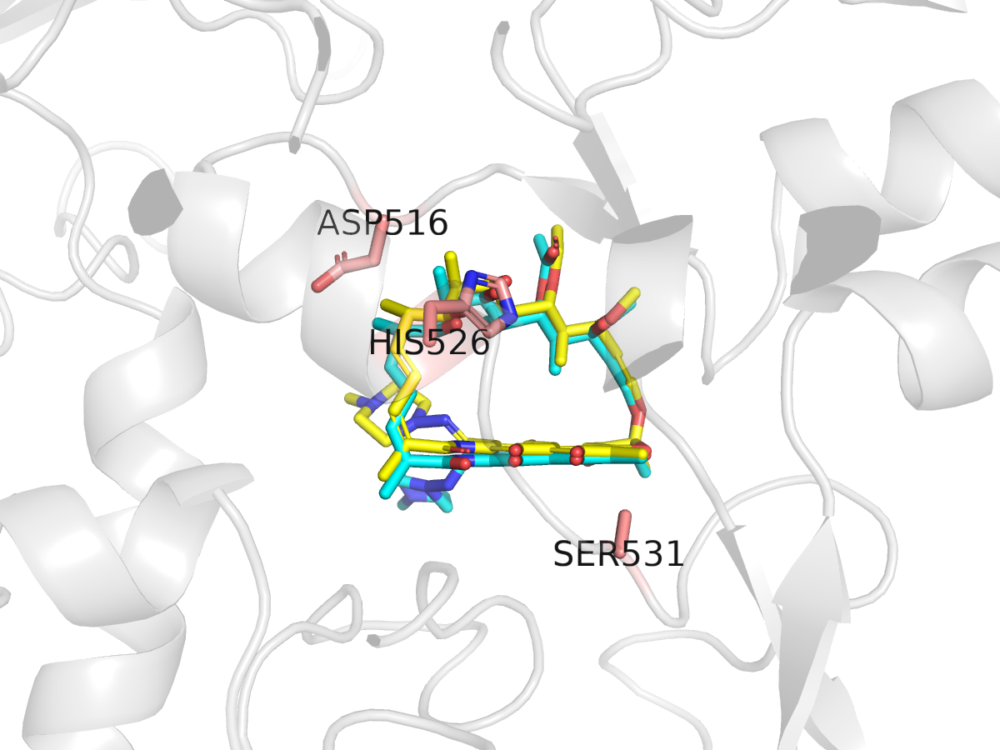

<div dir="rtl">

# درس: داکینگ مولکولی با AutoDock Vina؛ redocking ریفامپیسین و جهش S531L

**بخش:** `09_Structural_Bioinformatics` · **ماژول:** `03_Molecular_Docking` · **پیش‌نیاز:** ماژول‌های [۰۱](../01_Protein_Structure/) و [۰۲](../02_Small_Molecules/) · **زمان:** حدود ۶۰ دقیقه · **ابزار:** AutoDock Vina 1.2.7، Open Babel 3.2.1، PDBFixer 1.12، RDKit، gemmi، PyMOL · **آخرین بازبینی:** 2026-10-24

> ✅ **وضعیت: اجرا شده.** همه‌ی خروجی‌ها واقعی‌اند (2026-10-24).
>
> ⚠️ **حافظه:** هر اجرای Vina با ریفامپیسین (۵۹ اتم سنگین) نزدیک به **۱٫۳ گیگابایت** حافظه و ۱۴ ثانیه زمان گرفت؛ بیشتر از مرز ۱ گیگابایتی که برای این دوره گذاشته‌ایم. ما سنجیدیم: نه کوچک کردن گیرنده، نه کم کردن exhaustiveness و نه شمار هسته‌ها حافظه را کم نکرد؛ همین اجرا با مولکول کوچک تری‌متوپریم ۴۳۴ مگابایت و با اتانول ۳۴۰ مگابایت بود. پس این مقدار از اندازه‌ی خود ریفامپیسین است. بیشتر لپ‌تاپ‌های امروز (۸ گیگابایت) آن را اجرا می‌کنند؛ دیگر گام‌ها کمتر از ۵۰۰ مگابایت‌اند.
>
> **زمان در برابر حافظه (اندازه‌گیری واقعی، 2026-10-25):** حافظه با هیچ تنظیمی کم نشد و همیشه نزدیک به ۱٫۲۷ گیگابایت ماند؛ تنها **زمان** با شمار هسته‌ها عوض می‌شود. همین داکینگ (5UAC، ‏seed ۴۲):
>
> | هسته (`--cpu`) | exhaustiveness | زمان | حافظه | بهترین امتیاز |
> | :---: | :---: | :---: | :---: | :---: |
> | ۱ | ۱ | ۱۰ ثانیه | ۱٫۲۷ گیگابایت | ‏−۹٫۲۰ |
> | ۱ | ۸ | ۷۵ ثانیه | ۱٫۲۷ گیگابایت | ‏−۹٫۱۹ |
> | ۲ | ۸ | ۴۱ ثانیه | ۱٫۲۷ گیگابایت | ‏−۹٫۱۹ |
> | ۴ | ۸ | ۲۱ ثانیه | ۱٫۲۷ گیگابایت | ‏−۹٫۱۹ |
> | ۱۴ (سرور ما) | ۸ | ۱۴ ثانیه | ۱٫۲۷ گیگابایت | ‏−۹٫۱۹ |
> | ۲ | ۳۲ | ۱۵۹ ثانیه | ۱٫۲۷ گیگابایت | ‏−۹٫۱۷ |
>
> پس روی یک لپ‌تاپ چهارهسته‌ای، یک داکینگ کمتر از نیم دقیقه است. دو نکته: (۱) امتیاز با همان seed در هر شمار هسته یکسان ماند (−۹٫۱۸۵)، پس کم کردن هسته‌ها نتیجه را عوض نمی‌کند؛ (۲) اگر چند لیگاند را **هم‌زمان** داک کنید، حافظه هم ضرب می‌شود: دو اجرای موازی یعنی ۲٫۵ گیگابایت.

---

## در یک نگاه

**در پایان این درس می‌توانید:**
1. بگویید داکینگ چه پرسشی را پاسخ می‌دهد و چه پرسشی را نه.
2. گیرنده و لیگاند را از یک ساختار بلوری آماده کنید (پیوندها، هیدروژن، PDBQT).
3. جعبه‌ی جست‌وجو را تعریف و Vina را اجرا کنید و جدول خروجی را بخوانید.
4. روش را با **redocking** و RMSD کمتر از ۲ Å اعتبارسنجی کنید.
5. نتیجه‌ی داکینگ روی پروتئین جهش‌یافته (S531L) را با احتیاط تفسیر کنید.

<div dir="ltr">

```bash
conda activate structural
mkdir -p ~/struct/dock && cd ~/struct/dock
P=~/Bioinformatics_Learning-main/09_Structural_Bioinformatics/99_scripts_data
cp ../5UAC.cif.gz ../5UAL.cif.gz .
```

</div>

---

## ۱. داستان

پیش از آنکه با داکینگ ترکیب **تازه‌ای** را برای RNAP بسنجیم، باید بدانیم روش ما در این جایگاه کار می‌کند یا نه. بهترین آزمون: دارویی را که جای واقعی‌اش را از بلور می‌دانیم (ریفامپیسین در 5UAC) از جایش برداریم، دوباره داک کنیم، و ببینیم آیا Vina آن را **به همان‌جا** برمی‌گرداند. این **redocking** است. سپس همین کار را روی آنزیم جهش‌یافته‌ی **S531L** (5UAL) انجام می‌دهیم.

---

## ۲. مفهوم به زبان ساده

**داکینگ** دو کار انجام می‌دهد:

1. **جست‌وجو** (search): لیگاند را در جعبه‌ای پیرامون جایگاه می‌چرخاند، جابه‌جا می‌کند و پیوندهای چرخانش را می‌پیچاند تا آرایش‌های (pose) گوناگون بسازد.
2. **امتیازدهی** (scoring): برای هر pose با یک تابع ساده (در Vina: جمع جمله‌های دافعه، جاذبه، آب‌گریزی، پیوند هیدروژنی و جریمه‌ی پیوندهای چرخان) یک عدد می‌دهد که **تخمینی** از انرژی آزاد اتصال (kcal/mol) است. منفی‌تر = بهتر.

**تشبیه:** کلید (لیگاند) را در هزاران حالت در قفل (جایگاه) امتحان می‌کنیم و برای هر حالت می‌پرسیم «چقدر جا افتاد؟». پاسخ تقریبی است: تابع امتیاز ساده است، گیرنده **سفت** فرض می‌شود، و آب و آنتروپی به‌طور کامل حساب نمی‌شوند.

**آنچه داکینگ خوب پاسخ می‌دهد:** «لیگاند **کجا و چگونه** می‌نشیند؟» (به شرط اعتبارسنجی). **آنچه خوب پاسخ نمی‌دهد:** «تمایل اتصال **دقیقاً** چقدر است؟» یا «کدام از دو ترکیب نزدیک به هم قوی‌تر است؟». خطای معمول امتیاز Vina در حد ۲ kcal/mol است.

**اعتبارسنجی با redocking:** اگر RMSD بهترین pose با pose بلور **کمتر از ۲ Å** باشد، روش (آماده‌سازی + جعبه + پارامترها) در این جایگاه قابل اعتماد شمرده می‌شود.

> 📺 **فیلم:** *Molecular Docking Using AutoDock Vina* (کل روند، از جمله جعبه): https://www.youtube.com/watch?v=5zI82RCtMag · *AutoDock Vina Tutorial* (خط فرمان): https://www.youtube.com/watch?v=IxHxwTwOeXo
> 📄 **مرجع:** Trott O, Olson AJ (2010). *AutoDock Vina: improving the speed and accuracy of docking with a new scoring function, efficient optimization, and multithreading.* Journal of Computational Chemistry 31:455–461. https://doi.org/10.1002/jcc.21334 · Eberhardt J, Santos-Martins D, Tillack AF, Forli S (2021). *AutoDock Vina 1.2.0: new docking methods, expanded force field, and Python bindings.* J Chem Inf Model 61:3891–3898. https://doi.org/10.1021/acs.jcim.1c00203

---

## ۳. گام ۱: جدا کردن گیرنده و لیگاند

ساختار بلوری **پیوندهای دوگانه** و **هیدروژن** ندارد؛ تنها جای اتم‌های سنگین را دارد. اسکریپت `prep_complex.py`:
- زنجیره‌ی C را بی لیگاند، یون و آب در `5UAC_rec.pdb` می‌نویسد،
- ریفامپیسین را جدا می‌کند و با **RDKit** مرتبه‌ی پیوندها را از SMILES ‏PubChem (ماژول ۰۲) روی اتم‌های بلور کپی می‌کند (`AssignBondOrdersFromTemplate`)، فضاآرایی را از مختصات سه‌بعدی می‌خواند، و هیدروژن‌ها را با مختصات می‌افزاید،
- و مرکز و اندازه‌ی لیگاند را برای جعبه چاپ می‌کند.

<div dir="ltr">

```bash
SMI=$(curl -s "https://pubchem.ncbi.nlm.nih.gov/rest/pug/compound/name/rifampicin/property/SMILES/TXT")
python3 $P/03_Molecular_Docking/scripts/prep_complex.py 5UAC.cif.gz C RFP "$SMI" 5UAC
```

</div>

‏`/TXT` تنها خود SMILES را برمی‌گرداند و `$( … )` آن را در متغیر `SMI` می‌گذارد. **خروجی واقعی** (یک هشدار RDKit، `More than one matching pattern found`، هم می‌آید: برخی گروه‌ها مانند متیل‌های پیپرازین چند جفت‌شدن هم‌ارز دارند؛ بی‌خطر است):

<div dir="ltr">

```
receptor residues: 1342  ligand heavy atoms: 59  with H: 117
crystal stereochemistry matches SMILES: True
ligand centre: 114.680 29.079 -8.026
ligand size (A): 11.6 12.0 12.8
written: 5UAC_rec.pdb 5UAC_lig.mol
```

</div>

**توضیح خروجی:** ‏`crystal stereochemistry matches SMILES: True` یک آزمون مهم است: فضاآرایی ۹ مرکز کایرال در بلور با ریفامپیسین PubChem یکی است، پس مولکول درست را داریم. لیگاند نزدیک به ۱۲ Å است؛ جعبه‌ی ۲۴ Å (دو برابر) جای چرخیدن می‌دهد.

---

## ۴. گام ۲: پروتونه کردن و قالب PDBQT

**گیرنده:** ‏PDBFixer اتم‌های جاافتاده‌ی زنجیره‌های جانبی (در وضوح ۳٫۸ Å کم نیستند) و هیدروژن‌ها را در pH ۷ می‌افزاید؛ سپس Open Babel آن را به PDBQT بدل می‌کند (`-xr` = «گیرنده‌ی سفت»؛ پیوند چرخان ندارد). **لیگاند:** Open Babel نوع اتم‌های AutoDock و پیوندهای چرخان را تعیین می‌کند.

<div dir="ltr">

```bash
pdbfixer 5UAC_rec.pdb --add-atoms=all --keep-heterogens=none --replace-nonstandard --ph=7.0 --output=5UAC_rec_H.pdb
obabel 5UAC_rec_H.pdb -xr -O 5UAC_rec.pdbqt
obabel 5UAC_lig.mol -O 5UAC_lig.pdbqt
grep -c "^ATOM" 5UAC_rec.pdb 5UAC_rec_H.pdb 5UAC_rec.pdbqt
grep "active torsions" 5UAC_lig.pdbqt
```

</div>

**خروجی واقعی** (PDBFixer نزدیک به ۳ ثانیه و ۴۳۵ مگابایت):

<div dir="ltr">

```
1 molecule converted
1 molecule converted
5UAC_rec.pdb:10585
5UAC_rec_H.pdb:21188
5UAC_rec.pdbqt:12988
REMARK  20 active torsions:
```

</div>

**توضیح خروجی:**
- ‏۱۰٬۵۸۵ اتم سنگین ← ‏۲۱٬۱۸۸ با همه‌ی هیدروژن‌ها و اتم‌های جاافتاده ← ‏۱۲٬۹۸۸ در PDBQT. چرا کمتر؟ قالب AutoDock تنها هیدروژن‌های **قطبی** (روی N و O، نوع `HD`) را نگه می‌دارد؛ هیدروژن‌های روی کربن در اتم کربن «ادغام» می‌شوند.
- ‏**۲۰ پیچش فعال** برای لیگاند: پیوندهای OH، متیل‌ها، استات و دنباله‌ی پیپرازین. پیوندهای **درون حلقه‌ی بزرگ** چرخان نیستند؛ پس شکل حلقه‌ی بزرگ همان شکل بلور می‌ماند. این برای redocking خوب است ولی برای داکینگ یک ترکیب تازه محدودیت است (تمرین ۵).
- ستون بار جزئی گیرنده در PDBQT صفر است (`+0.000`)؛ تابع امتیاز Vina جمله‌ی الکتروستاتیک ندارد، پس بار را به کار نمی‌برد.

> 📺 **فیلم:** *Autodock Vina tutorial for Molecular Docking* (آماده‌سازی پروتئین): https://www.youtube.com/watch?v=Z0uEpFnc-as
> 📄 **مرجع:** O'Boyle NM, et al. (2011). *Open Babel: An open chemical toolbox.* Journal of Cheminformatics 3:33. https://doi.org/10.1186/1758-2946-3-33 · Eastman P, et al. (2017). *OpenMM 7: Rapid development of high performance algorithms for molecular dynamics.* PLoS Comput Biol 13:e1005659. https://doi.org/10.1371/journal.pcbi.1005659 (PDBFixer بخشی از پروژه‌ی OpenMM است)

---

## ۵. گام ۳: اجرای Vina

<div dir="ltr">

```bash
vina --receptor 5UAC_rec.pdbqt --ligand 5UAC_lig.pdbqt \
     --center_x 114.680 --center_y 29.079 --center_z -8.026 \
     --size_x 24 --size_y 24 --size_z 24 \
     --exhaustiveness 8 --seed 42 --out 5UAC_docked.pdbqt | tee 5UAC_vina.log
```

</div>

| گزینه | کار |
| :--- | :--- |
| ‏`--center_*` | مرکز جعبه = مرکز لیگاند بلور (گام ۱) |
| ‏`--size_*` | اندازه‌ی جعبه به آنگستروم |
| ‏`--exhaustiveness 8` | چقدر جست‌وجو شود (پیش‌فرض ۸)؛ بیشتر = کندتر و دقیق‌تر |
| ‏`--seed 42` | بذر عدد تصادفی؛ با همان seed، همان نتیجه |
| ‏`--out` | ‏poseها (پیش‌فرض ۹ تا) در یک فایل PDBQT چندمدلی |
| ‏`\| tee 5UAC_vina.log` | خروجی را هم روی صفحه نشان می‌دهد و هم در فایل می‌نویسد |

**خروجی واقعی** (بخش‌هایی از آن؛ سطرهای ارجاع مقاله، نام فایل‌ها، نوار پیشرفت و یک هشدار درباره‌ی شمار هسته‌ها کنار گذاشته شده‌اند؛ ۱۴ ثانیه، ۱٫۳ گیگابایت):

<div dir="ltr">

```
Scoring function : vina
Grid center: X 114.68 Y 29.079 Z -8.026
Grid size  : X 24 Y 24 Z 24
Grid space : 0.375
Exhaustiveness: 8
Computing Vina grid ... done.
Performing docking (random seed: 42) ...

mode |   affinity | dist from best mode
     | (kcal/mol) | rmsd l.b.| rmsd u.b.
-----+------------+----------+----------
   1       -9.185          0          0
   2       -8.232      2.788      4.509
   3       -8.071      2.336      3.003
   4       -7.871          3      8.903
   5       -7.728      3.934       8.69
   6        -7.63      3.226       8.26
   7       -7.628      6.195      10.44
   8       -7.345      4.611      10.37
   9       -7.311      6.566      11.09
```

</div>

**خواندن جدول:** هر سطر یک pose است، به ترتیب امتیاز. ‏`affinity` امتیاز Vina است. ستون‌های `rmsd` فاصله‌ی هر pose با **بهترین pose** (نه با بلور!) است: `l.b.` (کران پایین) و `u.b.` (کران بالا) دو شیوه‌ی جفت کردن اتم‌ها. ‏pose نخست با ‏−۹٫۱۹ kcal/mol بهترین است و بقیه بیش از ۰٫۹ kcal/mol بدترند.

---

## ۶. گام ۴: اعتبارسنجی با RMSD

حالا pose‌ها را با جای **بلوری** می‌سنجیم. Vina ترتیب اتم‌های فایل ورودی را نگه می‌دارد و `5UAC_lig.pdbqt` هنوز مختصات بلور را دارد. پس اسکریپت `rmsd_pdbqt.py` اتم‌های سنگین را به ترتیب جفت می‌کند و RMSD می‌گیرد (بی هم‌پوشانی، چون گیرنده ثابت بود):

<div dir="ltr">

```bash
python3 $P/03_Molecular_Docking/scripts/rmsd_pdbqt.py 5UAC_lig.pdbqt 5UAC_docked.pdbqt
```

</div>

**خروجی واقعی** (ستون‌ها: pose، شمار اتم‌های سنگین، RMSD به Å):

<div dir="ltr">

```
1 59 1.55
2 59 4.93
3 59 2.05
4 59 8.99
5 59 8.27
6 59 8.0
7 59 10.02
8 59 10.37
9 59 10.89
```

</div>

**توضیح خروجی:** **بهترین pose با ۱٫۵۵ Å، زیر مرز ۲ Å است: redocking موفق.** روش در این جایگاه کار می‌کند. ‏pose سوم (۲٫۰۵ Å) هم نزدیک است؛ ‏poseهای ۴ تا ۹ (۸ تا ۱۱ Å) جاهای دیگری در جعبه‌اند.

برای دیدن، اسکریپت `dock_view.pml` pose بلور (زرد) و بهترین pose داک‌شده (فیروزه‌ای) را با هم می‌کشد:

<div dir="ltr">

```bash
pymol -cq $P/03_Molecular_Docking/scripts/dock_view.pml
```

</div>

‏

حلقه‌ی بزرگ و هسته‌ی تخت کمابیش روی هم افتاده‌اند؛ بیشترین فرق در دنباله‌ی پیپرازین (پایین چپ) است که در بلور هم کمترین قطعیت را دارد.

<details>
<summary>✋ امتحان کن: امتیاز pose بلوری بی هیچ جابه‌جایی چقدر است؟ چرا از بهترین pose داک‌شده (−۹٫۱۹) بدتر است؟</summary>

<div dir="ltr">

```bash
vina --receptor 5UAC_rec.pdbqt --ligand 5UAC_lig.pdbqt --center_x 114.680 --center_y 29.079 --center_z -8.026 \
     --size_x 24 --size_y 24 --size_z 24 --score_only | grep "Estimated Free"
```

</div>

خروجی واقعی: `Estimated Free Energy of Binding   : -7.528 (kcal/mol)`. ‏pose بلوری در وضوح ۳٫۸ Å و با گیرنده‌ای که هیدروژن‌هایش را خودمان افزودیم، برای تابع امتیاز Vina «بهینه» نیست؛ Vina pose را کمی (۱٫۵۵ Å) جابه‌جا می‌کند تا امتیاز بهتری بگیرد. این نشان می‌دهد عدد Vina یک امتیاز است، نه انرژی واقعی.

</details>

---

## ۷. گام ۵: جهش S531L (5UAL)

همه‌ی گام‌ها را برای 5UAL تکرار می‌کنیم. مرکز لیگاند در این ساختار فرق دارد (ساختار در قاب مختصات دیگری است)؛ آن را از خروجی `prep_complex.py` برمی‌داریم.

<div dir="ltr">

```bash
python3 $P/03_Molecular_Docking/scripts/prep_complex.py 5UAL.cif.gz C RFP "$SMI" 5UAL
pdbfixer 5UAL_rec.pdb --add-atoms=all --keep-heterogens=none --replace-nonstandard --ph=7.0 --output=5UAL_rec_H.pdb
obabel 5UAL_rec_H.pdb -xr -O 5UAL_rec.pdbqt
obabel 5UAL_lig.mol -O 5UAL_lig.pdbqt
C5="--center_x -111.796 --center_y -28.977 --center_z -7.824 --size_x 24 --size_y 24 --size_z 24"
vina --receptor 5UAL_rec.pdbqt --ligand 5UAL_lig.pdbqt $C5 --score_only | grep "Estimated Free"
vina --receptor 5UAL_rec.pdbqt --ligand 5UAL_lig.pdbqt $C5 --exhaustiveness 8 --seed 42 --out 5UAL_docked.pdbqt
python3 $P/03_Molecular_Docking/scripts/rmsd_pdbqt.py 5UAL_lig.pdbqt 5UAL_docked.pdbqt
```

</div>

**خروجی واقعی** (بخش‌های کلیدی):

<div dir="ltr">

```
receptor residues: 1332  ligand heavy atoms: 59  with H: 117
crystal stereochemistry matches SMILES: True
ligand centre: -111.796 -28.977 -7.824
Estimated Free Energy of Binding   : -5.498 (kcal/mol) [=(1)+(2)+(3)-(4)]
   1       -7.952          0          0
   2       -7.784      2.889      7.855
   3        -7.64      3.727      8.459
   4       -7.542      3.601      8.671
   5       -7.411      2.832      8.306
1 59 8.42
2 59 8.17
3 59 4.69
4 59 2.27
5 59 1.56
```

</div>

**سنجش دو ساختار:**

| | ‏5UAC (وحشی) | 5UAL (S531L) |
| :--- | :---: | :---: |
| امتیاز pose بلوری (`--score_only`) | ‏−۷٫۵۳ | ‏−۵٫۵۰ |
| بهترین امتیاز داکینگ | ‏−۹٫۱۹ | ‏−۷٫۹۵ |
| ‏RMSD بهترین pose با بلور | ‏**۱٫۵۵ Å** (موفق) | ‏**۸٫۴۲ Å** (ناموفق) |
| ‏pose نزدیک به بلور | رتبه‌ی ۱ | رتبه‌ی ۵ (۱٫۵۶ Å، ‏−۷٫۴۱) |

**تفسیر محتاطانه:**
1. در جهش‌یافته هم امتیاز pose بلوری و هم بهترین امتیاز داکینگ **ضعیف‌تر** است. این **همسو** با مقاله‌ی اصلی است: به گفته‌ی چکیده‌ی آن، S531L هنگام اتصال ریفامپیسین سطح اتصال را بی‌نظم می‌کند و تمایل دارو را کم می‌کند.
2. در جهش‌یافته Vina **pose درست را در رتبه‌ی نخست نمی‌گذارد**؛ pose نزدیک به بلور تنها ۰٫۵ kcal/mol از بهترین pose بدتر است. یعنی در این جایگاه بی‌نظم‌تر، تابع امتیاز توان جدا کردن pose درست را ندارد.
3. **آنچه نمی‌توانیم بگوییم:** «جهش، اتصال را ۱٫۲ kcal/mol (یا ۲ kcal/mol) ضعیف کرده است». تفاوت‌ها در حد خطای Vina‌اند، ساختارها وضوح ۳٫۸ تا ۳٫۹ Å دارند، و گیرنده سفت فرض شده. داکینگ یک **فرضیه** می‌دهد؛ سنجش واقعی، آزمایش اتصال یا MIC است.

### ۷.۱ آیا جست‌وجوی بیشتر کمک می‌کند؟

هر دو ساختار را با `--exhaustiveness 32` و `--cpu 2` دوباره اجرا کردیم (نزدیک به سه دقیقه برای هر کدام؛ حافظه همان ۱٫۳ گیگابایت):

| | وحشی (5UAC) | جهش‌یافته (5UAL) |
| :--- | :---: | :---: |
| بهترین امتیاز | ‏−۹٫۱۷ | ‏−۷٫۹۴ |
| ‏RMSD ‏pose نخست | ۱٫۵۵ Å | ۸٫۴۳ Å |
| نزدیک‌ترین pose به بلور | رتبه‌ی ۲: **۱٫۰۰ Å** (−۸٫۹۹) | رتبه‌ی ۶: ۱٫۵۶ Å (−۷٫۴۱) |
| شمار poseهای زیر ۲ Å | ۳ (رتبه‌های ۱، ۲ و ۵) | ۱ (رتبه‌ی ۶) |

دو یافته:

1. **در وحشی، جست‌وجوی بیشتر pose بهتری پیدا کرد** (۱٫۰۰ Å در برابر ۱٫۵۵ Å با exhaustiveness ۸)، ولی تابع امتیاز آن را **دوم** گذاشت؛ تنها ۰٫۱۸ kcal/mol بدتر از pose نخست. یعنی جست‌وجو کار خود را کرد و **رده‌بندی** ضعیف بود.
2. **در جهش‌یافته، چهار برابر جست‌وجو هم pose درست را بالا نیاورد** (رتبه‌ی ۵ با exhaustiveness ۸، رتبه‌ی ۶ با ۳۲). پس مشکل «کم بودن جست‌وجو» نیست.

**نکته‌ی کاربردی:** اگر redocking شما شکست خورد، پیش از بالا بردن exhaustiveness بپرسید مشکل از جست‌وجوست یا از امتیازدهی. اگر pose درست در فهرست هست ولی رتبه‌ی نخست نیست، جست‌وجو درست کار کرده و بالا بردن آن کمکی نمی‌کند؛ باید تابع امتیاز دیگری (مانند Vinardo) یا روشی فراتر از داکینگ را آزمود.

> 📺 **فیلم:** *Molecular Docking Tutorial: AutoDock Vina*: https://www.youtube.com/watch?v=-Rv6jiEBsuI
> 📄 **مرجع:** Molodtsov V, et al. (2017). Mol Microbiol 103:1034–1045. https://doi.org/10.1111/mmi.13606 · مستند AutoDock Vina: https://autodock-vina.readthedocs.io

---

## ۸. سه اشتباه رایج

1. **داکینگ بی redocking.** بی آنکه بدانید روش در آن جایگاه pose درست را می‌دهد، امتیاز یک ترکیب تازه بی‌معناست.
2. **خواندن امتیاز به‌عنوان انرژی دقیق.** ‏−۹٫۱۹ در برابر −۸٫۹ یعنی «تفاوتی نمی‌دانیم». برای رده‌بندی ترکیب‌ها، تنها تفاوت‌های بزرگ و تکرارپذیر را جدی بگیرید.
3. **جعبه‌ی نادرست.** جعبه باید جایگاه را بپوشاند. جعبه‌ی جابه‌جا شده، pose و امتیاز نادرست می‌دهد بی آنکه Vina هیچ هشداری بدهد (تمرین ۳).

---

## 📘 برای کنجکاوها

- ‏**Meeko** (گروه Forli، سازندگان Vina 1.2) ابزار توصیه‌شده‌ی امروز برای ساختن PDBQT است و می‌تواند **حلقه‌های بزرگ را منعطف** کند: https://github.com/forlilab/Meeko
- ‏**Vinardo** یک تابع امتیاز دیگر در همان برنامه است (`--scoring vinardo`). ‏**smina** و **gnina** (با شبکه‌ی عصبی) شاخه‌های دیگر Vina‌اند.
- برای حرکت گیرنده و آب، پس از داکینگ دینامیک مولکولی (ماژول ۰۴) و روش‌های انرژی آزاد (مانند MM/GBSA یا FEP) به کار می‌روند؛ این‌ها در دوره‌ی جداگانه‌ی بیوانفورماتیک ساختاری آمده‌اند.

---

## جمع‌بندی

- داکینگ = جست‌وجو + امتیازدهی؛ امتیاز تخمینی است و گیرنده سفت.
- آماده‌سازی: مرتبه‌ی پیوند از SMILES، هیدروژن با PDBFixer/RDKit، PDBQT با Open Babel.
- ‏redocking ریفامپیسین در 5UAC: ‏۱٫۵۵ Å، موفق.
- در S531L امتیازها ضعیف‌تر و pose درست در رتبه‌ی ۵؛ همسو با مقاله، ولی اندازه‌ی اثر را نمی‌توان از داکینگ گفت.

---

## کارت دستورهای این درس

<div dir="ltr">

```bash
python3 prep_complex.py STRUCT.cif.gz CHAIN LIG "$SMILES" PREFIX
pdbfixer PREFIX_rec.pdb --add-atoms=all --keep-heterogens=none --replace-nonstandard --ph=7.0 --output=PREFIX_rec_H.pdb
obabel PREFIX_rec_H.pdb -xr -O PREFIX_rec.pdbqt
obabel PREFIX_lig.mol -O PREFIX_lig.pdbqt
vina --receptor R.pdbqt --ligand L.pdbqt --center_x X --center_y Y --center_z Z \
     --size_x 24 --size_y 24 --size_z 24 --exhaustiveness 8 --seed 42 --out docked.pdbqt
vina ... --score_only                                   # score a given pose
python3 rmsd_pdbqt.py L.pdbqt docked.pdbqt              # redocking RMSD per pose
```

</div>

---

## واژه‌نامه‌ی درس

| واژه | معنا |
| :--- | :--- |
| داکینگ (docking) | پیش‌بینی جای و آرایش اتصال یک لیگاند در جایگاه یک پروتئین |
| ‏pose | یک جای و آرایش معین لیگاند |
| تابع امتیاز (scoring function) | فرمولی که برای هر pose عددی مانند انرژی اتصال می‌دهد |
| جعبه‌ی جست‌وجو (grid box) | فضایی که لیگاند در آن جست‌وجو می‌شود |
| ‏exhaustiveness | شدت جست‌وجو در Vina |
| ‏redocking | داک کردن دوباره‌ی لیگاند بلوری برای اعتبارسنجی |
| پروتونه کردن | افزودن هیدروژن‌ها در یک pH معین |
| هیدروژن قطبی | هیدروژن روی N یا O، که در پیوند هیدروژنی شرکت می‌کند |
| گیرنده‌ی سفت (rigid receptor) | فرض اینکه اتم‌های پروتئین هنگام داکینگ تکان نمی‌خورند |

---

## منابع

**مقاله و مستند**
- Trott O, Olson AJ (2010). *AutoDock Vina.* J Comput Chem 31:455–461. https://doi.org/10.1002/jcc.21334
- Eberhardt J, et al. (2021). *AutoDock Vina 1.2.0.* J Chem Inf Model 61:3891–3898. https://doi.org/10.1021/acs.jcim.1c00203
- O'Boyle NM, et al. (2011). *Open Babel.* J Cheminform 3:33. https://doi.org/10.1186/1758-2946-3-33
- Eastman P, et al. (2017). *OpenMM 7.* PLoS Comput Biol 13:e1005659. https://doi.org/10.1371/journal.pcbi.1005659
- Molodtsov V, et al. (2017). Mol Microbiol 103:1034–1045. https://doi.org/10.1111/mmi.13606
- AutoDock Vina documentation: https://autodock-vina.readthedocs.io · Meeko: https://github.com/forlilab/Meeko

**کتاب**
- ‏Leach AR (2001). *Molecular Modelling: Principles and Applications*, 2nd ed. Pearson. (فصل داکینگ و طراحی دارو بر پایه‌ی ساختار)
- ‏Leach AR, Gillet VJ (2007). *An Introduction to Chemoinformatics*, revised ed. Springer. (فصل غربالگری مجازی و داکینگ)

**فیلم و دوره‌ی آموزشی**
- ‏Coursera: *Drug Discovery* (UC San Diego): https://www.coursera.org/learn/drug-discovery
- ‏edX: *Introduction to Drug Discovery* (EPFLx؛ داکینگ و غربالگری مجازی): https://www.edx.org/learn/biology-life-sciences/ecole-polytechnique-federale-de-lausanne-introduction-to-drug-discovery
- ‏YouTube: *Molecular Docking Using AutoDock Vina*: https://www.youtube.com/watch?v=5zI82RCtMag
- ‏YouTube: *AutoDock Vina Tutorial*: https://www.youtube.com/watch?v=IxHxwTwOeXo
- ‏YouTube: *Molecular Docking Tutorial: AutoDock Vina*: https://www.youtube.com/watch?v=-Rv6jiEBsuI
- ‏YouTube: *Autodock Vina tutorial for Molecular Docking*: https://www.youtube.com/watch?v=Z0uEpFnc-as

<sub>چکیده‌ی مقاله‌ی Molodtsov 2017 در 2026-10-24 از Europe PMC خوانده شد. نشانی‌های فیلم از جست‌وجوی وب‌اند و در وارسی پایان دوره سنجیده می‌شوند.</sub>

</div>
