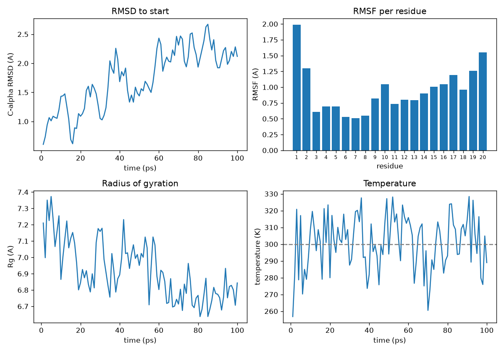

<div dir="rtl">

# درس: دینامیک مولکولی؛ پروتئین در حال حرکت

**بخش:** `09_Structural_Bioinformatics` · **ماژول:** `04_Molecular_Dynamics_Intro` · **پیش‌نیاز:** ماژول‌های [۰۱](../01_Protein_Structure/) تا [۰۳](../03_Molecular_Docking/)؛ پایتون (بخش [۰۳](../../03_Python/)) · **زمان:** حدود ۶۰ دقیقه · **ابزار:** OpenMM 8.6.1، mdtraj 1.11.1، matplotlib؛ GROMACS از مستندات · **آخرین بازبینی:** 2026-10-25

> ✅ **وضعیت: اجرا شده.** همه‌ی خروجی‌ها واقعی‌اند (2026-10-25). هر شبیه‌سازی ۱۰۰ پیکوثانیه با دو نخ CPU نزدیک به **۱۹۰ ثانیه** و **۳۳۶ مگابایت** حافظه گرفت؛ تحلیل یک ثانیه و ۱۹۱ مگابایت. پس این ماژول روی هر لپ‌تاپی اجرا می‌شود.
>
> **این درس مقدماتی است.** هدفش این است که بفهمید MD چه می‌گوید و خروجی‌اش را چگونه بخوانید، نه اینکه شبیه‌سازی پژوهشی بسازید. شبیه‌سازی جدی (آب صریح، چند صد نانوثانیه، چند تکرار، GPU) موضوع دوره‌ی جداگانه‌ی بیوانفورماتیک ساختاری است.

---

## در یک نگاه

**در پایان این درس می‌توانید:**
1. بگویید میدان نیرو، گام زمانی و ترموستات چه کار می‌کنند.
2. فرق آب صریح و آب ضمنی را با عدد توضیح دهید.
3. یک شبیه‌سازی کوتاه را اجرا کنید: کمینه‌سازی انرژی، سپس دینامیک در ۳۰۰ کلوین.
4. ‏RMSD، RMSF، شعاع چرخش و دما را حساب و تفسیر کنید.
5. **نویز را از یافته جدا کنید:** بگویید کدام نتیجه‌ی شبیه‌سازی کوتاه قابل اعتماد است و کدام نه.

<div dir="ltr">

```bash
conda activate structural
mkdir -p ~/struct/md && cd ~/struct/md
P=~/Bioinformatics_Learning-main/09_Structural_Bioinformatics/99_scripts_data
export OPENMM_CPU_THREADS=2      # keep two cores free for other work
```

</div>

---

## ۱. داستان

در ماژول ۰۱ یک ساختار **ایستا** دیدیم و در ماژول ۰۳ داکینگی انجام دادیم که در آن پروتئین **سفت** بود. ولی پروتئین واقعی در آب شناور است و پیوسته می‌لرزد، می‌پیچد و باز و بسته می‌شود. وقتی مقاله‌ی ساختار 5UAL می‌گوید جهش S531L جایگاه را «بی‌نظم» می‌کند، دارد درباره‌ی همین حرکت حرف می‌زند؛ چیزی که نه در عکس بلور پیداست و نه در داکینگ. **دینامیک مولکولی** (MD) همین حرکت را شبیه‌سازی می‌کند.

---

## ۲. مفهوم به زبان ساده

### ۲.۱ ایده‌ی اصلی: قانون دوم نیوتن، میلیون‌ها بار

‏MD بسیار ساده است: برای هر اتم نیروی وارد از همه‌ی اتم‌های دیگر را حساب می‌کند، با `F = ma` شتاب را می‌گیرد، اتم‌ها را یک **گام زمانی** کوچک جلو می‌برد، و این را میلیون‌ها بار تکرار می‌کند.

| جزء | چیست | در این درس |
| :--- | :--- | :--- |
| **میدان نیرو** (force field) | مجموعه‌ای از فرمول‌ها و عددها برای انرژی پیوند، زاویه، پیچش، واندروالس و بار | ‏Amber14 (ff14SB) |
| **گام زمانی** (time step) | هر گام چند فمتوثانیه جلو برویم | ۲ فمتوثانیه |
| **ترموستات** | دما را روی مقدار دلخواه نگه می‌دارد | ‏Langevin در ۳۰۰ کلوین |
| **قید** (constraint) | پیوندهای هیدروژن را ثابت نگه می‌دارد تا گام ۲ فمتوثانیه‌ای ممکن شود | ‏`HBonds` |

**چرا گام باید این‌قدر کوچک باشد؟** سریع‌ترین حرکت در پروتئین، ارتعاش پیوند C–H است که نزدیک به ۱۰ فمتوثانیه دوره دارد. گام باید چند برابر کوچک‌تر از سریع‌ترین حرکت باشد، وگرنه شبیه‌سازی می‌پاشد. با ثابت کردن پیوندهای هیدروژن (`HBonds`)، سریع‌ترین حرکت کندتر می‌شود و گام ۲ فمتوثانیه‌ای مجاز می‌شود.

**پیامدش را ببینید:** برای ۱۰۰ پیکوثانیه (یک ده‌هزارم میکروثانیه) به **۵۰٬۰۰۰ گام** نیاز داریم. بیشتر رویدادهای زیستی جالب (باز شدن یک حلقه، جدا شدن یک دارو، تاخوردن) در مقیاس میکروثانیه تا میلی‌ثانیه‌اند. همین شکاف، بزرگ‌ترین محدودیت MD است.

> 📺 **فیلم:** *Intro to Molecular Dynamics: Coding MD From Scratch* (ایده‌ی پایه با کد ساده): https://www.youtube.com/watch?v=ChQbBqndwIA
> 📄 **مرجع:** Maier JA, et al. (2015). *ff14SB: Improving the accuracy of protein side chain and backbone parameters from ff99SB.* Journal of Chemical Theory and Computation 11:3696–3713. https://doi.org/10.1021/acs.jctc.5b00255

### ۲.۲ آب: صریح یا ضمنی؟

پروتئین در خلأ رفتار درستی ندارد؛ آب لازم است. دو راه:

- **آب صریح** (explicit): هزاران مولکول آب واقعی در یک جعبه. درست‌تر، ولی گران.
- **آب ضمنی** (implicit): آب را با یک فرمول ریاضی جایگزین می‌کنیم که اثر میانگین آن را می‌دهد. ارزان‌تر و ساده‌تر، ولی تقریبی‌تر؛ در آن اثرهایی مانند پل آبی میان دارو و پروتئین از دست می‌رود.

**عدد واقعی** (سنجش ما روی همین پروتئین کوچک درس، 2026-10-25):

| | آب ضمنی (OBC2) | آب صریح (TIP3P) |
| :--- | :---: | :---: |
| شمار اتم‌ها | **۳۰۴** | **۴۸۱۰** (۱۴۹۹ مولکول آب) |
| اندازه‌ی جعبه | ندارد | ۳٫۷۵ × ۳٫۷۵ × ۳٫۷۵ نانومتر |
| زمان ۱۰۰ پیکوثانیه (دو نخ CPU) | ۱۹۰ ثانیه | ۵ تا ۶ دقیقه (برآورد از اجرای ۱ پیکوثانیه‌ای: ۳ تا ۳٫۴ ثانیه) |

نکته‌ی جالب: با اینکه آب صریح **۱۶ برابر** اتم بیشتر دارد، تنها نزدیک به ۱٫۶ برابر کندتر بود. دلیلش این است که آب ضمنی OBC2 **برش ندارد** و برهم‌کنش هر جفت اتم را حساب می‌کند، در حالی که آب صریح با PME و برش ۱ نانومتری کار می‌کند. برای پروتئین‌های بزرگ‌تر این نسبت عوض می‌شود. ما در این درس آب ضمنی را برمی‌گزینیم چون جعبه، یون و مرحله‌ی تعادل NPT را لازم ندارد و درس را ساده نگه می‌دارد.

> 📄 **مرجع:** Onufriev A, Bashford D, Case DA (2004). *Exploring protein native states and large-scale conformational changes with a modified generalized Born model.* Proteins 55:383–394. https://doi.org/10.1002/prot.20033 (مدل OBC که این‌جا به کار بردیم)

### ۲.۳ داده‌ی این درس: کوچک‌ترین پروتئین ممکن

شبیه‌سازی زیرواحد β آنزیم RNA پلیمراز (ماژول ۰۱) از توان این درس بیرون است: آن زنجیره به‌تنهایی ۲۱٬۱۸۸ اتم دارد (ماژول ۰۳) و با آب صریح، **برآورد سرانگشتی** بیش از صد هزار اتم می‌شود؛ چنین کاری GPU و روزها زمان می‌خواهد.

به جایش **Trp-cage** را برمی‌داریم: یک مینی‌پروتئین ۲۰ اسیدآمینه‌ای که در آزمایشگاه طراحی شده و کوچک‌ترین توالی شناخته‌شده‌ای است که ساختار پایدار می‌گیرد. ساختار آن `1L2Y` است، همان ساختار NMR با ۳۸ مدل که در تمرین ۳ ماژول ۰۱ دیدید.

> 📄 **مرجع:** Neidigh JW, Fesinmeyer RM, Andersen NH (2002). *Designing a 20-residue protein.* Nature Structural Biology 9:425–430. https://doi.org/10.1038/nsb798

---

## ۳. گام ۱: اجرای شبیه‌سازی

اسکریپت `md_run.py` این کارها را انجام می‌دهد: خواندن مدل نخست ساختار، افزودن هیدروژن‌ها، ساختن سامانه با Amber14 و آب ضمنی، **کمینه‌سازی انرژی**، و سپس ۱۰۰ پیکوثانیه دینامیک در ۳۰۰ کلوین با ثبت یک فریم در هر پیکوثانیه.

<div dir="ltr">

```bash
curl -sS -O https://files.rcsb.org/download/1L2Y.pdb
python3 $P/04_Molecular_Dynamics_Intro/scripts/md_run.py 1L2Y.pdb trpcage 100 1
```

</div>

آرگومان‌ها: فایل ورودی، پیشوند خروجی، **۱۰۰** پیکوثانیه، و **۱** بذر عدد تصادفی.

**خروجی واقعی:**

<div dir="ltr">

```
atoms: 304  residues: 20
potential energy before / after minimisation: -2431.2 / -2629.5 kJ/mol
100 ps (50000 steps) in 189 s
written: trpcage_start.pdb trpcage.dcd trpcage_log.csv
```

</div>

**توضیح خروجی:**
- ‏۲۰ باقی‌مانده با همه‌ی هیدروژن‌ها = ۳۰۴ اتم.
- **کمینه‌سازی انرژی** پیش از دینامیک لازم است: ساختار تجربی ممکن است چند برخورد اتمی کوچک داشته باشد و اگر همان‌طور گرم شود، نیروهای بزرگ شبیه‌سازی را می‌پاشانند. انرژی از ‏−۲۴۳۱ به **−۲۶۲۹** کیلوژول بر مول رسید؛ یعنی ساختار کمی شل شد.
- ‏۵۰٬۰۰۰ گام در ۱۸۹ ثانیه، یعنی نزدیک به ۲۶۵ گام در ثانیه.

نگاهی به گزارش دما و انرژی:

<div dir="ltr">

```bash
head -3 trpcage_log.csv
```

</div>

<div dir="ltr">

```
#"Step","Time (ps)","Potential Energy (kJ/mole)","Temperature (K)"
500,1.0000000000000007,-1797.8518205735465,256.8059665670375
1000,2.0000000000000013,-1743.5653612134256,281.8164157592522
```

</div>

دما از صفر آغاز می‌شود و در چند پیکوثانیه به پیرامون ۳۰۰ کلوین می‌رسد (ترموستات Langevin). انرژی پتانسیل از −۲۶۲۹ (پس از کمینه‌سازی، در صفر کلوین) بالا رفته، چون اتم‌ها اکنون انرژی جنبشی دارند. **این بخش آغازین «تعادل» (equilibration) است و در تحلیل نباید با بقیه یکی شمرده شود.**

> 📺 **فیلم:** *Exercise: The Basics of OpenMM Molecular Dynamics Simulations*: https://www.youtube.com/watch?v=0LFewVljxVY · *Molecular Dynamics Simulation Using Free GPU on Google Colab*: https://www.youtube.com/watch?v=F-SsbOw2YrM
> 📄 **مرجع:** Eastman P, et al. (2017). *OpenMM 7: Rapid development of high performance algorithms for molecular dynamics.* PLoS Computational Biology 13:e1005659. https://doi.org/10.1371/journal.pcbi.1005659 · راهنمای OpenMM: http://docs.openmm.org/latest/userguide/

---

## ۴. گام ۲: تحلیل مسیر

اسکریپت `md_analysis.py` با کتابخانه‌ی **mdtraj** چهار چیز را حساب می‌کند:

| معیار | پرسش |
| :--- | :--- |
| ‏**RMSD** نسبت به ساختار آغازین | «پروتئین چقدر از جای نخست خود دور شده؟» |
| ‏**RMSF** هر باقی‌مانده | «کدام بخش‌ها بیشتر می‌لرزند؟» |
| **شعاع چرخش** (Rg) | «پروتئین جمع است یا باز شده؟» |
| **دما** | «ترموستات کار کرده؟» |

<div dir="ltr">

```bash
python3 $P/04_Molecular_Dynamics_Intro/scripts/md_analysis.py \
    trpcage_start.pdb trpcage.dcd trpcage_log.csv trpcage
```

</div>

**خروجی واقعی** (یک هشدار mdtraj درباره‌ی `CRYST1` ساختگی هم می‌آید؛ بی‌خطر است، چون جعبه‌ای نداریم):

<div dir="ltr">

```
frames: 100  C-alpha atoms: 20
temperature: mean 301.1 K (sd 16.1)
RMSD to start: mean of 2nd half 2.12 A, max 2.67 A
radius of gyration: mean 6.92 A (sd 0.17)
most mobile residues (RMSF): ASN1 1.99 A, SER20 1.55 A, LEU2 1.30 A
written: trpcage_analysis.png trpcage_rmsf.tsv
```

</div>



**خواندن نمودارها:**

1. **دما** (پایین راست) پیرامون ۳۰۰ کلوین می‌لرزد با میانگین ۳۰۱٫۱ و انحراف ۱۶٫۱ کلوین. این نوسان **عادی و درست** است: در سامانه‌ای با ۳۰۴ اتم، نوسان دما بزرگ است (نوسان نسبی با ریشه‌ی شمار اتم‌ها کم می‌شود). ترموستات دما را **به‌طور میانگین** نگه می‌دارد، نه در هر لحظه.
2. ‏**RMSD** (بالا چپ) از صفر آغاز می‌شود، در ۴۰ پیکوثانیه‌ی نخست بالا می‌رود و سپس پیرامون ۲ آنگستروم می‌ماند. دو آنگستروم برای یک پروتئین ۲۰ تایی یعنی «ساختار کلی پابرجاست ولی جزئیات تکان خورده». **اگر RMSD پیوسته بالا می‌رفت**، یا شبیه‌سازی به تعادل نرسیده بود یا پروتئین داشت باز می‌شد.
3. ‏**RMSF** (بالا راست) الگوی روشنی دارد: دو سر زنجیره (باقی‌مانده‌های ۱، ۲، ۱۹ و ۲۰) بیشترین لرزش را دارند و میانه‌ی پروتئین (۶ تا ۸) کمترین. این همان چیزی است که انتظار داریم: سرها آزادند و هسته بسته است. همین الگو را در pLDDT مدل AlphaFold ماژول ۰۱ هم دیدیم (کمترین اطمینان در دو سر زنجیره).
4. **شعاع چرخش** (پایین چپ) پیرامون ۶٫۹ آنگستروم می‌ماند؛ پروتئین جمع مانده و باز نشده است.

> 📺 **فیلم:** *Molecular Dynamics Simulation in Python – Theory Part 1*: https://www.youtube.com/watch?v=x38CCEERl-Q
> 📄 **مرجع:** McGibbon RT, et al. (2015). *MDTraj: A modern open library for the analysis of molecular dynamics trajectories.* Biophysical Journal 109:1528–1532. https://doi.org/10.1016/j.bpj.2015.08.015

---

## ۵. گام ۳: مهم‌ترین گام — نویز یا یافته؟

یک شبیه‌سازی به تنهایی چیزی ثابت نمی‌کند. دو اجرای دیگر گرفتیم: یکی با **بذر دیگر** (۲) و یکی با **همان بذر ۱** که تکرار شود.

<div dir="ltr">

```bash
python3 $P/04_Molecular_Dynamics_Intro/scripts/md_run.py 1L2Y.pdb trpcage_s2 100 2
python3 $P/04_Molecular_Dynamics_Intro/scripts/md_analysis.py trpcage_s2_start.pdb trpcage_s2.dcd trpcage_s2_log.csv trpcage_s2
python3 $P/04_Molecular_Dynamics_Intro/scripts/md_run.py 1L2Y.pdb trpcage_s1b 100 1
python3 $P/04_Molecular_Dynamics_Intro/scripts/md_analysis.py trpcage_s1b_start.pdb trpcage_s1b.dcd trpcage_s1b_log.csv trpcage_s1b
```

</div>

**خروجی واقعی هر سه اجرا کنار هم:**

| | اجرای ۱ (بذر ۱) | اجرای ۲ (بذر ۲) | اجرای ۳ (**باز هم بذر ۱**) |
| :--- | :---: | :---: | :---: |
| انرژی پس از کمینه‌سازی | ‏−۲۶۲۹٫۵ | ‏−۲۶۲۹٫۲ | ‏−۲۶۲۸٫۶ |
| دمای میانگین (K) | ۳۰۱٫۱ | ۲۹۶٫۰ | ۲۹۸٫۷ |
| ‏RMSD نیمه‌ی دوم (Å) | ۲٫۱۲ | ۱٫۸۰ | ۲٫۳۰ |
| بیشینه‌ی RMSD (Å) | ۲٫۶۷ | ۳٫۲۵ | ۳٫۶۵ |
| شعاع چرخش (Å) | ۶٫۹۲ | ۶٫۹۳ | ۷٫۰۸ |
| متحرک‌ترین باقی‌مانده‌ها | ‏ASN1، SER20، LEU2 | ‏ASN1، SER20، LEU2 | ‏SER20، PRO19، ASN1 |

**دو نتیجه‌ی مهم:**

**۱. شبیه‌سازی با همان بذر، همان نتیجه را نداد.** اجرای ۱ و ۳ هر دو بذر ۱ داشتند ولی RMSD ‏۲٫۱۲ در برابر ۲٫۳۰ و Rg ‏۶٫۹۲ در برابر ۷٫۰۸ دادند. چرا؟ محاسبه‌ی موازی روی CPU، نیروها را همیشه به یک **ترتیب** جمع نمی‌کند، و چون جمع اعداد اعشاری ترتیب‌پذیر نیست، در رقم‌های پایانی تفاوت‌های ریز پدید می‌آید. سامانه‌ی دینامیکی این تفاوت‌ها را بزرگ می‌کند (رفتار آشوبناک). پس **بذر یکسان در MD تضمین تکرار دقیق نیست**، برخلاف داکینگ ماژول ۰۳ که با بذر یکسان دقیقاً همان امتیاز را داد.

**۲. تفاوت دو بذر گوناگون از تفاوت دو تکرار یک بذر بیشتر نیست.** بازه‌ی RMSD در سه اجرا ۱٫۸۰ تا ۲٫۳۰ است و هیچ ترتیب معناداری ندارد. یعنی در ۱۰۰ پیکوثانیه، این عددها **نویز**‌اند.

**پس چه چیزی در این داده قابل اعتماد است؟** الگویی که در هر سه اجرا تکرار شد:
- دو سر زنجیره همیشه متحرک‌ترین‌اند (ASN1 و SER20 در هر سه فهرست).
- ساختار کلی پابرجا ماند (RMSD زیر ۴ آنگستروم، Rg پیرامون ۷).
- دما پیرامون ۳۰۰ کلوین ماند.

**قاعده‌ی کار:** هر ادعایی که در چند **تکرار مستقل** دیده نشود، یافته نیست. و اگر می‌خواهید دو حالت (برای نمونه وحشی و جهش‌یافته) را بسنجید، تفاوت آن‌ها باید از پراکندگی میان تکرارهای یک حالت بزرگ‌تر باشد.

<details>
<summary>✋ امتحان کن: اگر همین روش را برای سنجیدن وحشی و S531L به کار ببریم، چند شبیه‌سازی و چه طولی لازم است؟</summary>

با این داده نمی‌توان پاسخ دقیق داد، ولی جهت کار روشن است: **بسیار بیشتر از یک اجرای ۱۰۰ پیکوثانیه‌ای**. در این درس دیدیم پراکندگی RMSD میان تکرارها ۰٫۵ آنگستروم است؛ پس تفاوتی که بخواهیم گزارش کنیم باید از آن بزرگ‌تر باشد و با چند تکرار مستقل (در بسیاری از پژوهش‌ها سه تا پنج) نشان داده شود. افزون بر این، پروتئین ما ۲۰ باقی‌مانده دارد و RNAP بیش از هزار؛ زمان لازم برای نمونه‌گیری معنادار در آن بسیار بیشتر است. این گونه کار، موضوع دوره‌ی تخصصی است و GPU می‌خواهد.

</details>

**مقیاس زمان، با عدد:** شبیه‌سازی‌های مشهور تاخوردن پروتئین (Lindorff-Larsen و همکاران، ۲۰۱۱) روی ابررایانه‌ی ویژه‌ای به نام Anton انجام شدند و به مقیاس **میلی‌ثانیه** رسیدند. ‏۱۰۰ پیکوثانیه‌ی ما یک ده‌میلیونیم آن است.

> 📄 **مرجع:** Lindorff-Larsen K, Piana S, Dror RO, Shaw DE (2011). *How fast-folding proteins fold.* Science 334:517–520. https://doi.org/10.1126/science.1208351

---

## ‏۶. ‏GROMACS و آب صریح (از مستندات)

‏**GROMACS** پرکاربردترین نرم‌افزار MD در زیست‌شناسی است و برای آب صریح روی GPU بسیار بهینه شده. روند استاندارد آن (از راهنمای رسمی) پنج گام دارد:

<div dir="ltr">

```bash
gmx pdb2gmx -f protein.pdb -o processed.gro -water tip3p    # 1. topology + force field
gmx editconf -f processed.gro -o box.gro -c -d 1.0 -bt cubic # 2. box
gmx solvate -cp box.gro -cs spc216.gro -o solv.gro -p topol.top  # 3. add water
gmx grompp -f ions.mdp -c solv.gro -p topol.top -o ions.tpr
gmx genion -s ions.tpr -o solv_ions.gro -p topol.top -pname NA -nname CL -neutral  # 4. ions
gmx grompp -f minim.mdp -c solv_ions.gro -p topol.top -o em.tpr && gmx mdrun -v -deffnm em   # 5a. EM
gmx grompp -f nvt.mdp   -c em.gro  -p topol.top -o nvt.tpr && gmx mdrun -deffnm nvt          # 5b. NVT
gmx grompp -f npt.mdp   -c nvt.gro -p topol.top -o npt.tpr && gmx mdrun -deffnm npt          # 5c. NPT
gmx grompp -f md.mdp    -c npt.gro -p topol.top -o md.tpr  && gmx mdrun -deffnm md           # 5d. production
```

</div>

دو مرحله‌ی تعادل که در درس ما (آب ضمنی) لازم نبود:
- ‏**NVT**: شمار ذره، حجم و دما ثابت؛ سامانه تا دمای هدف گرم می‌شود.
- ‏**NPT**: شمار ذره، فشار و دما ثابت؛ حجم جعبه تنظیم می‌شود تا چگالی آب درست شود.

آموزش گام‌به‌گام مشهور این روند، «لیزوزیم در آب» است که بسیاری از فیلم‌های YouTube هم بر پایه‌ی آن ساخته شده‌اند.

> 📺 **فیلم:** *GROMACS Molecular Dynamics Course for Beginners*: https://www.youtube.com/watch?v=F2gFs_qCrmw · *Molecular Dynamics Tutorial* (لیزوزیم در آب): https://www.youtube.com/watch?v=3VqYLpSz9x0 · *Introduction to GROMACS – Session 1* (EuroCC): https://www.youtube.com/watch?v=JIidBCfpzUo
> 📄 **مرجع:** Abraham MJ, et al. (2015). *GROMACS: High performance molecular simulations through multi-level parallelism from laptops to supercomputers.* SoftwareX 1–2:19–25. https://doi.org/10.1016/j.softx.2015.06.001 · راهنمای رسمی GROMACS: https://manual.gromacs.org/current/ · آموزش لیزوزیم (Justin Lemkul): http://www.mdtutorials.com/gmx/

---

## ۷. سه اشتباه رایج

1. **تفسیر یک اجرای کوتاه.** همان‌طور که دیدیم، دو تکرار یک بذر هم عددهای متفاوت می‌دهند. بی تکرار مستقل، هیچ تفاوتی را گزارش نکنید.
2. **نگاه نکردن به دما و انرژی.** اگر دما به‌شدت بالا برود یا انرژی ناگهان بپرد، شبیه‌سازی پاشیده است و بقیه‌ی تحلیل بی‌معناست. همیشه نخست این دو را ببینید.
3. **شمردن بخش تعادل در تحلیل.** ۲۰ تا ۴۰ پیکوثانیه‌ی نخست، گرم شدن سامانه است. اسکریپت ما RMSD را روی **نیمه‌ی دوم** میانگین می‌گیرد؛ اگر کل بازه را بگیرید، عدد کوچک‌تر و گمراه‌کننده می‌شود.

---

## 📘 برای کنجکاوها

- با `Platform.getPlatformByName('CUDA')` همین اسکریپت روی GPU اجرا می‌شود و ده‌ها برابر سریع‌تر است.
- ‏**enhanced sampling** (مانند replica exchange یا metadynamics) راه‌هایی برای دیدن رویدادهای کند در زمان کوتاه‌اند.
- پس از MD می‌توان انرژی اتصال را با روش‌هایی مانند **MM/GBSA** تخمین زد که از داکینگ دقیق‌تر است ولی از آزمایش هنوز دور.
- مسیر شبیه‌سازی را می‌توان در PyMOL دید: `load trpcage_start.pdb` سپس `load_traj trpcage.dcd`.

---

## جمع‌بندی

- ‏MD قانون نیوتن را با گام ۲ فمتوثانیه‌ای تکرار می‌کند؛ ۱۰۰ پیکوثانیه = ۵۰ هزار گام.
- آب ضمنی سامانه را از ۴۸۱۰ به ۳۰۴ اتم رساند و کار را ساده کرد؛ آب صریح درست‌تر ولی گران‌تر است.
- شبیه‌سازی Trp-cage پایدار ماند: ‏RMSD پیرامون ۲ آنگستروم، دما ۳۰۱ کلوین، سرهای زنجیره متحرک‌ترین.
- **سه اجرا نشان داد عددهای دقیق نویزند و تنها الگوهای تکرارشونده یافته‌اند**؛ حتی با بذر یکسان، نتیجه عیناً تکرار نشد.
- شبیه‌سازی پژوهشی (آب صریح، نانوثانیه تا میکروثانیه، چند تکرار) با GROMACS روی GPU انجام می‌شود.

---

## کارت دستورهای این درس

<div dir="ltr">

```bash
export OPENMM_CPU_THREADS=2
python3 md_run.py STRUCTURE.pdb PREFIX 100 SEED        # minimise + 100 ps at 300 K
python3 md_analysis.py PREFIX_start.pdb PREFIX.dcd PREFIX_log.csv PREFIX
head -3 PREFIX_log.csv                                  # step, time, energy, temperature
```

</div>

---

## واژه‌نامه‌ی درس

| واژه | معنا |
| :--- | :--- |
| دینامیک مولکولی (MD) | شبیه‌سازی حرکت اتم‌ها با قانون نیوتن |
| میدان نیرو (force field) | مجموعه‌ی فرمول‌ها و پارامترهای انرژی میان اتم‌ها |
| گام زمانی (time step) | بازه‌ی زمانی هر گام شبیه‌سازی (این‌جا ۲ فمتوثانیه) |
| ترموستات | روشی برای نگه داشتن دما؛ این‌جا Langevin |
| کمینه‌سازی انرژی | شل کردن ساختار پیش از آغاز دینامیک |
| تعادل (equilibration) | بخش آغازین شبیه‌سازی تا رسیدن به دما و چگالی پایدار |
| آب صریح / ضمنی | مولکول‌های واقعی آب / فرمولی که اثر میانگین آب را می‌دهد |
| ‏PME | روش محاسبه‌ی برهم‌کنش‌های الکتروستاتیک دوربرد در جعبه‌ی تناوبی |
| ‏RMSD / RMSF | دوری از ساختار آغازین در هر زمان / لرزش هر باقی‌مانده در کل مسیر |
| شعاع چرخش (Rg) | معیار جمع بودن یا باز بودن ساختار |
| مسیر (trajectory) | رشته‌ی فریم‌های ذخیره‌شده‌ی شبیه‌سازی |
| تکرار مستقل (replica) | اجرای دوباره‌ی شبیه‌سازی با سرعت‌های آغازین دیگر |

---

## منابع

**مقاله و مستند**
- ‏Eastman P, et al. (2017). *OpenMM 7.* PLoS Comput Biol 13:e1005659. https://doi.org/10.1371/journal.pcbi.1005659 · راهنما: http://docs.openmm.org/latest/userguide/
- Maier JA, et al. (2015). *ff14SB.* J Chem Theory Comput 11:3696–3713. https://doi.org/10.1021/acs.jctc.5b00255
- Onufriev A, Bashford D, Case DA (2004). *Modified generalized Born model (OBC).* Proteins 55:383–394. https://doi.org/10.1002/prot.20033
- Neidigh JW, Fesinmeyer RM, Andersen NH (2002). *Designing a 20-residue protein.* Nat Struct Biol 9:425–430. https://doi.org/10.1038/nsb798
- McGibbon RT, et al. (2015). *MDTraj.* Biophys J 109:1528–1532. https://doi.org/10.1016/j.bpj.2015.08.015
- Abraham MJ, et al. (2015). *GROMACS.* SoftwareX 1–2:19–25. https://doi.org/10.1016/j.softx.2015.06.001 · https://manual.gromacs.org/current/
- Lindorff-Larsen K, et al. (2011). *How fast-folding proteins fold.* Science 334:517–520. https://doi.org/10.1126/science.1208351
- آموزش لیزوزیم در آب با GROMACS (Justin Lemkul): http://www.mdtutorials.com/gmx/

**کتاب**
- ‏Leach AR (2001). *Molecular Modelling: Principles and Applications*, 2nd ed. Pearson. (فصل‌های میدان نیرو و دینامیک مولکولی)
- ‏Frenkel D, Smit B (2023). *Understanding Molecular Simulation: From Algorithms to Applications*, 3rd ed. Academic Press. (مبانی الگوریتم‌ها و ترموستات‌ها)
- ‏Allen MP, Tildesley DJ (2017). *Computer Simulation of Liquids*, 2nd ed. Oxford University Press. (مرجع کلاسیک پیاده‌سازی MD)

**فیلم و دوره‌ی آموزشی**
- ‏Coursera: *Drug Discovery* (UC San Diego؛ بخش روش‌های محاسباتی): https://www.coursera.org/learn/drug-discovery
- ‏edX: *Introduction to Drug Discovery* (EPFLx؛ شامل دینامیک مولکولی): https://www.edx.org/learn/biology-life-sciences/ecole-polytechnique-federale-de-lausanne-introduction-to-drug-discovery
- ‏YouTube: *GROMACS Molecular Dynamics Course for Beginners*: https://www.youtube.com/watch?v=F2gFs_qCrmw
- ‏YouTube: *Molecular Dynamics Tutorial* (لیزوزیم در آب): https://www.youtube.com/watch?v=3VqYLpSz9x0
- ‏YouTube: *Introduction to GROMACS – Session 1* (EuroCC): https://www.youtube.com/watch?v=JIidBCfpzUo
- ‏YouTube: *Exercise: The Basics of OpenMM Molecular Dynamics Simulations*: https://www.youtube.com/watch?v=0LFewVljxVY
- ‏YouTube: *Intro to Molecular Dynamics: Coding MD From Scratch*: https://www.youtube.com/watch?v=ChQbBqndwIA

<sub>همه‌ی عددها از اجرای 2026-10-25 روی همین سرور با `OPENMM_CPU_THREADS=2`‌اند. شش DOI بالا در همان تاریخ با Crossref وارسی شدند. نشانی‌های فیلم از جست‌وجوی وب‌اند و در وارسی پایان دوره سنجیده می‌شوند.</sub>

</div>
