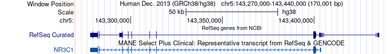
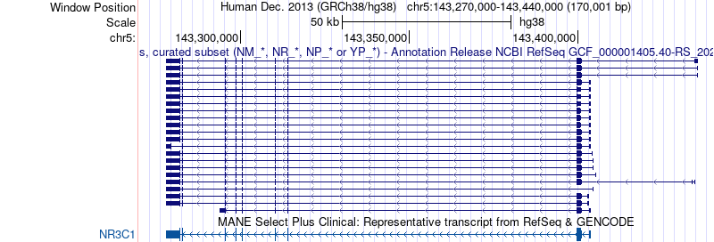
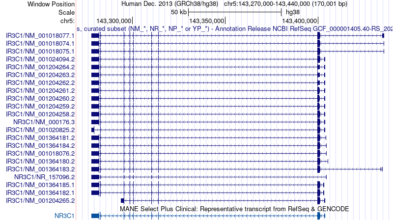
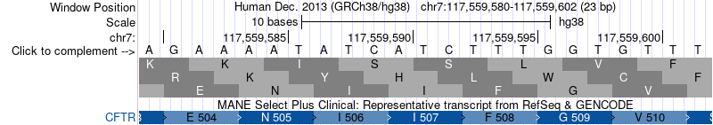
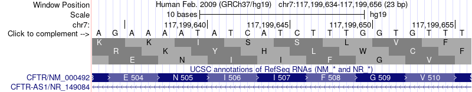

<div dir="rtl">

# درس: مرورگر ژنوم UCSC؛ ترک‌ها، Table Browser، ترک خودتان و liftOver

**بخش:** `12_V2_Global_Databases_Browsers` · **ماژول:** `02_UCSC_Genome_Browser` · **پیش‌نیاز:** ماژول [12/01](../01_Ensembl_BioMart/) (جدول `dex_ids.tsv`)؛ فرمت BED و شماره‌گذاری از صفر ([02/03](../../02_BioLinux/03_Annotation_Formats/)، بخش ۳)؛ Conda ([02/01](../../02_BioLinux/01_Conda_Bioconda/))؛ واریانت F508del ([11/05](../../11_V2_NCBI_Databases/05_Variation_Clinical/)) · **زمان:** حدود ۸۰ دقیقه · **ابزار:** UCSC Genome Browser (وب، ✍️)، UCSC REST API، `curl` و `jq`، liftOver (بسته‌ی `ucsc-liftover` 502 از Bioconda، محیط `databases`) · **آخرین بازبینی:** 2026-10-27

> ✅ **وضعیت: اجرا شده.** خروجی API و liftOver واقعی‌اند (2026-10-27). تصویرهای درس را خود سرور UCSC (`hgRenderTracks`) در همان روز ساخت. Table Browser و بارگذاری ترک خودتان کارهای وب‌اند (✍️ از مستندات): نسخه‌ی اسکریپتی Table Browser پشت آزمون ضدربات Cloudflare بود.

---

## در یک نگاه

**در پایان این درس می‌توانید:**
1. در مرورگر UCSC به یک ژن بروید، **اسمبلی** را برگزینید و ترک‌ها را در پنج حالت نمایش ببینید.
2. با **UCSC REST API** رونوشت MANE، توالی و جست‌وجوی یک ژن را بگیرید و مختصات **0-based** آن را با Ensembl بسنجید.
3. بدانید **Table Browser** چه می‌کند و همان کار را با API انجام دهید.
4. از جدول 12/01 یک فایل **BED** بسازید و آن را به‌عنوان **ترک خودتان** (custom track) ببینید.
5. با **liftOver** مختصات را میان hg19 و hg38 جابه‌جا کنید و سه گونه شکست آن را بشناسید.

**پیش از آغاز:**

<div dir="ltr">

```bash
mkdir -p ~/global/m02 && cd ~/global/m02
U=https://api.genome.ucsc.edu
P=~/Bioinformatics_Learning-main/12_V2_Global_Databases_Browsers/99_scripts_data
conda activate databases          # liftOver (envs/databases.yml)
```

</div>

---

## ۱. داستان

در 12/01 جای هشت ژن پاسخ به دگزامتازون را از Ensembl گرفتید. اکنون می‌خواهید آن‌ها را **ببینید**: رونوشت‌های NR3C1 کجا هستند، کدون آغاز کجاست. یک همکار هم جدول واریانتی فرستاده که مختصاتش روی **hg19** (اسمبلی قدیمی‌تر، ۲۰۰۹) است، در حالی که همه‌ی کار شما روی **hg38** است. **UCSC Genome Browser** (دانشگاه کالیفرنیا، سانتاکروز) برای هر دو کار ساخته شد: پرکاربردترین مرورگر ژنوم جهان، با ابزار **liftOver** برای جابه‌جایی مختصات.

**پاسخ معلوم:**
- رونوشت MANE ژن NR3C1 ‏`ENST00000394464.7` است و از 143277934 تا 143403686 (1-based) روی رشته‌ی منفی کروموزوم ۵ (12/01).
- ‏F508del در CFTR روی GRCh37 (hg19) در 7:117199645 و روی GRCh38 (hg38) در 7:117559591 است (11/05).

---

## ۲. مفهوم به زبان ساده

### ۲.۱ ترک (track)

مرورگر ژنوم مانند **نقشه‌ی شهر با لایه‌های شفاف** است. محور افقی، کروموزوم است. هر **ترک** یک لایه است: ژن‌های RefSeq، رونوشت‌های GENCODE، SNPها، حفظ‌شدگی میان گونه‌ها و ده‌ها لایه‌ی دیگر. هر ترک را می‌توانید روشن یا خاموش کنید و نمایشش را عوض کنید.

### ۲.۲ اسمبلی: hg19، hg38 و hs1

| نام UCSC | نام GRC | سال | یادداشت |
| :--- | :--- | :---: | :--- |
| ‏hg19 | ‏GRCh37 | ۲۰۰۹ | هنوز در بسیاری از داده‌های بالینی و GWAS قدیمی |
| ‏hg38 | ‏GRCh38 | ۲۰۱۳ | اسمبلی استاندارد امروز (این دوره) |
| ‏hs1 | ‏T2T CHM13v2.0 | ۲۰۲۲ | نخستین ژنوم انسان **بی شکاف** (Telomere-to-Telomere) |

یک باز در دو اسمبلی شماره‌ی **دیگری** دارد، چون در ساختن اسمبلی تازه شکاف‌ها پر شدند و تکه‌هایی جابه‌جا شدند. پس «chr7:117559591» بی نام اسمبلی بی‌معناست.

### ۲.۳ دو شیوه‌ی شماره‌گذاری (یادآوری 02/03)

| | ‏1-based، بسته | ‏0-based، نیمه‌باز |
| :--- | :--- | :--- |
| که به کار می‌برد | ‏NCBI (نمایش)، Ensembl، VCF، GFF، **نمایش** مرورگر UCSC | ‏BED، **جدول‌های درونی و API** ‏UCSC، SPDI |
| سه باز نخست کروموزوم | ‏`1-3` | ‏`0 3` |
| تبدیل | آغاز = آغاز BED + ۱ | آغاز = آغاز 1-based − ۱ |

پایان در هر دو یکی است. این یک **منهای یک** سرچشمه‌ی بسیاری از خطاهای بیوانفورماتیک است.

---

## ۳. گام ۱: مرورگر وب (✍️)

**چرا؟** پیش از API، یک بار ناحیه را با چشم ببینید.

✍️ **گام‌ها (از راهنمای UCSC و فیلم‌های رسمی آن):**
1. ‏https://genome.ucsc.edu ← **Genomes**. ‏*Human* و اسمبلی **GRCh38/hg38** را برگزینید.
2. در جعبه‌ی جست‌وجو `NR3C1` را بنویسید و **GO** بزنید. اگر چند پاسخ آمد، پاسخ ترک **MANE** را برگزینید.
3. بالای تصویر دکمه‌های **zoom in/out** و **move** هستند. می‌توانید روی خط‌کش (ruler) بکشید تا بزرگ شود.
4. زیر تصویر، **فهرست ترک‌ها** است. برای هر ترک یک منوی کشویی با پنج حالت: **hide** (پنهان)، **dense** (همه در یک خط)، **squish** (هر رونوشت یک خط باریک، بی نام)، **pack** (هر رونوشت با نام)، **full** (هر رونوشت در خط خودش). پس از تغییر، **refresh** بزنید.
5. روی هر رونوشت بزنید تا صفحه‌ی جزئیاتش باز شود (شناسه‌ها، اگزون‌ها، پیوند به NCBI و Ensembl).

سه حالت نمایش همین ناحیه برای ترک *RefSeq Curated* (ترک MANE زیرش در حالت pack است). این تصویرها را سرور UCSC در 2026-10-27 ساخت:

‏**dense**: همه‌ی رونوشت‌ها روی هم، در یک خط:



‏**squish**: هر رونوشت یک خط باریک:



‏**pack**: هر رونوشت با نامش:



**خواندن تصویر:**
- جعبه‌های **پهن** اگزون کدکننده‌اند، جعبه‌های **باریک** UTR و خط‌ها اینترون. پیکان‌های روی خط (`<`) جهت رونویسی را نشان می‌دهند: این ژن روی رشته‌ی منفی است، پس از راست به چپ خوانده می‌شود.
- در pack، ‏۲۲ رونوشت RefSeq دیده می‌شود، و چندین `NM_` با شکل **یکسان**: همان هشت رکورد «transcript variant 1» که در 12/01 دیدید (یک mRNA، چند AUG آغاز).
- ترک **MANE** تنها یک رونوشت دارد: `NM_000176.3` = `ENST00000394464.7`.
- اگزون نخست در سمت **راست** (کنار 143,400,000) است، و چند رونوشت آن را جای دیگری دارند (اگزون‌های 1 جایگزین، با UTR 5′ گوناگون).

<details>
<summary>✋ امتحان کن: برای ژنی با ۸۲ رونوشت (ترک GENCODE)، کدام حالت را برمی‌گزینید و چرا؟</summary>

‏**squish** یا **dense**. ‏pack و full برای ۸۲ رونوشت صفحه را بسیار بلند می‌کنند. با squish شکل همه را می‌بینید و با dense تنها «کجا اگزون هست». برای خواندن نام یک رونوشت، ناحیه را کوچک کنید و تنها همان ترک را pack کنید.

</details>

> 📺 **فیلم:** *UCSC Genome Browser Basics, Part 1: Getting around in the Browser* (UCSC Genome Browser): https://www.youtube.com/watch?v=NBDMNv2KFik · *Controlling the visibility of data tracks on the UCSC Genome Browser*: https://www.youtube.com/watch?v=jKix2B3hwnw
> 📄 **مرجع:** Kent WJ, et al. (2002). *The Human Genome Browser at UCSC.* Genome Res 12:996–1006. https://doi.org/10.1101/gr.229102 · Casper J, et al. (2026). *The UCSC Genome Browser database: 2026 update.* Nucleic Acids Res 54(D1):D1331–D1335. https://doi.org/10.1093/nar/gkaf1250

---

## ۴. گام ۲: ‏UCSC REST API

**چرا؟** همان داده‌ی ترک‌ها را بی مرورگر، با `curl` و JSON بگیریم. نشانی‌ها با `;` میان گزینه‌ها ساخته می‌شوند، مانند Ensembl.

### ۴.۱ اسمبلی‌ها و کروموزوم‌ها

<div dir="ltr">

```bash
curl -sS "$U/list/ucscGenomes" | jq -r '.ucscGenomes | to_entries[]
    | select(.key == "hg19" or .key == "hg38" or .key == "hs1") | [.key, .value.description] | @tsv'
curl -sS "$U/list/chromosomes?genome=hg38" | jq '{chromCount, chr5: .chromosomes.chr5}'
```

</div>

**خروجی واقعی (2026-10-27):**

<div dir="ltr">

```
hg19	Feb. 2009 (GRCh37/hg19)
hg38	Dec. 2013 (GRCh38/hg38)
hs1	Jan. 2022 (T2T CHM13v2.0/hs1)
{
  "chromCount": 711,
  "chr5": 181538259
}
```

</div>

‏hg38 ‏**۷۱۱** «کروموزوم» دارد: ۲۵ کروموزوم اصلی (۱ تا ۲۲، X، Y، M) و بقیه تکه‌های جانبی: `_random` (جایشان روی کروموزوم روشن نیست)، `chrUn_` (کروموزومشان هم روشن نیست) و `_alt` (نسخه‌های دیگر یک ناحیه در جمعیت‌ها). کروموزوم ۵ ‏۱۸۱٬۵۳۸٬۲۵۹ باز است.

### ۴.۲ جست‌وجو

<div dir="ltr">

```bash
curl -sS "$U/search?search=NR3C1&genome=hg38" \
  | jq -r '.positionMatches[] | [.trackName, (.matches | length), .matches[0].position] | @tsv' | head -8
```

</div>

**خروجی واقعی (2026-10-27):**

<div dir="ltr">

```
mane	1	chr5:143277934-143403686
hgnc	2	chr5:143277931-143435512
knownGene	82	chr5:143277934-143403686
ncbiRefSeqCurated	22	chr5:143277931-143435512
refGene	22	chr5:143277934-143403686
ncbiRefSeqOther	1	chr16:87467136-87467670
xenoRefGene	25	chr5:143281886-143399888
wgEncodeGencodeBasicV50	23	chr5:143277931-143435512
```

</div>

**توضیح خروجی:**
- هر سطر یک **ترک** است و شمار پاسخ‌هایش. ‏`knownGene` (رونوشت‌های GENCODE در UCSC) ‏**۸۲** رونوشت دارد و `ncbiRefSeqCurated` ‏۲۲.
- ‏`position` همان چیزی است که در جعبه‌ی جست‌وجو نوشته می‌شود و **1-based** است: ‏`chr5:143277934-143403686` درست همان مختصات Ensembl برای MANE است. ✅
- ‏`ncbiRefSeqOther` روی **chr16**: یک رکورد RefSeq دیگر با نام NR3C1 (نه خود ژن). همیشه به کروموزوم پاسخ نگاه کنید.
- ‏`xenoRefGene`: رونوشت‌های **گونه‌های دیگر** که روی ژنوم انسان هم‌تراز شده‌اند.

### ۴.۳ داده‌ی یک ترک

<div dir="ltr">

```bash
curl -sS "$U/getData/track?genome=hg38;track=mane;chrom=chr5;start=143270000;end=143440000" \
  | jq -c '.mane[] | {chrom, chromStart, chromEnd, name, strand, thickStart, thickEnd, blockCount, geneName, geneName2}'
```

</div>

**تکه‌به‌تکه:**

| بخش | کار |
| :--- | :--- |
| ‏`getData/track` | ردیف‌های یک ترک در یک ناحیه |
| ‏`track=mane` | نام درونی ترک (همان `trackName` بخش ۴.۲) |
| ‏`start=…;end=…` | ناحیه، **0-based** |

**خروجی واقعی (2026-10-27):**

<div dir="ltr">

```
{"chrom":"chr5","chromStart":143277933,"chromEnd":143403686,"name":"ENST00000394464.7","strand":"-","thickStart":143281888,"thickEnd":143400839,"blockCount":9,"geneName":"ENSG00000113580.17","geneName2":"NR3C1"}
```

</div>

**توضیح خروجی:**
- ‏`chromStart: 143277933` (0-based) = ‏**143277934** (1-based)، آغاز همین رونوشت در Ensembl. ✅ ‏`chromEnd` در هر دو یکی است.
- ‏`thickStart`/`thickEnd`: بخش «پهن»، یعنی **CDS**. ‏`blockCount: 9` یعنی ۹ اگزون.
- ‏UCSC در ترک MANE شناسه‌های Ensembl را با **همان نسخه‌ی 116** (`.7` و `.17`) نشان می‌دهد.

### ۴.۴ توالی

‏NR3C1 روی رشته‌ی منفی است، پس کدون **آغاز** در سر **بزرگ** CDS است: سه باز پیش از `thickEnd`:

<div dir="ltr">

```bash
curl -sS "$U/getData/sequence?genome=hg38;chrom=chr5;start=143400836;end=143400839" | jq -r .dna
curl -sS "$U/getData/sequence?genome=hg38;chrom=chr5;start=143400836;end=143400839" | jq -r .dna | rev | tr ACGT TGCA
```

</div>

**خروجی واقعی (2026-10-27):**

<div dir="ltr">

```
CAT
ATG
```

</div>

‏API همیشه رشته‌ی **مثبت** را می‌دهد: `CAT`. ‏`rev` آن را وارونه و `tr ACGT TGCA` مکمل می‌کند: **`ATG`**، کدون آغاز. ✅ ‏`start=143400836` (0-based) یعنی بازهای ۱۴۳۴۰۰۸۳۷ تا ۱۴۳۴۰۰۸۳۹ (1-based).

<details>
<summary>✋ امتحان کن: کدون پایان کجاست و چیست؟</summary>

در سر **کوچک** CDS، یعنی سه باز نخست از `thickStart` به بعد: `start=143281888;end=143281891`. پاسخ API ‏`TCA` است و مکمل وارونه‌اش **`TGA`**، کدون پایان. ✅ (اگر سه باز **پیش** از `thickStart` را بگیرید، `CAG` می‌آید که بیرون از CDS است: همان خطای «یکی جابه‌جا».)

</details>

> 📺 **فیلم:** *How do I identify codon numbers with the UCSC Genome Browser?* (UCSC Genome Browser): https://www.youtube.com/watch?v=bLnfD799AZw
> 📄 **مرجع:** راهنمای API: https://genome.ucsc.edu/goldenPath/help/api.html

---

## ۵. گام ۳: ‏Table Browser (✍️)

**چرا؟** Table Browser «BioMart» ‏UCSC است: هر ترک یک یا چند **جدول** دارد و Table Browser آن را برای یک ناحیه، یک فهرست ژن یا کل ژنوم بیرون می‌دهد، به شکل جدول، BED، GTF یا FASTA.

✍️ **گام‌ها (از راهنمای Table Browser):**
1. منوی **Tools** ← **Table Browser** (https://genome.ucsc.edu/cgi-bin/hgTables).
2. ‏*clade:* Mammal، *genome:* Human، *assembly:* hg38.
3. ‏*group:* Genes and Gene Predictions، *track:* MANE، *table:* mane.
4. ‏*region:* ‏**position** و `chr5:143270000-143440000` (یا **genome** برای همه‌ی ژن‌ها؛ یا **identifiers** برای بارگذاری فهرست نام‌ها).
5. ‏*output format:* ‏**BED** (یا *all fields from selected table*، یا *sequence* برای FASTA). دکمه‌ی **get output**.
6. برای BED صفحه‌ی دوم می‌پرسد چه بخشی را می‌خواهید: **Whole Gene**، **Exons**، **Coding Exons**، **5′ UTR**، **Introns**، یا ناحیه‌ی **upstream** با درازای دلخواه. این همان راه گرفتن **اگزون‌ها** یا **پروموترها**ی صدها ژن با یک کلیک است.

**همان کار با API:** ستون‌های `chromStarts` و `blockSizes` در پاسخ `getData/track` (گام ۲) مختصات اگزون‌ها را دارند؛ تمرین ۲ آن‌ها را به BED اگزون‌ها برمی‌گرداند.

**یادداشت:** نشانی Table Browser را می‌شود با گزینه‌ها پر کرد و با `curl` زد. ولی در 2026-10-27 این نشانی از سرور دوره یک صفحه‌ی **آزمون ضدربات** (Cloudflare Turnstile) برگرداند، نه جدول. برای کار اسکریپتی، API را به کار ببرید.

> 📺 **فیلم:** *How do I find a list of genes in a genomic region using the UCSC Genome Browser?*: https://www.youtube.com/watch?v=RjB_N1GpT0U · *How do I get the coordinates and sequences of exons using the UCSC Genome Browser*: https://www.youtube.com/watch?v=6JoUqM1iKxQ
> 📄 **مرجع:** Karolchik D, et al. (2004). *The UCSC Table Browser data retrieval tool.* Nucleic Acids Res 32:D493–D496. https://doi.org/10.1093/nar/gkh103 · راهنما: https://genome.ucsc.edu/goldenPath/help/hgTablesHelp.html

---

## ۶. گام ۴: ترک خودتان (custom track)

**چرا؟** داده‌ی خودتان (پیک‌های ChIP-seq، واریانت‌ها، ژن‌های پاسخ‌دهنده) را **کنار** ترک‌های UCSC ببینید.

### ۶.۱ از جدول Ensembl به BED

جدول `dex_ids.tsv` در 12/01 مختصات **1-based** و کروموزوم **بی `chr`** داشت. BED هر دو را به شیوه‌ی UCSC می‌خواهد:

<div dir="ltr">

```bash
awk -F'\t' 'BEGIN {OFS = "\t"} NR > 1 && $2 != "NOT_FOUND" {
      print "chr"$3, $4 - 1, $5, $1, 0, ($6 == 1 ? "+" : "-") }' ~/global/m01/dex_ids.tsv \
  | sort -k1,1 -k2,2n > dex_hg38.bed
cat dex_hg38.bed
```

</div>

**تکه‌به‌تکه:**

| بخش | کار |
| :--- | :--- |
| ‏`NR > 1 && $2 != "NOT_FOUND"` | سرخط و نام‌های یافته‌نشده را کنار بگذار |
| ‏`"chr"$3` | ‏`5` ← `chr5` |
| ‏`$4 - 1` | آغاز 1-based ← 0-based |
| ‏`$6 == 1 ? "+" : "-"` | اگر رشته ۱ است `+` بنویس، وگرنه `-` (‏`?:` یعنی «اگر … آن‌گاه … وگرنه …») |
| ‏`sort -k1,1 -k2,2n` | بر پایه‌ی کروموزوم و سپس آغاز (عددی) مرتب کن؛ بسیاری از ابزارها BED مرتب می‌خواهند |

**خروجی واقعی (2026-10-27):**

<div dir="ltr">

```
chr11	114058334	114256765	ZBTB16	0	+
chr16	84819974	84920768	CRISPLD2	0	+
chr17	8140466	8156506	PER1	0	-
chr3	126342634	126357462	KLF15	0	-
chr5	143277930	143435512	NR3C1	0	-
chr5	172766991	172771198	DUSP1	0	-
chr6	35572944	35728622	FKBP5	0	-
chrX	107713220	107777342	TSC22D3	0	-
```

</div>

‏`sort -k1,1` نام کروموزوم را به ترتیب **حروف** می‌چیند (`chr11` پیش از `chr3`). این برای ابزارها پذیرفتنی است، ولی ترتیب «طبیعی» نیست.

### ۶.۲ یک ترک با سرخط `track`

فایل `nr3c1_regions.bed` در `$P/02_UCSC_Genome_Browser/data/` دو ناحیه دارد: **۲ کیلوباز پروموتر** و بازه‌ی **CDS**:

<div dir="ltr">

```text
track name=myRegions description="NR3C1 promoter and CDS" color=200,0,0
chr5	143403686	143405686	promoter_2kb	0	-
chr5	143281888	143400839	CDS_span	0	-
```

</div>

- سطر `track` نام، توضیح و رنگ (RGB) ترک را می‌گوید.
- **پروموتر روی رشته‌ی منفی:** رونویسی در `chromEnd` رونوشت MANE ‏(143403686) آغاز می‌شود و به سوی عددهای **کوچک‌تر** می‌رود. پس «بالادست» یعنی عددهای **بزرگ‌تر**: از 143403686 تا 143405686. برای ژن روی رشته‌ی مثبت، پروموتر **پیش** از `chromStart` بود.
- ‏CDS همان `thickStart`/`thickEnd` گام ۲ است، بی هیچ تبدیل، چون هر دو 0-based‌اند.

✍️ **بارگذاری (از راهنمای custom track):** در مرورگر **My Data** ← **Custom Tracks** ← فایل را **Choose File** کنید (یا متن را بچسبانید) ← **Submit** ← **go**. ترک تازه بالای ترک‌های UCSC، به رنگ سرخ، می‌آید. ترک خودتان تنها روی همان رایانه دیده می‌شود و ۴۸ ساعت پس از آخرین دیدن پاک می‌شود، مگر در یک **نشست** (session) ذخیره شود. برای نگه‌داشتن یا هم‌رسانی، از **My Data ← My Sessions** یک نشست بسازید.

<details>
<summary>✋ امتحان کن: اگر در 6.1 منهای یک را فراموش کنید، ترک NR3C1 کجا اشتباه است؟</summary>

آغاز BED می‌شد 143277931، یعنی (پس از نمایش 1-based) باز ۱۴۳۲۷۷۹۳۲. ترک **یک باز کوتاه‌تر** از سر چپ می‌شد. برای یک ژن ۱۵۷ کیلوبازی دیده نمی‌شود، ولی برای یک SNP یا کدون یعنی **باز اشتباه**.

</details>

> 📺 **فیلم:** *Part 3: Genome Browser links: Composite tracks, custom tracks and spreadsheets* (UCSC Genome Browser): https://www.youtube.com/watch?v=Yy4UmepYs2Q
> 📄 **مرجع:** راهنمای custom track: https://genome.ucsc.edu/goldenPath/help/customTrack.html · قالب BED: https://genome.ucsc.edu/FAQ/FAQformat.html#format1

---

## ۷. گام ۵: ‏liftOver؛ از hg19 به hg38

**چرا؟** واریانت‌های همکارتان روی hg19 هستند. **liftOver** هر بازه را با یک فایل **chain** (نقشه‌ی هم‌ترازی دو اسمبلی) به اسمبلی دیگر می‌برد.

### ۷.۱ نخست ببینید: یک ناحیه، دو شماره

این دو تصویر را سرور UCSC ساخت: ۲۳ باز پیرامون F508del در دو اسمبلی.

**hg38** (chr7:117,559,580-117,559,602):



**hg19** (chr7:117,199,634-117,199,656):



توالی **یکسان** است (`AGAAAATATCATCTTTGGTGTTT`)، با کدون‌های I506، I507، F508 و G509 در همان جا. تنها **شماره**‌ی بازها ۳۵۹٬۹۴۶ تا فرق دارد. (‏`ATC ATC TTT`: حذف F508del سه باز `CTT` از میان `ATC` و `TTT` را برمی‌دارد؛ 11/05.) ‏API همین را با متن می‌گوید:

<div dir="ltr">

```bash
curl -sS "$U/getData/sequence?genome=hg38;chrom=chr7;start=117559579;end=117559602" | jq -r .dna
curl -sS "$U/getData/sequence?genome=hg19;chrom=chr7;start=117199633;end=117199656" | jq -r .dna
```

</div>

**خروجی واقعی (2026-10-27):**

<div dir="ltr">

```
AGAAAATATCATCTTTGGTGTTT
AGAAAATATCATCTTTGGTGTTT
```

</div>

### ‏۷.۲ ‏liftOver در خط فرمان

<div dir="ltr">

```bash
curl -sS -O https://hgdownload.soe.ucsc.edu/goldenPath/hg19/liftOver/hg19ToHg38.over.chain.gz
printf "chr7\t117199644\t117199645\tF508del_rs113993960\n" > f508_hg19.bed
liftOver f508_hg19.bed hg19ToHg38.over.chain.gz f508_hg38.bed f508_unmapped.txt
cat f508_hg38.bed f508_unmapped.txt
```

</div>

**تکه‌به‌تکه:**

| بخش | کار |
| :--- | :--- |
| ‏`hg19ToHg38.over.chain.gz` | فایل chain از hg19 **به** hg38 (۲۲۸ کیلوبایت). جهت در نام است؛ برای وارونه `hg38ToHg19` |
| ‏`printf "…\t…"` | یک سطر BED؛ باز 117199645 (1-based) = بازه‌ی `117199644 117199645` (0-based) |
| ورودی‌های liftOver | به ترتیب: BED ورودی، chain، BED خروجی، فایل ناحیه‌های جابه‌جانشده |

**خروجی واقعی (2026-10-27):**

<div dir="ltr">

```
Reading liftover chains
Mapping coordinates
chr7	117559590	117559591	F508del_rs113993960
```

</div>

‏`117559590 117559591` (0-based) = باز **117559591** (1-based)، درست همان `CHRPOS` ‏dbSNP در 11/05. ✅ فایل ناحیه‌های جابه‌جانشده تهی است. (دو سطر نخست پیام‌های خود liftOver به stderr هستند.)

**همان کار با Ensembl REST** (12/01)، بی نصب هیچ ابزاری:

<div dir="ltr">

```bash
curl -sS "https://rest.ensembl.org/map/human/GRCh37/7:117199645..117199645:1/GRCh38?content-type=application/json" \
  | jq -c '.mappings[] | {from: .original.start, to: .mapped.start, assembly: .mapped.assembly}'
```

</div>

**خروجی واقعی (2026-10-27):**

<div dir="ltr">

```
{"from":117199645,"to":117559591,"assembly":"GRCh38"}
```

</div>

### ۷.۳ هشت ژن به hg19

<div dir="ltr">

```bash
curl -sS -O https://hgdownload.soe.ucsc.edu/goldenPath/hg38/liftOver/hg38ToHg19.over.chain.gz
liftOver dex_hg38.bed hg38ToHg19.over.chain.gz dex_hg19.bed dex_unmapped.txt
cat dex_hg19.bed
curl -sS "https://grch37.rest.ensembl.org/lookup/symbol/homo_sapiens/NR3C1?content-type=application/json" \
  | jq -c '{id, start, end, assembly_name}'
```

</div>

**خروجی واقعی (2026-10-27):**

<div dir="ltr">

```
chr11	113929056	114127487	ZBTB16	0	+
chr16	84853580	84954374	CRISPLD2	0	+
chr17	8043784	8059824	PER1	0	-
chr3	126061477	126076305	KLF15	0	-
chr5	142657495	142815077	NR3C1	0	-
chr5	172193994	172198201	DUSP1	0	-
chr6	35540721	35696399	FKBP5	0	-
chrX	106956450	107020572	TSC22D3	0	-
{"id":"ENSG00000113580","start":142657496,"end":142815077,"assembly_name":"GRCh37"}
```

</div>

همه‌ی هشت ژن جابه‌جا شدند. ‏NR3C1 روی hg19 از 142657495 (0-based) = **142657496** (1-based) تا 142815077 است، درست همان سرور **GRCh37** ‏Ensembl (`grch37.rest.ensembl.org`، سروری جدا که تنها اسمبلی قدیمی را دارد). ✅

### ۷.۴ وقتی liftOver شکست می‌خورد

برای دیدن شکست‌ها، **۳۰۰۰** پنجره‌ی ۱ کیلوبازی تصادفی روی کروموزوم ۱ ‏hg19 ساختیم و به hg38 بردیم:

<div dir="ltr">

```bash
awk 'BEGIN {srand(7); for (i = 0; i < 3000; i++) {s = int(rand() * 248000000); printf "chr1\t%d\t%d\tw%d\n", s, s + 1000, i}}' > rand_hg19.bed
liftOver rand_hg19.bed hg19ToHg38.over.chain.gz rand_hg38.bed rand_unmapped.txt 2> /dev/null
wc -l < rand_hg38.bed
grep '^#' rand_unmapped.txt | sort | uniq -c
cut -f1 rand_hg38.bed | sort | uniq -c
```

</div>

**خروجی واقعی (2026-10-27):**

<div dir="ltr">

```
2676
    315 #Deleted in new
      9 #Split in new
   2664 chr1
      6 chr14_GL000009v2_random
      3 chr1_KI270706v1_random
      3 chr4_GL000008v2_random
```

</div>

**سه گونه پیشامد:**

1. ‏**`#Deleted in new` (۳۱۵ پنجره):** chain برای این بازه هیچ هم‌ترازی‌ای ندارد. همه را با API ‏UCSC وارسی کردیم: هر ۳۱۵ پنجره تنها `N` بودند، یعنی **شکاف** hg19 (بیشترشان در ناحیه‌ی سانترومر و هتروکروماتین، ۱۲۱ تا ۱۴۴ مگاباز). در hg19 توالی‌ای نبود که جابه‌جا شود.
2. ‏**`#Split in new` (۹ پنجره):** تکه‌های بازه در hg38 در دو جای جدا افتاده‌اند. با پیش‌فرض `-minMatch=0.95` (دست‌کم ۹۵٪ بازها باید جابه‌جا شوند) liftOver آن‌ها را رها می‌کند.
3. **جابه‌جایی به کروموزوم دیگر (۱۲ پنجره):** توالی که hg19 کنار سانترومر chr1 گذاشته بود، در hg38 روی تکه‌های `_random` (برای نمونه `chr4_GL000008v2_random`) است. liftOver پاسخ داده، ولی کروموزوم عوض شده است.

**درس:** ‏`wc -l` را پیش و پس از liftOver بشمارید، فایل unmapped را بخوانید، و پاسخ‌های بیرون از کروموزوم اصلی را جدا ببینید. پایین آوردن `-minMatch` پنجره‌های split را «نجات» می‌دهد، ولی تنها **بخشی** از بازه را (تمرین ۵).

> 📺 **فیلم:** ‏UCSC فیلم رسمی ویژه‌ی liftOver ندارد؛ برگزیدن اسمبلی در *UCSC Genome Browser Gateway*: https://www.youtube.com/watch?v=5zc9sqd4SD4
> 📄 **مرجع:** Hinrichs AS, et al. (2006). *The UCSC Genome Browser Database: update 2006.* Nucleic Acids Res 34:D590–D598 (معرفی liftOver). https://doi.org/10.1093/nar/gkj144 · ابزار وب: https://genome.ucsc.edu/cgi-bin/hgLiftOver · فایل‌های chain: https://hgdownload.soe.ucsc.edu/downloads.html#liftover

---

## ۸. سه اشتباه رایج

1. **آمیختن 0-based و 1-based.** ‏API و BED ‏UCSC از صفر می‌شمارند، جعبه‌ی جست‌وجو و Ensembl از یک. نشانه: یک باز جابه‌جایی، یا کدون `CAG` به جای `TGA` (گام ۲). هر بار که از یک پایگاه به دیگری می‌روید، از خود بپرسید «این عدد از کدام شیوه است؟».
2. ‏**liftOver با chain وارونه یا روی داده‌ای که از پیش hg38 است.** ‏`hg19ToHg38` را روی BED ‏hg38 بزنید، liftOver خطا **نمی‌دهد**. ما این را با `dex_hg38.bed` آزمودیم: هر هشت ژن «جابه‌جا» شدند و فایل unmapped تهی بود، ولی NR3C1 به 143898365 رفت، ۶۲۰ کیلوباز دورتر از جای درستش، و بقیه هم همین‌طور. پیش از liftOver اسمبلی ورودی را از سرخط فایل یا روش کار وارسی کنید، و پس از آن یک نقطه‌ی شناخته‌شده (مانند F508del) را بسنجید.
3. **فراموش کردن `chr`.** ‏UCSC ‏`chr5` می‌خواهد و Ensembl `5`. ترک خودتان با `5` بارگذاری نمی‌شود یا به هیچ‌جا نمی‌رود، و liftOver همه‌ی سطرها را «Deleted» می‌گوید.

---

## 📘 برای کنجکاوها

- ‏**‏Track hubs:** برای داده‌ی بزرگ (BigWig، BigBed، BAM) به جای بارگذاری، فایل را روی یک سرور وب می‌گذارید و UCSC تنها تکه‌ی دیده‌شده را می‌خواند. همین راه را در 12/03 برای IGV می‌بینید.
- ‏**‏Genome Browser in a Box / in the Cloud:** نسخه‌ی خصوصی UCSC روی رایانه‌ی خودتان، برای داده‌ای که نباید بیرون برود.
- ‏**hs1 (T2T):** ‏UCSC برای hs1 هم chain دارد (`hg38ToHs1.over.chain.gz`). ناحیه‌هایی که در hg38 شکاف بودند، در hs1 توالی دارند؛ پس داده‌ی تازه روی hs1 گاهی به hg38 **برنمی‌گردد**.
- ‏**‏in-Silico PCR:** ‏UCSC جای آغازگرهای PCR را روی ژنوم می‌یابد (Tools ← In-Silico PCR)؛ همان کار Primer-BLAST در 11/07.

---

## جمع‌بندی

- مرورگر UCSC = ژنوم + ترک‌ها؛ هر ترک پنج حالت نمایش دارد (hide، dense، squish، pack، full).
- اسمبلی را همیشه بنویسید: hg19 ‏(GRCh37)، hg38 ‏(GRCh38)، hs1 ‏(T2T).
- ‏API ‏UCSC: ‏`list`، `search`، `getData/track`، `getData/sequence`؛ مختصات **0-based**. ‏NR3C1 MANE: ‏`chromStart` 143277933 = Ensembl 143277934.
- ‏Table Browser برای جدول، BED یا FASTA از هر ترک؛ از سرور دوره تنها با مرورگر.
- ترک خودتان = BED با `chr` و آغاز 0-based، و یک سطر `track`.
- ‏liftOver با chain درست؛ F508del: hg19 ‏117199645 ← hg38 ‏117559591. شکست‌ها: شکاف (Deleted)، بازه‌ی شکسته (Split)، کروموزوم دیگر.

---

## کارت دستورهای این درس

<div dir="ltr">

```bash
U=https://api.genome.ucsc.edu
curl -sS "$U/list/ucscGenomes"                                         # assemblies
curl -sS "$U/list/chromosomes?genome=hg38"                             # chromosome sizes
curl -sS "$U/search?search=GENE&genome=hg38"                           # where is a gene (1-based positions)
curl -sS "$U/getData/track?genome=hg38;track=mane;chrom=chrN;start=S;end=E"     # track rows (0-based)
curl -sS "$U/getData/sequence?genome=hg38;chrom=chrN;start=S;end=E"   # plus-strand DNA (0-based)
jq -r .dna | rev | tr ACGT TGCA                                        # reverse complement
awk -F'\t' 'BEGIN{OFS="\t"} {print "chr"$chr, $start-1, $end, $name}'  # 1-based table -> BED
liftOver in.bed hg19ToHg38.over.chain.gz out.bed unmapped.txt          # convert assemblies
liftOver -minMatch=0.5 …                                               # accept partial matches (careful)
curl -sS "https://rest.ensembl.org/map/human/GRCh37/CHR:S..E:1/GRCh38?content-type=application/json"
```

</div>

---

## واژه‌نامه‌ی درس

| واژه | معنا |
| :--- | :--- |
| مرورگر ژنوم | برنامه‌ای که ژنوم و لایه‌های داده را روی محور کروموزوم نشان می‌دهد |
| ترک (track) | یک لایه‌ی داده در مرورگر |
| حالت نمایش | ‏hide، dense، squish، pack، full |
| اسمبلی (hg19، hg38، hs1) | نسخه‌ی ژنوم مرجع که مختصات بر پایه‌ی آن است |
| ‏0-based / 1-based | شمارش از صفر (BED، API ‏UCSC) / از یک (VCF، Ensembl، نمایش) |
| ‏thickStart / thickEnd | آغاز و پایان CDS در BED و جدول‌های UCSC |
| ‏Table Browser | ابزار بیرون کشیدن جدول از ترک‌های UCSC |
| ترک خودتان (custom track) | داده‌ی شما که روی مرورگر بارگذاری می‌شود |
| نشست (session) | ذخیره‌ی حالت مرورگر و ترک‌ها برای بعد یا هم‌رسانی |
| ‏liftOver | جابه‌جایی مختصات میان دو اسمبلی |
| فایل chain | نقشه‌ی هم‌ترازی دو اسمبلی برای liftOver |
| ‏minMatch | کمترین نسبت بازهایی که باید جابه‌جا شوند (پیش‌فرض ۰٫۹۵) |
| ‏`_random` / `chrUn` / `_alt` | تکه‌های اسمبلی: جای روشن نیست / کروموزوم روشن نیست / نسخه‌ی دیگر یک ناحیه |
| شکاف (gap) | بخشی از اسمبلی که توالی‌اش ناشناخته است (`N`) |

---

## منابع

**مقاله و مستند**
- ‏Kent WJ, et al. (2002). *The Human Genome Browser at UCSC.* Genome Res 12:996–1006. https://doi.org/10.1101/gr.229102
- ‏Casper J, et al. (2026). *The UCSC Genome Browser database: 2026 update.* Nucleic Acids Res 54(D1):D1331–D1335. https://doi.org/10.1093/nar/gkaf1250
- ‏Perez G, et al. (2025). *The UCSC Genome Browser database: 2025 update.* Nucleic Acids Res 53(D1):D1243–D1249. https://doi.org/10.1093/nar/gkae974
- ‏Karolchik D, et al. (2004). *The UCSC Table Browser data retrieval tool.* Nucleic Acids Res 32:D493–D496. https://doi.org/10.1093/nar/gkh103
- ‏Hinrichs AS, et al. (2006). *The UCSC Genome Browser Database: update 2006.* Nucleic Acids Res 34:D590–D598. https://doi.org/10.1093/nar/gkj144
- ‏Schneider VA, et al. (2017). *Evaluation of GRCh38 and de novo haploid genome assemblies demonstrates the enduring quality of the reference assembly.* Genome Res 27:849–864. https://doi.org/10.1101/gr.213611.116
- راهنماها: API ‏https://genome.ucsc.edu/goldenPath/help/api.html · Table Browser ‏https://genome.ucsc.edu/goldenPath/help/hgTablesHelp.html · custom track ‏https://genome.ucsc.edu/goldenPath/help/customTrack.html

**کتاب**
- ‏Baxevanis AD, Bader GD, Wishart DS, eds. (2020). *Bioinformatics*, 4th ed. Wiley. (فصل ۴: *Genome Browsers*، نوشته‌ی Tyra G. Wolfsberg)
- ‏Buffalo V (2015). *Bioinformatics Data Skills*. O'Reilly. (فصل ۹: داده‌ی بازه‌ای، BED و شماره‌گذاری از صفر)

**فیلم و دوره‌ی آموزشی**
- ‏Coursera: *Command Line Tools for Genomic Data Science* (Johns Hopkins): https://www.coursera.org/learn/genomic-tools
- ‏edX: *Introduction to Genomic Data Science* (UC San Diego): https://www.edx.org/learn/bioinformatics/the-university-of-california-san-diego-introduction-to-genomic-data-science
- ‏YouTube: *UCSC Genome Browser Basics, Part 1: Getting around in the Browser*: https://www.youtube.com/watch?v=NBDMNv2KFik
- ‏YouTube: *UCSC Genome Browser Basics, Part 2: Configuring the Browser*: https://www.youtube.com/watch?v=cYys5iXN0NY
- ‏YouTube: *How do I get the coordinates and sequences of exons using the UCSC Genome Browser*: https://www.youtube.com/watch?v=6JoUqM1iKxQ

<sub>همه‌ی دستورها در 2026-10-27 روی سرور دوره اجرا شدند (UCSC API، liftOver 502 از Bioconda، Ensembl REST). تصویرها با `hgRenderTracks` ‏UCSC در همان روز ساخته شدند. ترک خودتان از راه نشانی در `hgRenderTracks` نمایش داده نشد و Table Browser پشت Cloudflare بود؛ این دو از راهنمای UCSC نوشته شدند (✍️). فیلم‌ها از صفحه‌ی آموزش UCSC (https://genome.ucsc.edu/training/) برداشته و با noembed وارسی شدند؛ همه از کانال رسمی UCSC Genome Browser. DOIها با Crossref.</sub>

</div>
